# Software Engineering Course Resources

A consolidated README for the [`softwareEngg` directory](https://github.com/rahmanziaur/javaee/tree/main/softwareEngg) in the [rahmanziaur/javaee](https://github.com/rahmanziaur/javaee) repository.

## Repository contents

- [`1-SoftEng-Intro-simple.pdf`](https://github.com/rahmanziaur/javaee/tree/main/softwareEngg/1-SoftEng-Intro-simple.pdf) - 119,526 bytes
- [`1-SoftEng-Intro-simple.ppt`](https://github.com/rahmanziaur/javaee/tree/main/softwareEngg/1-SoftEng-Intro-simple.ppt) - 586,240 bytes
- [`2-SoftEng-DevelopmentProcess.pdf`](https://github.com/rahmanziaur/javaee/tree/main/softwareEngg/2-SoftEng-DevelopmentProcess.pdf) - 914,813 bytes
- [`2-SoftEng-DevelopmentProcess.ppt`](https://github.com/rahmanziaur/javaee/tree/main/softwareEngg/2-SoftEng-DevelopmentProcess.ppt) - 2,085,888 bytes
- [`3-SoftEng-Requirements.pdf`](https://github.com/rahmanziaur/javaee/tree/main/softwareEngg/3-SoftEng-Requirements.pdf) - 674,095 bytes
- [`3-SoftEng-Requirements.ppt`](https://github.com/rahmanziaur/javaee/tree/main/softwareEngg/3-SoftEng-Requirements.ppt) - 7,222,784 bytes
- [`4-SoftEng-Design.pdf`](https://github.com/rahmanziaur/javaee/tree/main/softwareEngg/4-SoftEng-Design.pdf) - 2,048,258 bytes
- [`4-SoftEng-Design.ppt`](https://github.com/rahmanziaur/javaee/tree/main/softwareEngg/4-SoftEng-Design.ppt) - 4,950,528 bytes
- [`5-SoftEng-Modeling.pdf`](https://github.com/rahmanziaur/javaee/tree/main/softwareEngg/5-SoftEng-Modeling.pdf) - 1,037,777 bytes
- [`5-SoftEng-Modeling.ppt`](https://github.com/rahmanziaur/javaee/tree/main/softwareEngg/5-SoftEng-Modeling.ppt) - 2,799,104 bytes
- [`6-SoftEng-Testing.pdf`](https://github.com/rahmanziaur/javaee/tree/main/softwareEngg/6-SoftEng-Testing.pdf) - 1,390,176 bytes
- [`6-SoftEng-Testing.ppt`](https://github.com/rahmanziaur/javaee/tree/main/softwareEngg/6-SoftEng-Testing.ppt) - 3,019,776 bytes
- [`book/readme.md`](https://github.com/rahmanziaur/javaee/tree/main/softwareEngg/book/readme.md) - 2 bytes
- [`book/Software Engineering - Ian Sommerville.pdf`](https://github.com/rahmanziaur/javaee/tree/main/softwareEngg/book/Software%20Engineering%20-%20Ian%20Sommerville.pdf) - 4,121,212 bytes
- [`DaoAuthenticationProvider.png`](https://github.com/rahmanziaur/javaee/tree/main/softwareEngg/DaoAuthenticationProvider.png) - 12,304 bytes
- [`EAAP.vsd`](https://github.com/rahmanziaur/javaee/tree/main/softwareEngg/EAAP.vsd) - 315,392 bytes
- [`Getting Started _ Spring Security Architecture.pdf`](https://github.com/rahmanziaur/javaee/tree/main/softwareEngg/Getting%20Started%20_%20Spring%20Security%20Architecture.pdf) - 805,068 bytes
- [`Intro to Spring Security Expressions _ Baeldung.pdf`](https://github.com/rahmanziaur/javaee/tree/main/softwareEngg/Intro%20to%20Spring%20Security%20Expressions%20_%20Baeldung.pdf) - 1,686,635 bytes
- [`plantUML/class-table-inheritence.txt`](https://github.com/rahmanziaur/javaee/tree/main/softwareEngg/plantUML/class-table-inheritence.txt) - 772 bytes
- [`plantUML/concrete-table-inheritence.txt`](https://github.com/rahmanziaur/javaee/tree/main/softwareEngg/plantUML/concrete-table-inheritence.txt) - 602 bytes
- [`plantUML/controler-templateengine.txt`](https://github.com/rahmanziaur/javaee/tree/main/softwareEngg/plantUML/controler-templateengine.txt) - 617 bytes
- [`plantUML/data-mapper-pattern-jpa.txt`](https://github.com/rahmanziaur/javaee/tree/main/softwareEngg/plantUML/data-mapper-pattern-jpa.txt) - 407 bytes
- [`plantUML/data-mapper-pattern.txt`](https://github.com/rahmanziaur/javaee/tree/main/softwareEngg/plantUML/data-mapper-pattern.txt) - 380 bytes
- [`plantUML/domain-pattern.txt`](https://github.com/rahmanziaur/javaee/tree/main/softwareEngg/plantUML/domain-pattern.txt) - 785 bytes
- [`plantUML/eaap-architecture.txt`](https://github.com/rahmanziaur/javaee/tree/main/softwareEngg/plantUML/eaap-architecture.txt) - 280 bytes
- [`plantUML/FK-many-to-many.txt`](https://github.com/rahmanziaur/javaee/tree/main/softwareEngg/plantUML/FK-many-to-many.txt) - 439 bytes
- [`plantUML/FK-many-to-one.txt`](https://github.com/rahmanziaur/javaee/tree/main/softwareEngg/plantUML/FK-many-to-one.txt) - 505 bytes
- [`plantUML/FK-one-to-many.txt`](https://github.com/rahmanziaur/javaee/tree/main/softwareEngg/plantUML/FK-one-to-many.txt) - 568 bytes
- [`plantUML/FK-one-to-one.txt`](https://github.com/rahmanziaur/javaee/tree/main/softwareEngg/plantUML/FK-one-to-one.txt) - 498 bytes
- [`plantUML/identity-field.txt`](https://github.com/rahmanziaur/javaee/tree/main/softwareEngg/plantUML/identity-field.txt) - 331 bytes
- [`plantUML/single-table.txt`](https://github.com/rahmanziaur/javaee/tree/main/softwareEngg/plantUML/single-table.txt) - 525 bytes
- [`plantUML/spring security.txt`](https://github.com/rahmanziaur/javaee/tree/main/softwareEngg/plantUML/spring%20security.txt) - 528 bytes
- [`plantUML/table-module-and-gateway.txt`](https://github.com/rahmanziaur/javaee/tree/main/softwareEngg/plantUML/table-module-and-gateway.txt) - 1,108 bytes
- [`plantUML/table-module.txt`](https://github.com/rahmanziaur/javaee/tree/main/softwareEngg/plantUML/table-module.txt) - 801 bytes
- [`plantUML/transaction-script.txt`](https://github.com/rahmanziaur/javaee/tree/main/softwareEngg/plantUML/transaction-script.txt) - 705 bytes
- [`readme.md`](https://github.com/rahmanziaur/javaee/tree/main/softwareEngg/readme.md) - 28,440 bytes
- [`SoftEng-Lab-IoC-DI.pdf`](https://github.com/rahmanziaur/javaee/tree/main/softwareEngg/SoftEng-Lab-IoC-DI.pdf) - 82,171 bytes
- [`SoftEng-Lab-IoC-DI.ppt`](https://github.com/rahmanziaur/javaee/tree/main/softwareEngg/SoftEng-Lab-IoC-DI.ppt) - 619,520 bytes
- [`SoftEng-Lab-JPA.pdf`](https://github.com/rahmanziaur/javaee/tree/main/softwareEngg/SoftEng-Lab-JPA.pdf) - 413,409 bytes
- [`SoftEng-Lab-JPA.ppt`](https://github.com/rahmanziaur/javaee/tree/main/softwareEngg/SoftEng-Lab-JPA.ppt) - 1,120,768 bytes
- [`SoftEng-Lab-Security.ppt`](https://github.com/rahmanziaur/javaee/tree/main/softwareEngg/SoftEng-Lab-Security.ppt) - 494,592 bytes
- [`SoftEng-Lab-Web-Apps.ppt`](https://github.com/rahmanziaur/javaee/tree/main/softwareEngg/SoftEng-Lab-Web-Apps.ppt) - 791,040 bytes
- [`Spring Security - Form Login with Database - good one.pdf`](https://github.com/rahmanziaur/javaee/tree/main/softwareEngg/Spring%20Security%20-%20Form%20Login%20with%20Database%20-%20good%20one.pdf) - 1,130,877 bytes
- [`Spring Security Authentication Providers _ Java Development Journal.pdf`](https://github.com/rahmanziaur/javaee/tree/main/softwareEngg/Spring%20Security%20Authentication%20Providers%20_%20Java%20Development%20Journal.pdf) - 881,352 bytes
- [`Spring Security without the WebSecurityConfigurerAdapter.pdf`](https://github.com/rahmanziaur/javaee/tree/main/softwareEngg/Spring%20Security%20without%20the%20WebSecurityConfigurerAdapter.pdf) - 364,102 bytes
- [`SpringSecurityArchitecture.vsd`](https://github.com/rahmanziaur/javaee/tree/main/softwareEngg/SpringSecurityArchitecture.vsd) - 181,248 bytes

## Existing README files

### `readme.md`


**Lecture # 1: (27/09/2026)**

*Part A: Static VS Non Static*

If your goal is to **count how many objects have been created**, then the field `count` should normally be **`static`**, not non-static. The important point is that **static does not mean the value will not increase**. It means there is **one shared copy of the variable for the entire class**.

### Example: `static count` — correct for object counting

```java
class Student {
    static int count = 0;

    Student() {
        count++;
    }
}

public class Main {
    public static void main(String[] args) {
        Student s1 = new Student();
        Student s2 = new Student();
        Student s3 = new Student();

        System.out.println(Student.count);
    }
}
```

Output:

```text
3
```

Why?

```text
Student class
     |
     +---- static count = 3  ← ONE shared variable
     |
     +---- s1
     +---- s2
     +---- s3
```

Every time the constructor runs:

```java
count++;
```

it modifies the **same shared variable**.

---

### What happens if `count` is non-static?

```java
class Student {
    int count = 0;

    Student() {
        count++;
    }
}
```

Now **every object gets its own `count`**:

```text
s1 → count = 1
s2 → count = 1
s3 → count = 1
```

So:

```java
System.out.println(s1.count); // 1
System.out.println(s2.count); // 1
System.out.println(s3.count); // 1
```

It does **not** actually count the total number of objects. It counts something separately inside each object.

---

### The key difference

|                                  | `static int count` | `int count`        |
| -------------------------------- | ------------------ | ------------------ |
| Copies of variable               | **One per class**  | **One per object** |
| Shared by objects?               | Yes                | No                 |
| `count++` across 3 objects       | 1 → 2 → 3          | Each object: 0 → 1 |
| Suitable for total object count? | **Yes**            | No                 |


**Part B:**

Sure. Since you want to demonstrate **multiple threads**, an **infinite loop**, and then stop each thread after roughly **10 seconds**, I would structure it with a loop controlled by time rather than using a truly uncontrolled infinite loop.

Also, because `CookingTask` extends `Thread`, you don't need to create another `Thread` around it. You can simply call `task.start()`.

```java
public class ThreadMain {
    public static void main(String[] args) {

        CookingTask task1 = new CookingTask("Cooking");
        CookingTask task2 = new CookingTask("Washing");
        CookingTask task3 = new CookingTask("Cleaning");

        task1.start();
        task2.start();
        task3.start();

        System.out.println("All tasks started...");
    }
}

class CookingTask extends Thread {

    private String taskName;

    public CookingTask(String taskName) {
        this.taskName = taskName;
    }

    @Override
    public void run() {

        long startTime = System.currentTimeMillis();

        while (true) {

            System.out.println(
                    Thread.currentThread().getName()
                    + " - Running: " + taskName
            );

            // Wait 1 second before next iteration
            try {
                Thread.sleep(1000);
            } catch (InterruptedException e) {
                System.out.println(taskName + " interrupted.");
                break;
            }

            // Stop after 10 seconds
            if (System.currentTimeMillis() - startTime >= 10_000) {
                break;
            }
        }

        System.out.println(taskName + " finished.");
    }
}
```

### What happens

You create **three separate thread objects**:

```java
CookingTask task1 = new CookingTask("Cooking");
CookingTask task2 = new CookingTask("Washing");
CookingTask task3 = new CookingTask("Cleaning");
```

Then:

```java
task1.start();
task2.start();
task3.start();
```

All three can execute concurrently.

You'll see output similar to:

```text
All tasks started...

Thread-0 - Running: Cooking
Thread-1 - Running: Washing
Thread-2 - Running: Cleaning

Thread-0 - Running: Cooking
Thread-1 - Running: Washing
Thread-2 - Running: Cleaning

Thread-0 - Running: Cooking
Thread-2 - Running: Cleaning
Thread-1 - Running: Washing

...

Cooking finished.
Washing finished.
Cleaning finished.
```

Notice that the order is **not guaranteed**. Sometimes `Thread-2` may print before `Thread-0`, etc. That's an important part of understanding Java multithreading.

### If you specifically want an infinite `for` loop

For teaching purposes, you can use:

```java
for (;;) {
    System.out.println("Running " + taskName);

    try {
        Thread.sleep(1000);
    } catch (InterruptedException e) {
        break;
    }

    if (System.currentTimeMillis() - startTime >= 10_000) {
        break;
    }
}
```

`for (;;)` is Java's traditional **infinite loop**:

```java
for (;;) {
    // runs forever unless something breaks it
}
```

The `break` after 10 seconds is what terminates it.

**One more important correction to your original code:** you had:

```java
CookingTask task = new CookingTask("task");
Thread thread = new Thread(task);
thread.start();
```

Since `CookingTask extends Thread`, this creates a `Thread` **inside another Thread object**, which isn't what you want. Use:

```java
CookingTask task = new CookingTask("task");
task.start();
```

**Adding a static count and a non-static count to the above example to see the difference**

Yes. This is a good experiment because with **3 thread objects**, you can see exactly why `static` and non-static fields behave differently.

```java
public class ThreadMain {

    public static void main(String[] args) {

        CookingTask task1 = new CookingTask("Cooking");
        CookingTask task2 = new CookingTask("Washing");
        CookingTask task3 = new CookingTask("Cleaning");

        task1.start();
        task2.start();
        task3.start();
    }
}


class CookingTask extends Thread {

    private String taskName;

    // ONE copy shared by ALL CookingTask objects
    static int staticCount = 0;

    // ONE copy for EACH CookingTask object
    int nonStaticCount = 0;


    public CookingTask(String taskName) {
        this.taskName = taskName;
    }


    @Override
    public void run() {

        long startTime = System.currentTimeMillis();

        for (;;) {

            // Increase both counters
            staticCount++;
            nonStaticCount++;

            System.out.println(
                    Thread.currentThread().getName()
                    + " | " + taskName
                    + " | Static Count = " + staticCount
                    + " | Non-Static Count = " + nonStaticCount
            );

            try {
                Thread.sleep(1000);
            } catch (InterruptedException e) {
                break;
            }

            // Stop after approximately 10 seconds
            if (System.currentTimeMillis() - startTime >= 10_000) {
                break;
            }
        }

        System.out.println(
                taskName + " finished. "
                + "Final Non-Static Count = " + nonStaticCount
        );
    }
}
```

### What you should observe

There are **3 objects**:

```text
task1
task2
task3
```

The non-static variable exists separately:

```text
task1 → nonStaticCount
task2 → nonStaticCount
task3 → nonStaticCount
```

But `staticCount` has only **one copy**:

```text
             ┌── task1
             │
staticCount ─┼── task2
             │
             └── task3
             ↑
       ONE shared variable
```

So after the first iteration, you might see something like:

```text
Thread-0 | Cooking  | Static Count = 1 | Non-Static Count = 1
Thread-1 | Washing  | Static Count = 2 | Non-Static Count = 1
Thread-2 | Cleaning | Static Count = 3 | Non-Static Count = 1

Thread-0 | Cooking  | Static Count = 4 | Non-Static Count = 2
Thread-1 | Washing  | Static Count = 5 | Non-Static Count = 2
Thread-2 | Cleaning | Static Count = 6 | Non-Static Count = 2
```

The important observation is:

**Static:**

```text
1 → 2 → 3 → 4 → 5 → 6 → ...
```

All three threads are modifying the **same variable**.

**Non-static:**

```text
Cooking:  1 → 2 → 3 → 4 ...
Washing:  1 → 2 → 3 → 4 ...
Cleaning: 1 → 2 → 3 → 4 ...
```

Each object has its **own copy**.

### One more interesting experiment

At the end of `main()`, try:

```java
System.out.println(CookingTask.staticCount);
```

You can access the static variable using the **class name** because it belongs to the class:

```java
CookingTask.staticCount
```

But you cannot do:

```java
CookingTask.nonStaticCount;  // ERROR
```

because `nonStaticCount` belongs to an **object**, not the class.

For example:

```java
System.out.println(task1.nonStaticCount);
System.out.println(task2.nonStaticCount);
System.out.println(task3.nonStaticCount);
```

will give three potentially different values.

Absolutely. This is the key concept behind why your `staticCount++` experiment can produce surprising results.

# Now see the concept of race condition, how to solve using synchornised and AtomicInteger

## 1. What is a race condition?

A **race condition** occurs when multiple threads access and modify the **same shared data at the same time**, and the final result depends on the timing/order of the threads.

In your example:

```java
static int staticCount = 0;
```

There is only **one `staticCount` shared by all three threads**.

Each thread executes:

```java
staticCount++;
```

The problem is that:

```java
staticCount++;
```

looks like one operation, but internally it is approximately:

```text
1. READ  staticCount
2. ADD   1
3. WRITE staticCount
```

It is therefore **not atomic**.

---

## 2. How can the problem happen?

Suppose:

```text
staticCount = 10
```

Two threads execute `staticCount++` at nearly the same time.

### Thread 1

```text
READ → 10
```

### Thread 2

```text
READ → 10
```

Both threads have now read `10`.

Then:

```text
Thread 1: 10 + 1 = 11
Thread 2: 10 + 1 = 11
```

And both write:

```text
Thread 1 → WRITE 11
Thread 2 → WRITE 11
```

You expected:

```text
10 → 11 → 12
```

But you got:

```text
10 → 11
```

One increment was effectively **lost**.

This is called a **lost update**.

---

# 3. Let's do the experiment

Instead of running for 10 seconds, let's make the experiment easier to measure.

We'll create three threads, and each thread will increment the counter **1,000,000 times**.

### Experiment 1 — No synchronization

```java
public class ThreadMain {

    public static void main(String[] args) throws InterruptedException {

        CookingTask task1 = new CookingTask("Cooking");
        CookingTask task2 = new CookingTask("Washing");
        CookingTask task3 = new CookingTask("Cleaning");

        task1.start();
        task2.start();
        task3.start();

        // Wait for all threads to finish
        task1.join();
        task2.join();
        task3.join();

        System.out.println("Expected Count = " + (3 * 1_000_000));
        System.out.println("Actual Count   = " + CookingTask.staticCount);
    }
}


class CookingTask extends Thread {

    static int staticCount = 0;

    private String taskName;

    public CookingTask(String taskName) {
        this.taskName = taskName;
    }

    @Override
    public void run() {

        for (int i = 0; i < 1_000_000; i++) {
            staticCount++;
        }

        System.out.println(taskName + " finished.");
    }
}
```

You might expect:

```text
Expected Count = 3000000
Actual Count   = 3000000
```

But you may get something like:

```text
Expected Count = 3000000
Actual Count   = 1847291
```

or:

```text
Expected Count = 3000000
Actual Count   = 2478392
```

The exact result can vary.

That's the **race condition**.

---

# 4. Solution 1 — `synchronized`

We can protect the increment using `synchronized`.

Change:

```java
staticCount++;
```

to:

```java
incrementCount();
```

and create:

```java
static synchronized void incrementCount() {
    staticCount++;
}
```

Complete version:

```java
public class ThreadMain {

    public static void main(String[] args) throws InterruptedException {

        CookingTask task1 = new CookingTask("Cooking");
        CookingTask task2 = new CookingTask("Washing");
        CookingTask task3 = new CookingTask("Cleaning");

        task1.start();
        task2.start();
        task3.start();

        task1.join();
        task2.join();
        task3.join();

        System.out.println("Expected Count = " + (3 * 1_000_000));
        System.out.println("Actual Count   = " + CookingTask.staticCount);
    }
}


class CookingTask extends Thread {

    static int staticCount = 0;

    private String taskName;

    public CookingTask(String taskName) {
        this.taskName = taskName;
    }

    @Override
    public void run() {

        for (int i = 0; i < 1_000_000; i++) {
            incrementCount();
        }

        System.out.println(taskName + " finished.");
    }

    static synchronized void incrementCount() {
        staticCount++;
    }
}
```

Now:

```text
Expected Count = 3000000
Actual Count   = 3000000
```

### Why?

`synchronized` makes sure that **only one thread at a time** can execute the synchronized method.

Conceptually:

```text
Thread 1 → 🔒 increment → 🔓
Thread 2 → waits
Thread 2 → 🔒 increment → 🔓
Thread 3 → waits
Thread 3 → 🔒 increment → 🔓
```

So the read → add → write sequence is protected.

---

# 5. Solution 2 — `AtomicInteger`

Java provides a special class for this kind of situation:

```java
AtomicInteger
```

Import it:

```java
import java.util.concurrent.atomic.AtomicInteger;
```

Then:

```java
static AtomicInteger staticCount = new AtomicInteger(0);
```

Instead of:

```java
staticCount++;
```

use:

```java
staticCount.incrementAndGet();
```

Complete example:

```java
import java.util.concurrent.atomic.AtomicInteger;

public class ThreadMain {

    public static void main(String[] args) throws InterruptedException {

        CookingTask task1 = new CookingTask("Cooking");
        CookingTask task2 = new CookingTask("Washing");
        CookingTask task3 = new CookingTask("Cleaning");

        task1.start();
        task2.start();
        task3.start();

        task1.join();
        task2.join();
        task3.join();

        System.out.println("Expected Count = " + (3 * 1_000_000));
        System.out.println("Actual Count   = " + CookingTask.staticCount.get());
    }
}


class CookingTask extends Thread {

    static AtomicInteger staticCount = new AtomicInteger(0);

    private String taskName;

    public CookingTask(String taskName) {
        this.taskName = taskName;
    }

    @Override
    public void run() {

        for (int i = 0; i < 1_000_000; i++) {
            staticCount.incrementAndGet();
        }

        System.out.println(taskName + " finished.");
    }
}
```

Now again:

```text
Expected Count = 3000000
Actual Count   = 3000000
```

---

## 6. `synchronized` vs `AtomicInteger`

|                               | `staticCount++` | `synchronized`            | `AtomicInteger`     |
| ----------------------------- | --------------- | ------------------------- | ------------------- |
| Thread-safe?                  | ❌ No            | ✅ Yes                     | ✅ Yes               |
| Race condition?               | Possible        | Prevented                 | Prevented           |
| Lock required?                | No              | Yes                       | No explicit lock    |
| Suitable for simple counters? | ❌               | ✅                         | ✅                   |
| Operation                     | `++`            | synchronized method/block | `incrementAndGet()` |

A useful way to remember it:

```text
static
  ↓
ONE shared variable

multiple threads
  ↓
simultaneous access

staticCount++
  ↓
READ → MODIFY → WRITE

READ/MODIFY/WRITE can overlap
  ↓
RACE CONDITION
```

Whereas:

```text
AtomicInteger
      ↓
incrementAndGet()
      ↓
atomic increment
      ↓
safe concurrent counter
```

### One subtle point

The `join()` calls in the examples are **not** what makes the counter thread-safe.

```java
task1.join();
task2.join();
task3.join();
```

They simply make `main()` **wait until the worker threads finish** before printing the result.

So there are actually **two separate concurrency concepts** in this experiment:

1. **`synchronized` / `AtomicInteger`** → protects the shared counter.
2. **`join()`** → makes the main thread wait for the worker threads.

That distinction is very important when learning Java concurrency.

# Java Thread Laboratory

Now we can turn our above `CookingTask` example into a small **Java Thread laboratory** and progressively test the most important concepts: lifecycle, scheduling, priorities, interruption, `sleep()`, `join()`, synchronization, atomic variables, daemon threads, and thread coordination.

### Experiment roadmap

| Experiment | Concept                   | What you'll observe              |
| ---------- | ------------------------- | -------------------------------- |
| 1          | `start()` vs `run()`      | New thread vs normal method call |
| 2          | `sleep()`                 | Thread pauses without ending     |
| 3          | `join()`                  | One thread waits for another     |
| 4          | `getState()`              | Thread lifecycle                 |
| 5          | `getName()` / `setName()` | Identifying threads              |
| 6          | `isAlive()`               | Whether a thread is running      |
| 7          | `interrupt()`             | Requesting a thread to stop/wake |
| 8          | Thread priority           | Scheduling hint                  |
| 9          | Race condition            | Shared data corruption           |
| 10         | `synchronized`            | Protecting shared data           |
| 11         | `AtomicInteger`           | Lock-free atomic counter         |
| 12         | `volatile`                | Visibility between threads       |
| 13         | Daemon thread             | Background thread behavior       |
| 14         | `synchronized` block      | Fine-grained locking             |
| 15         | `wait()` / `notify()`     | Thread coordination              |

Let's start with **Experiments 1–7**, using your existing code.

---

# 1. `start()` vs `run()`

This is one of the most important beginner concepts.

### Test A — `start()`

```java
CookingTask task1 = new CookingTask("Cooking");
CookingTask task2 = new CookingTask("Washing");

task1.start();
task2.start();
```

Both tasks execute concurrently.

You may see:

```text
Cooking
Washing
Cooking
Washing
...
```

The exact order isn't guaranteed.

### Test B — `run()`

Change it to:

```java
task1.run();
task2.run();
```

Now you are **not creating new threads**.

It's essentially:

```text
main thread
   |
   +-- run Cooking
   |
   +-- run Washing
```

So `task2` won't start until `task1.run()` finishes.

### Key lesson

```java
start();
```

means:

> Create/start execution on a new thread.

while:

```java
run();
```

means:

> Just call this method normally.

---

# 2. Experiment with `sleep()`

Your current code already uses:

```java
Thread.sleep(1000);
```

Try:

```java
Thread.sleep(3000);
```

Now each thread prints once every **3 seconds**.

For example:

```text
Cooking
Washing
Cleaning

--- 3 seconds ---

Cooking
Washing
Cleaning
```

Important:

`sleep()` does **not** stop the thread permanently.

It puts the thread into a timed waiting state.

---

# 3. Experiment with `join()`

Create three tasks:

```java
CookingTask task1 = new CookingTask("Cooking");
CookingTask task2 = new CookingTask("Washing");
CookingTask task3 = new CookingTask("Cleaning");

task1.start();
task2.start();
task3.start();

task1.join();
task2.join();
task3.join();

System.out.println("All tasks completed!");
```

The main thread waits here:

```java
task1.join();
```

until `task1` finishes.

Then:

```java
task2.join();
```

and so on.

### Important distinction

`join()` does **not** make the worker threads execute sequentially.

This:

```java
task1.start();
task2.start();
task3.start();
```

still starts three threads.

`join()` only tells the **main thread to wait**.

---

# 4. Experiment with thread state

Add:

```java
System.out.println(task1.getState());
```

For example:

```java
CookingTask task1 = new CookingTask("Cooking");

System.out.println("Before start: " + task1.getState());

task1.start();

System.out.println("After start: " + task1.getState());

task1.join();

System.out.println("After finish: " + task1.getState());
```

You may see:

```text
Before start: NEW
After start: RUNNABLE
After finish: TERMINATED
```

This demonstrates the thread lifecycle:

```text
NEW
 ↓
RUNNABLE
 ↓
RUNNING
 ↓
TERMINATED
```

Java's `Thread.State` has additional states such as:

```text
NEW
RUNNABLE
BLOCKED
WAITING
TIMED_WAITING
TERMINATED
```

---

# 5. Give threads names

Instead of:

```text
Thread-0
Thread-1
Thread-2
```

give them meaningful names.

You can do:

```java
task1.setName("Cooking-Thread");
task2.setName("Washing-Thread");
task3.setName("Cleaning-Thread");
```

Then:

```java
System.out.println(
    Thread.currentThread().getName()
);
```

Output:

```text
Cooking-Thread
Washing-Thread
Cleaning-Thread
```

This becomes extremely useful when debugging real multithreaded applications.

---

# 6. Experiment with `isAlive()`

Try:

```java
CookingTask task1 = new CookingTask("Cooking");

System.out.println(task1.isAlive());

task1.start();

System.out.println(task1.isAlive());

task1.join();

System.out.println(task1.isAlive());
```

Likely:

```text
false
true
false
```

Meaning:

```text
Before start
    ↓
not alive

After start
    ↓
alive

After termination
    ↓
not alive
```

---

# 7. Experiment with `interrupt()`

This is particularly useful.

Create a task that keeps running:

```java
class CookingTask extends Thread {

    private String taskName;

    public CookingTask(String taskName) {
        this.taskName = taskName;
    }

    @Override
    public void run() {

        for (;;) {

            System.out.println(
                    Thread.currentThread().getName()
                    + " → " + taskName
            );

            try {
                Thread.sleep(1000);
            } catch (InterruptedException e) {

                System.out.println(
                        taskName + " was interrupted!"
                );

                break;
            }
        }

        System.out.println(taskName + " finished.");
    }
}
```

Then in `main()`:

```java
CookingTask task1 = new CookingTask("Cooking");

task1.start();

Thread.sleep(5000);

task1.interrupt();
```

The sequence is:

```text
Cooking
Cooking
Cooking
Cooking
Cooking

        ↓

main()
   |
   | interrupt()
   ↓

Cooking was interrupted!
Cooking finished.
```

### Important concept

Many beginners think:

```java
task1.interrupt();
```

means:

> Kill the thread.

It doesn't.

It **requests interruption**.

The thread must respond appropriately.

In our example, `sleep()` throws:

```java
InterruptedException
```

and we respond with:

```java
break;
```

which actually ends the loop.

---

# 8. Now combine everything

Here's a useful version of your experiment:

```java
public class ThreadMain {

    public static void main(String[] args)
            throws InterruptedException {

        CookingTask task1 = new CookingTask("Cooking");
        CookingTask task2 = new CookingTask("Washing");
        CookingTask task3 = new CookingTask("Cleaning");

        task1.setName("Thread-Cooking");
        task2.setName("Thread-Washing");
        task3.setName("Thread-Cleaning");

        System.out.println("Task 1: " + task1.getState());

        task1.start();
        task2.start();
        task3.start();

        System.out.println("Task 1: " + task1.getState());

        // Let them run for 5 seconds
        Thread.sleep(5000);

        System.out.println("Interrupting threads...");

        task1.interrupt();
        task2.interrupt();
        task3.interrupt();

        // Wait for all threads
        task1.join();
        task2.join();
        task3.join();

        System.out.println("All threads finished.");

        System.out.println(
                "Task 1 state: " + task1.getState()
        );

        System.out.println(
                "Task 1 alive: " + task1.isAlive()
        );
    }
}


class CookingTask extends Thread {

    private String taskName;

    public CookingTask(String taskName) {
        this.taskName = taskName;
    }

    @Override
    public void run() {

        for (;;) {

            System.out.println(
                    Thread.currentThread().getName()
                    + " → Running " + taskName
            );

            try {
                Thread.sleep(1000);
            }
            catch (InterruptedException e) {

                System.out.println(
                        taskName + " received interrupt."
                );

                break;
            }
        }

        System.out.println(
                taskName + " terminated."
        );
    }
}
```

This one program demonstrates:

```text
             Java Thread
                 │
       ┌─────────┼─────────┐
       ↓         ↓         ↓
     start()   sleep()   interrupt()
       │         │         │
       ↓         ↓         ↓
    NEW →     TIMED →   interruption
   RUNNABLE   WAITING      request
       │
       ↓
   TERMINATED
       ↑
      join()
       ↑
   main waits
```

## The next important experiment: `volatile`

After this, I'd recommend testing **`volatile` vs a normal variable**, because it introduces another fundamental concurrency problem: **visibility**.

For example, two threads can share:

```java
boolean running = true;
```

One thread changes:

```java
running = false;
```

but another thread may not immediately observe that change because of **thread visibility/caching**.

Changing it to:

```java
volatile boolean running = true;
```

gives you a very interesting experiment showing the difference between **atomicity** (your `staticCount++` problem) and **visibility** (`volatile` problem).

See here for more: 
- https://rahmanziaur.github.io/java-thread/
- https://github.com/rahmanziaur/java-thread
  
**Previous Year Recommended Topics:**

Servlet Learning Project (Lab): https://github.com/rahmanziaur/TestServlet19
Spring Boot Helps: https://youtu.be/-Fe0zk-F4OA
Spring Boot Projects: https://youtu.be/HYGnVeCs0Yg
https://github.com/RameshMF/student-management-system-springboot
GFG 100 Days Tute: https://www.geeksforgeeks.org/blogs/100-days-of-spring-boot/

### `book/readme.md`

_Empty file._

## Helpful links

- https://www.cs.uoi.gr/~zarras/se.htm
- https://github.com/zarras/myy803-GoF-patterns-tutorials

## PlantUML diagrams

### `class-table-inheritence.txt`

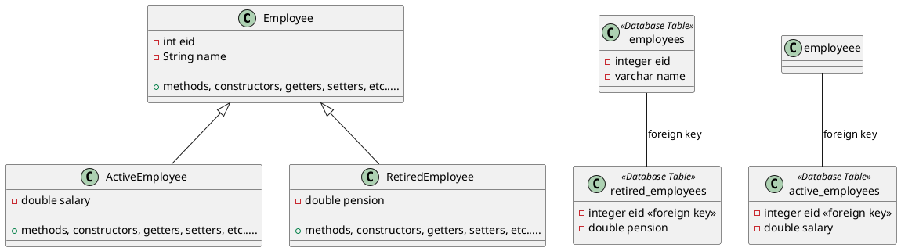

### `concrete-table-inheritence.txt`

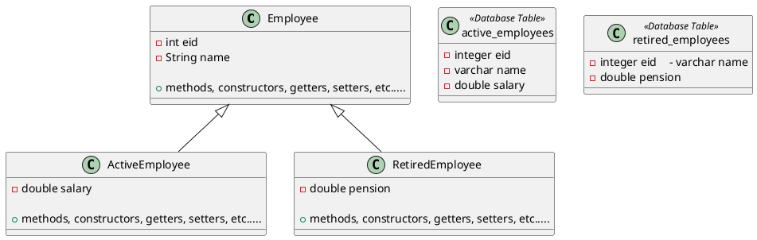

### `controler-templateengine.txt`

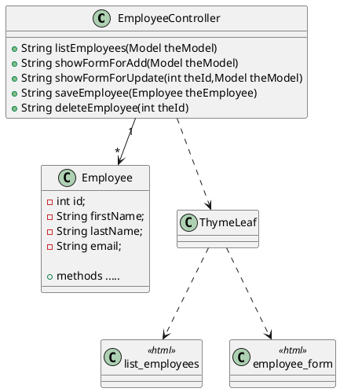

### `data-mapper-pattern-jpa.txt`

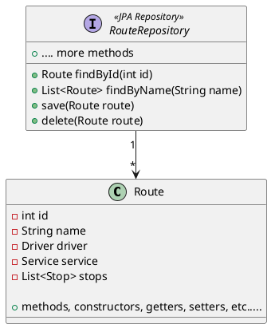

### `data-mapper-pattern.txt`

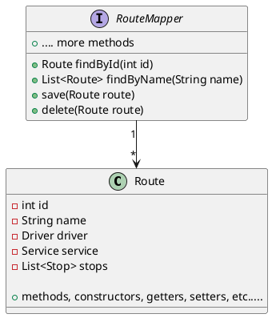

### `domain-pattern.txt`

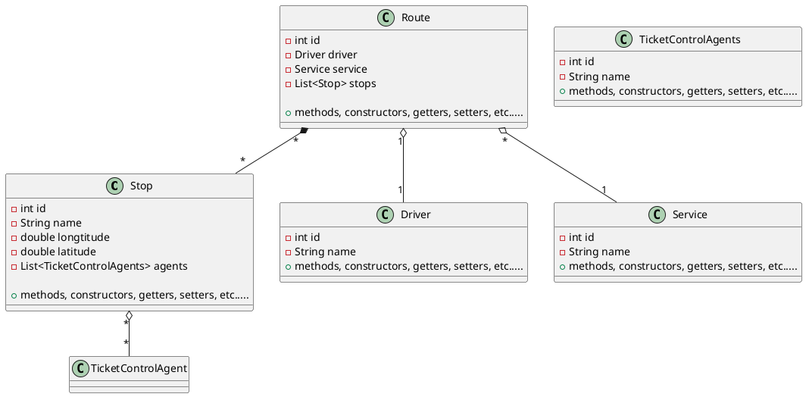

### `eaap-architecture.txt`

```plantuml
folder views

folder controllers 

folder services

folder data_mappers

folder domain_model

database DBMS


views ..> controllers
controllers ..> services
services ..> data_mappers
data_mappers ..> DBMS
data_mappers ..> domain_model
services ..> domain_model
```

### `FK-many-to-many.txt`

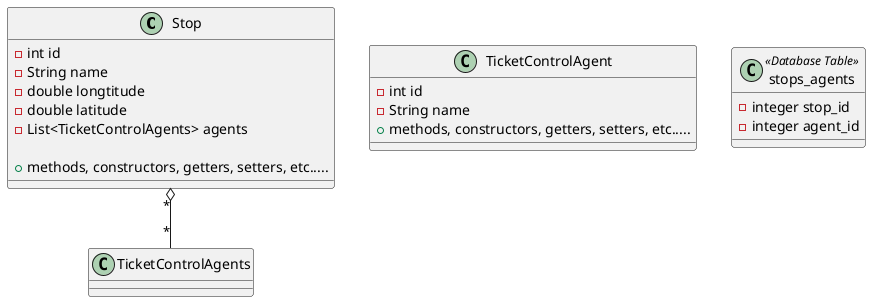

### `FK-many-to-one.txt`

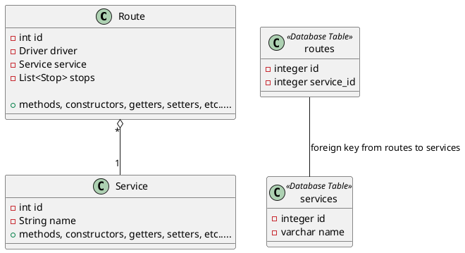

### `FK-one-to-many.txt`

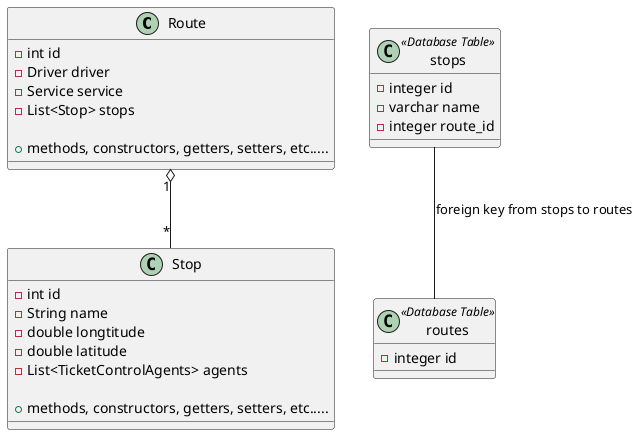

### `FK-one-to-one.txt`

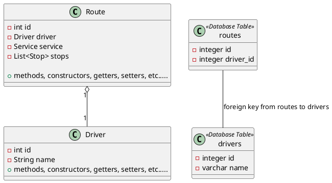

### `identity-field.txt`

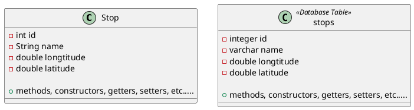

### `single-table.txt`

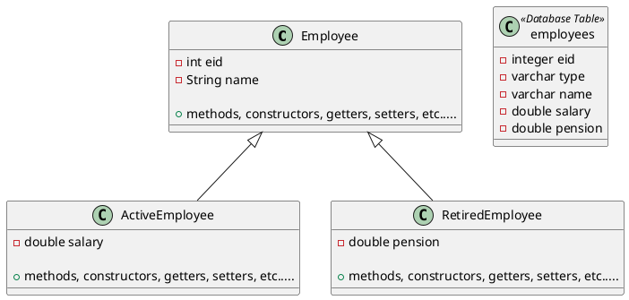

### `spring security.txt`

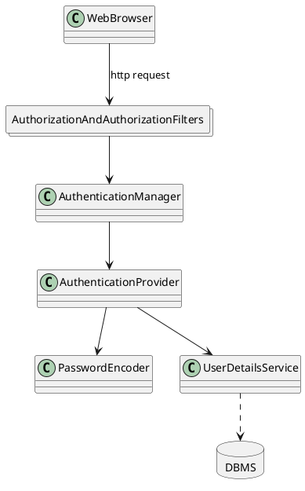

### `table-module-and-gateway.txt`

```plantuml
@startuml

class StopGateway {
	+ void saveStop(int stopId, String name, 
			double longtitude, double latitude, int status, int routeId)	
	+ void deleteStop(int stopId)	
	+ void updateStop(int stopId, String name, int status, 
			double latitude, double longtitude, int routeId) 	
	+ ResultSet findStopsById(int stopId) 
	+ ResultSet findStopsByRouteId(int routeId) throws SQLException 
}

public class RouteGateway {
	+ void saveRoute(int routeId, String name)	
	+ void deleteRoute(int routeId)
	+ findRouteById(int routeId)	
}

class RouteModule {
	+ String reportRouteStatus(int routeId) 	
}

public class StopModule {
	+ void setStopStatus(int stopId, int status) 	
	+ String reportStopStatus(int stopId) 	
}

class routes <<Database Table>>{
	- integer id
	- varchar name
}

class stops <<Database Table>>{
	- integer id
	- varchar name
        - double longtitude
        - double latitude
        - int status
}


RouteModule --> StopModule
RouteModule --> RouteGateway
StopModule --> StopGateway

StopGateWay  ..> stops
RouteGateway  ..> routes
@enduml
```

### `table-module.txt`

```plantuml
@startuml

class RouteModule {
	+ void saveRoute(int routeId, String name)
	+ void deleteRoute(int routeId)
	+ String reportRouteStatus(int routeId) 	
}

public class StopModule {
	+ void saveStop(int stopId, String name, 
			double longtitude, double latitude, int status, int routeId)	
	+ void deleteStop(int stopId)	
	+ void setStopStatus(int stopId, int status) 	
	+ String reportStopStatus(int stopId) 	
	+ ResultSet findStopsByRouteId(int routeId) throws SQLException 
}


class routes <<Database Table>>{
	- integer id
	- varchar name
}

class stops <<Database Table>>{
	- integer id
	- varchar name
        - double longtitude
        - double latitude
        - int status
}

RouteModule --> StopModule

StopModule  ..> stops
RouteModule  ..> routes
@enduml
```

### `transaction-script.txt`

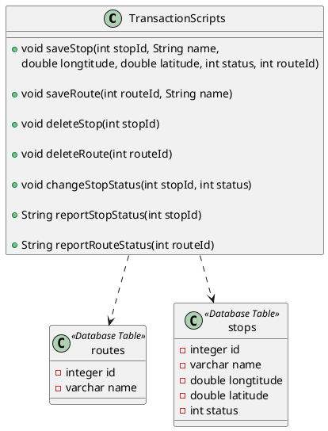

## PowerPoint slide text

### [`1-SoftEng-Intro-simple.ppt`](https://github.com/rahmanziaur/javaee/tree/main/softwareEngg/1-SoftEng-Intro-simple.ppt)

_Text extraction unavailable: Package not found at 'c:\Users\Sadia Kabir Mou\.copilot\session-state\325c45f1-8a66-4d2e-b816-cec5fd034314\files\javaee-readme-source\softwareEngg\1-SoftEng-Intro-simple.ppt'_

### [`2-SoftEng-DevelopmentProcess.ppt`](https://github.com/rahmanziaur/javaee/tree/main/softwareEngg/2-SoftEng-DevelopmentProcess.ppt)

_Text extraction unavailable: Package not found at 'c:\Users\Sadia Kabir Mou\.copilot\session-state\325c45f1-8a66-4d2e-b816-cec5fd034314\files\javaee-readme-source\softwareEngg\2-SoftEng-DevelopmentProcess.ppt'_

### [`3-SoftEng-Requirements.ppt`](https://github.com/rahmanziaur/javaee/tree/main/softwareEngg/3-SoftEng-Requirements.ppt)

_Text extraction unavailable: Package not found at 'c:\Users\Sadia Kabir Mou\.copilot\session-state\325c45f1-8a66-4d2e-b816-cec5fd034314\files\javaee-readme-source\softwareEngg\3-SoftEng-Requirements.ppt'_

### [`4-SoftEng-Design.ppt`](https://github.com/rahmanziaur/javaee/tree/main/softwareEngg/4-SoftEng-Design.ppt)

_Text extraction unavailable: Package not found at 'c:\Users\Sadia Kabir Mou\.copilot\session-state\325c45f1-8a66-4d2e-b816-cec5fd034314\files\javaee-readme-source\softwareEngg\4-SoftEng-Design.ppt'_

### [`5-SoftEng-Modeling.ppt`](https://github.com/rahmanziaur/javaee/tree/main/softwareEngg/5-SoftEng-Modeling.ppt)

_Text extraction unavailable: Package not found at 'c:\Users\Sadia Kabir Mou\.copilot\session-state\325c45f1-8a66-4d2e-b816-cec5fd034314\files\javaee-readme-source\softwareEngg\5-SoftEng-Modeling.ppt'_

### [`6-SoftEng-Testing.ppt`](https://github.com/rahmanziaur/javaee/tree/main/softwareEngg/6-SoftEng-Testing.ppt)

_Text extraction unavailable: Package not found at 'c:\Users\Sadia Kabir Mou\.copilot\session-state\325c45f1-8a66-4d2e-b816-cec5fd034314\files\javaee-readme-source\softwareEngg\6-SoftEng-Testing.ppt'_

### [`SoftEng-Lab-IoC-DI.ppt`](https://github.com/rahmanziaur/javaee/tree/main/softwareEngg/SoftEng-Lab-IoC-DI.ppt)

_Text extraction unavailable: Package not found at 'c:\Users\Sadia Kabir Mou\.copilot\session-state\325c45f1-8a66-4d2e-b816-cec5fd034314\files\javaee-readme-source\softwareEngg\SoftEng-Lab-IoC-DI.ppt'_

### [`SoftEng-Lab-JPA.ppt`](https://github.com/rahmanziaur/javaee/tree/main/softwareEngg/SoftEng-Lab-JPA.ppt)

_Text extraction unavailable: Package not found at 'c:\Users\Sadia Kabir Mou\.copilot\session-state\325c45f1-8a66-4d2e-b816-cec5fd034314\files\javaee-readme-source\softwareEngg\SoftEng-Lab-JPA.ppt'_

### [`SoftEng-Lab-Security.ppt`](https://github.com/rahmanziaur/javaee/tree/main/softwareEngg/SoftEng-Lab-Security.ppt)

_Text extraction unavailable: Package not found at 'c:\Users\Sadia Kabir Mou\.copilot\session-state\325c45f1-8a66-4d2e-b816-cec5fd034314\files\javaee-readme-source\softwareEngg\SoftEng-Lab-Security.ppt'_

### [`SoftEng-Lab-Web-Apps.ppt`](https://github.com/rahmanziaur/javaee/tree/main/softwareEngg/SoftEng-Lab-Web-Apps.ppt)

_Text extraction unavailable: Package not found at 'c:\Users\Sadia Kabir Mou\.copilot\session-state\325c45f1-8a66-4d2e-b816-cec5fd034314\files\javaee-readme-source\softwareEngg\SoftEng-Lab-Web-Apps.ppt'_

## PDF document text

### [`1-SoftEng-Intro-simple.pdf`](https://github.com/rahmanziaur/javaee/tree/main/softwareEngg/1-SoftEng-Intro-simple.pdf)

#### Page 1

28/2/2022
1
Slides material sources: 
Software Engineering - Theory & Practice, S. L. Pfleeger
Introduction to Software Engineering, I. Sommerville
SWEBOK v3: IEEE Software Engineering Body of Knowledge
Software Engineering
www.cs.uoi.gr/~zarras/http://www.cs.uoi.gr/~zarras/se.htm
What are the objectives & 
expected outcomes?

#### Page 2

28/2/2022
2
What are the objectives & expected 
outcomes?
The study and application of systematic processes , methods and techniques
for software design , implementation and testing . 
Learn how to:
Specify requirements for a large scale software system.
Specify the architecture of the system based on the requirements specification.
Design and implement the subsystems of the system’s architecture.
Test the system in a principled way that guarantees the quality of the result.
Organize the delivery of the system and the user’s training .
Literature and study material 
The main textbooks for the course are:
1. Software Engineering - Theory & Practice, S. L. Pfleeger, ISBN 978-960-461-
477 6
2. Software Engineering, I. Sommerville, ISBN 978-960-461-220-8
Apart from the above textbooks you can download the course's lecture notes.
1. SWEBOK v3: IEEE Software Engineering Body of Knowledge
2. Lethbridge and Laganiere, Object-Oriented Software Engineering Practical   
Software Development using UML and Java, 2005
3. R.C. Martin, Agile Software Development, Principles, Patterns, and Practices, 
2003 
4. GoF, Design Patterns: Elements of Reusable OO Software, 1995 
5. Software Testing – A Craftsman’s Approach, P Jorgensen

#### Page 3

28/2/2022
3
Project, Labs, Related Technologies
The project is developed by groups of 2-3 students. 
Final deliverables:
1. Source code
2. Report
We will have a LAB in I5 where we will discuss the project and related
technologies like Spring, Thymeleaf, Bootstrap, JPA, Hibernate, MySQL, JUnit,
Mockito, Maven etc.
Grades and exams
The will also be a final written exam at the end of the semester.
If FinalExamGrade >=5 and ProjectGrade >= 5 
Overall grade = 0.6 * FinalExamGrade + 0.4 * ProjectGrade
Else
Overall grade = min(FinalExamGrade, ProjectGrade)

### [`2-SoftEng-DevelopmentProcess.pdf`](https://github.com/rahmanziaur/javaee/tree/main/softwareEngg/2-SoftEng-DevelopmentProcess.pdf)

#### Page 1

7/3/2024
1
Slides material sources: 
Software Engineering - Theory & Practice, S. L. Pfleeger
Introduction to Software Engineering, I. Sommerville
SWEBOK v3: IEEE Software Engineering Body of Knowledge
Software Development Process
www.cs.uoi.gr/~zarras/http://www.cs.uoi.gr/~zarras/se.htm
Software engineering 
fundamentals
1
2

#### Page 2

7/3/2024
2
What is software?
What is software?
Computer programs and associated documentation . 
Software products may be developed for a particular customer or may be 
developed for a general market .
3
4

#### Page 3

7/3/2024
3
What is software engineering?
What is software engineering?
ISO/IEC/IEEE Systems and Software Engineering Vocabulary (SEVOCAB) 
defines software engineering as 
“the application of a systematic , disciplined ,
quantifiable approach to the development ,
operation , and maintenance of software ; 
that is, the application of engineering to software ”
5
6

#### Page 4

7/3/2024
4
Development process 
fundamentals
What is a process?
7
8

#### Page 5

7/3/2024
5
What is a process ?
A process is a series of steps involving activities that take some input , 
constraints , and resources to produce an intended output of some kind. 
A process involves a set of tools and techniques.
What is a software 
development process?
9
10

#### Page 6

7/3/2024
6
What is a software development process 
model ?
A structured set of activities required to develop a software system . 
There are many different software processes but all involve these key 
activities:
Requirements specification – defining what the system should do.
Design and implementation – defining the organization of the system and 
implementing the system.
Verification & Validation – checking if it works correctly and if it does 
what the customer wants.
Evolution – changing the system in response to changing customer needs.
What is a software development 
process model?
11
12

#### Page 7

7/3/2024
7
What is a development process model?
A software process model is a abstract representation of a process. 
It presents a description of a process from some particular perspective.
A process description may include:
Activities that constitute the process .
Products , which are the outcomes of a process activity; 
Roles , which reflect the responsibilities of the people involved in the 
process;
Pre- and post-conditions , which are statements that are true before and 
after a process activity has been enacted or a product produced.
It is usually given in some notation like a simple directed graph with 
nodes & edges, a UML activity diagram , a BPMN process model , a Gantt 
chart .... and many more ...
Well known software 
development processes … a 
historical retrospection
13
14

#### Page 8

7/3/2024
8
How do we develop small 
programs for internal 
operation/personal use?
The code & fix model
In the introduction of the Spiral model Boehm refers to 
the basic model used in the earliest days of software .
Write 
some code
Fix the 
problems
15
16

#### Page 9

7/3/2024
9
What is wrong with that?
The code & fix model
Write 
some code
Fix the 
problems
After a number of fixes ,  subsequent fixes may become  
very expensive .
Frequently,  the software becomes a poor match to users ’ 
needs that it is rejected or redeveloped . 
17
18

#### Page 10

7/3/2024
10
The code & fix model
Write 
some code
Fix the 
problems
Code is expensive to fix because of poor preparation for 
testing and modification . 
Lack of requirements analysis and design .
How do we develop larger 
programs for delivery to a 
customer?
19
20

#### Page 11

7/3/2024
11
The stage wise model
H.D. Benington, Production of Large
Computer Programs, In ONR Symp.
Advanced Programming Methods for Digital
Computers, pp. 15-27, 1956.
Also available in Annals of the History of
Computing, pp. 350-361, 1983 and in Proc.
9th Int’l Conf. Software Engineering (ICSE),
1987.
The waterfall model
 W. W. Royce, Managing the Development
of Large Software Systems: Concepts and
Techniques, Proc. of Wescon, 1970.
Also available in Proc. 9th Int’l Conf.
Software Engineering (ICSE), 1987
A highly influential refinement of the 
stage-wise model . It provided two 
primary enhancements to the stage-wise 
model
21
22

#### Page 12

7/3/2024
12
The waterfall model W. W. Royce, Managing the Development
of Large Software Systems: Concepts and
Techniques, Proc. of Wescon, 1970.
Also available in Proc. 9th Int’l Conf.
Software Engineering (ICSE), 1987
(1) Recognition of the feedback 
loops between stages, and a 
guideline to confine the feedback 
loops to successive stages to 
minimize the expensive rework
involved in feedback across many 
stages .
The waterfall model
W. W. Royce, Managing the Development
of Large Software Systems: Concepts and
Techniques, Proc. of Wescon, 1970.
Also available in Proc. 9th Int’l Conf.
Software Engineering (ICSE), 1987
(2) An initial incorporation 
of prototyping in the 
software life cycle, via a 
“build it twice” step 
running in parallel with 
requirements analysis
and design.
23
24

#### Page 13

7/3/2024
13
The waterfall model
W. W. Royce, Managing the Development
of Large Software Systems: Concepts and
Techniques, Proc. of Wescon, 1970.
Also available in Proc. 9th Int’l Conf.
Software Engineering (ICSE), 1987
Document the 
design – At least 
6 documents 
maintained during 
the whole process.
The evolutionary development model
McCracken and Jackson, Life-Cycle
Concept Considered Harmful, ACM
Software Engineering Notes, pp. 29-32,
1982.
25
26

#### Page 14

7/3/2024
14
Ok, but how about risks and 
alternatives?
The spiral model
Barry W. Boehm, A Spiral Model of Software
Development and Enhancement, IEEE
Computer 21(5), pp. 61-72, 1988.
27
28

#### Page 15

7/3/2024
15
The spiral model
Barry W. Boehm, A Spiral Model of
Software Development and
Enhancement, IEEE Computer 21(5),
pp. 61-72,1988.
Agile approaches …
29
30

#### Page 16

7/3/2024
16
Agile methods
Dissatisfaction with the overheads involved in 
conventional processes of the 1980s and 1990s 
led to the creation of agile methods . 
The aim of agile methods is to reduce 
overheads in the software process (e.g. by 
limiting documentation) and to be able to 
respond quickly to changing requirements
without excessive rework.
Agile manifesto 
31
32

#### Page 17

7/3/2024
17
eXtreme Programming (XP)
XP model
http://www.extremeprogramming.org/
33
34

#### Page 18

7/3/2024
18
35
36

#### Page 19

7/3/2024
19
Scrum
Scrum
https://www.scrumguides.org/
Scrum is a process framework that has been used to manage work on 
complex products since the early 1990s. 
Scrum is not a process, technique, or definitive method. Rather, it is a 
framework within which you can employ various processes and 
techniques. 
Ken Schwaber and Jeff Sutherland
37
38

#### Page 20

7/3/2024
20
Scrum Team
https://www.scrumguides.org/
The Product Owner is the person responsible for managing the Product Backlog . 
Product Backlog management includes: 
1. Clearly expressing Product Backlog items; 
2. Ordering the items in the Product Backlog to best achieve goals and missions; 
3. Ensuring that the Product Backlog is visible , transparent, and clear to all, and 
shows what the Scrum Team will work on next; 
4. Ensuring the Development Team understands items in the Product Backlog to 
the level needed.
Scrum Team
https://www.scrumguides.org/
The Development Team consists of professionals who do the work of delivering a 
potentially releasable Increment of “Done” product at the end of each Sprint . 
A “Done” increment is required at the Sprint Review . Only members of the 
Development Team create the Increment.
<= 3  Size of team  < 9
39
40

#### Page 21

7/3/2024
21
Scrum Team
https://www.scrumguides.org/
The Scrum Master is responsible for promoting and supporting Scrum as defined 
in the Scrum Guide.
Scrum Masters do this by helping everyone understand Scrum theory, practices, 
rules, and values.
Scrum Events
https://www.scrumguides.org/
The Sprint
The heart of Scrum is a Sprint, a time-box of one month or less during which a 
“Done”, useable, and potentially releasable product Increment is created. Sprints 
have consistent durations throughout a development effort. 
A new Sprint starts immediately after the conclusion of the previous Sprint . 
Sprints contain and consist of the Sprint Planning , Daily Scrums , the development 
work , the Sprint Review , and the Sprint Retrospective . 
During the Sprint :  No changes are made that would endanger the Sprint 
Goal ;  Quality goals do not decrease; and,  Scope may be clarified and re-
negotiated between the Product Owner and Development Team as more is 
learned.
41
42

#### Page 22

7/3/2024
22
Scrum Events
https://www.scrumguides.org/
Sprint Planning
Sprint Planning is time-boxed to a maximum of eight hours for a one-month 
Sprint.  For shorter Sprints, the event is usually shorter. 
Sprint Planning answers the following : 
1. What can be delivered in the Increment resulting from the upcoming Sprint? 
2. How will the work needed to deliver the Increment be achieved?
What => select from Program Backlog
How => designing the product 
Scrum Events
https://www.scrumguides.org/
Daily Scrum
The Daily Scrum is a 15-minute time-boxed event for the Development Team. The 
Daily Scrum is held every day of the Sprint.
Here is an example of what might be used:  
What did I do yesterday that helped the Development Team meet the Sprint Goal? 
What will I do today to help the Development Team meet the Sprint Goal? 
Do I see any impediment that prevents me or the Development Team from 
meeting the Sprint Goal?
43
44

#### Page 23

7/3/2024
23
Scrum Events
https://www.scrumguides.org/
Sprint Review
A Sprint Review is held at the end of the Sprint to inspect the Increment and 
adapt the Product Backlog if needed. 
During the Sprint Review, the Scrum Team and stakeholders collaborate about 
what was done in the Sprint.  Based on that and any changes to the Product 
Backlog during the Sprint, attendees collaborate on the next things that could be 
done to optimize value. 
This is an informal meeting, not a status meeting , and the presentation of the 
Increment is intended to elicit feedback and foster collaboration. This is at most a 
four-hour meeting for one-month Sprints . For shorter Sprints, the event is usually 
shorter
Scrum Events
https://www.scrumguides.org/
Sprint Retrospective
The Sprint Retrospective is an opportunity for the Scrum Team to inspect itself 
and create a plan for improvements to be enacted during the next Sprint.
1. Inspect how the last Sprint went with regards to people, relationships, process, 
and tools ; 
2. Identify and order the major items that went well and potential improvements ;
3. Create a plan for implementing improvements to the way the Scrum Team 
does its work.
45
46

#### Page 24

7/3/2024
24
Scrum Artefacts
https://www.scrumguides.org/
Product Backlog
The Product Backlog is an ordered list of everything that is known to be needed in 
the product . 
The Product Owner is responsible for the Product Backlog, including its content, 
availability, and ordering. 
A Product Backlog is never complete . 
The Product Backlog lists all features , functions , requirements , enhancements , and 
fixes that constitute the changes to be made to the product in future releases. 
Product Backlog items often include test descriptions
Scrum Artefacts
https://www.scrumguides.org/
Sprint Backlog
The Sprint Backlog is the set of Product Backlog items selected for the Sprint, plus 
a plan for delivering the product Increment and realizing the Sprint Goal .
The Sprint Backlog is a forecast by the Development Team about what 
functionality will be in the next Increment and the work needed to deliver that 
functionality into a “Done” Increment. 
As work is performed or completed, the estimated remaining work is updated .
47
48

### [`3-SoftEng-Requirements.pdf`](https://github.com/rahmanziaur/javaee/tree/main/softwareEngg/3-SoftEng-Requirements.pdf)

#### Page 1

28/2/2022
1
Slides material sources: 
Software Engineering - Theory & Practice, S. L. Pfleeger
Introduction to Software Engineering, I. Sommerville
SWEBOK v3: IEEE Software Engineering Body of Knowledge
IEEE Recommended Practice for Software Requirements Specifications
Software Requirements
www.cs.uoi.gr/~zarras/http://www.cs.uoi.gr/~zarras/se.htm
Software requirements 
fundamentals

#### Page 2

28/2/2022
2
What is a software requirement?
What is a requirement?
At its most basic, a requirement is a property that must be 
exhibited by a software in order to solve some problem in the real 
world . SWEBOK v3: IEEE Software 
Engineering Body of Knowledge
It may range from a high-level abstract statement of a service or 
of a system constraint to a detailed mathematical functional 
specification .

#### Page 3

28/2/2022
3
How can we classify requirements?
How can we classify requirements?
Product  / Process requirements
Functional  / Non-functional requirements
System / Software requirements

#### Page 4

28/2/2022
4
What makes them so important?
What makes them so important?
According to a large scale empirical study (> 8000 projects) done by Standish 
in 1995 they are amongst the top factors that cause a project to fail .
Incomplete requirements (13.1%)
Lack of user involvement (12.4%)
Unrealistic expectations (9.9%)
Lack of executive support (9.3%)
Changing requirements and specifications (8.7 %)
Lack of planning (8.1%)
System no longer needed (7.5%)

#### Page 5

28/2/2022
5
What is a functional requirement?
What is a functional requirement?
A functional requirement describes a function/service that the 
software is to execute/provide .  
Sometimes known as capability or feature .

#### Page 6

28/2/2022
6
What is a non functional 
requirement?
What is a non functional requirement?
A non-functional requirement is a constraint on the provided 
functions/services .  
Sometimes known as constraints or quality requirements . 
Can be further classified according to whether they are performance
requirements, maintainability requirements, safety requirements, 
reliability requirements, security requirements, availability requirements, 
interoperability requirements…. or any other quality attribute….

#### Page 7

28/2/2022
7
What makes a good software 
requirement specification (SRS)?
It should be correct
An SRS is correct if, and only if, every requirement stated 
therein is one that the software should/shall meet .
There is no tool or procedure that ensures correctness. 
The SRS should be compared with any applicable superior 
specification , such as a system requirements specification, 
with other project documentation , and with other 
applicable standards, to ensure that it agrees. 
Alternatively the customer or user can determine if the 
SRS correctly reflects the actual needs. 
IEEE Recommended Practice for 
Software Requirements Specifications

#### Page 8

28/2/2022
8
It should be unambiguous
An SRS is unambiguous if, and only if, every 
requirement stated therein has only one 
interpretation . 
As a minimum , this requires that each 
concept/characteristic of the product be described 
using a single unique term . 
IEEE Recommended Practice for 
Software Requirements Specifications
It should be complete
An SRS is complete if, and only if it includes:
All significant requirements . 
Definition of the responses of the software to all 
realizable classes of input data in all realizable classes of 
situations . Note that it is important to specify the 
responses to both valid and invalid input values.
Full labels and references to all figures, tables, and 
diagrams in the SRS and definition of all terms and units 
of measure .
IEEE Recommended Practice for 
Software Requirements Specifications

#### Page 9

28/2/2022
9
It should be consistent
SRS is internally consistent if, and only if, no subset 
of individual requirements described in it conflict .
Consistency refers to internal consistency . If an SRS 
does not agree with some higher-level document , 
such as a system requirements specification, then it 
is not correct .
IEEE Recommended Practice for 
Software Requirements Specifications
It should be consistent
IEEE Recommended Practice for 
Software Requirements Specifications
The specified characteristics of real-world concepts 
may conflict . 
For example:
a) The format of an output report may be described 
in one requirement as tabular but in another as 
textual.
b) One requirement may state that all lights shall be 
green while another may state that all lights shall 
be blue.

#### Page 10

28/2/2022
10
It should be consistent
IEEE Recommended Practice for 
Software Requirements Specifications
There may be logical or temporal conflicts between 
two specified actions. 
For example οne requirement may state that A must 
always follow B, while another may require that A 
and B occur simultaneously.
It should be consistent
IEEE Recommended Practice for 
Software Requirements Specifications
Two or more requirements may describe the same 
real-world object but use different terms for that 
object.
For example, a program’s request for a user input 
may be called a prompt in one requirement
and a cue in another.

#### Page 11

28/2/2022
11
It should be ranked for importance
IEEE Recommended Practice for 
Software Requirements Specifications
An SRS is ranked for importance if and only if each 
requirement in it has an identifier to indicate the 
importance of that particular requirement.
Essential - Implies that the software will not be acceptable unless these 
requirements are provided in an agreed manner.
Conditional - Implies that these are requirements that would enhance the 
software product, but would not make it unacceptable if they are absent.
Optional - Implies a class of functions that may or may not be worthwhile . This 
gives the supplier the opportunity to propose something that exceeds the SRS.
It should be ranked for stability
IEEE Recommended Practice for 
Software Requirements Specifications
An SRS is ranked for stability if and only if each 
requirement in it has an identifier to indicate the 
stability of that particular requirement.
Stability can be expressed in terms of the number of expected changes to any 
requirement based on experience or knowledge of forthcoming events that 
affect the organization, functions, and people supported by the software system.

#### Page 12

28/2/2022
12
It should be verifiable
IEEE Recommended Practice for 
Software Requirements Specifications
An SRS is verifiable if, and only if, every requirement 
stated therein is verifiable . 
A requirement is verifiable if, and only if, there exists 
some finite cost-effective process with which a 
person or machine can check that the software 
product meets the requirement . 
In general any ambiguous requirement is not 
verifiable . 
It should be verifiable
IEEE Recommended Practice for 
Software Requirements Specifications
Examples of non-verifiable requirements are 
statements such as:
“works well”, “good human interface” and “shall 
usually happen” 
An example of a verifiable statement is:
Output of the program shall be produced within 20 s of 
event X 60% of the time; and shall be produced within 30 
s of event Y 100% of the time.
This statement can be verified because it uses 
concrete terms and measurable quantities .

#### Page 13

28/2/2022
13
It should be modifiable
IEEE Recommended Practice for 
Software Requirements Specifications
An SRS is modifiable if, and only if, its structure and style are such that any 
changes to the requirements can be made easily.
SRS must have a coherent and easy-to-use organization with a table of 
contents , an index , and explicit cross-referencing .
Not be redundant (i.e., the same requirement should not appear in more 
than one place in the SRS).
Express each requirement separately , rather than intermixed with other 
requirements.
It should be traceable
IEEE Recommended Practice for 
Software Requirements Specifications
An SRS is traceable if the origin of each of its requirements is 
clear and facilitates the referencing of each requirement in 
future development or documentation . 
Backward traceability - each requirement must explicitly 
reference its source in earlier documents .
Forward traceability - each requirement in the SRS must 
have a unique name or reference number .

#### Page 14

28/2/2022
14
Software requirements process & 
techniques
Where do we start from?

#### Page 15

28/2/2022
15
Requirements elicitation
Requirements elicitation is the first stage in building 
an understanding of the problem the software is required 
to solve. 
It is fundamentally a human activity and is where the 
stakeholders are identified and relationships established 
between the development team and the customer .
It is variously termed requirements capture , requirements 
discovery , and requirements acquisition .
How do we collect requirements?

#### Page 16

28/2/2022
16
Elicitation techniques
Interviews - Interviewing stakeholders is a
“traditional” means of eliciting requirements.
Types of interviews
Closed interviews based on pre-determined list 
of questions
Open interviews where various issues are 
explored with stakeholders.
Effective interviewing
Be open-minded , avoid pre-conceived ideas and 
be willing to listen to stakeholders.
Prompt the interviewee using a springboard 
question , a requirements proposal , or by working 
together on a prototype system.
Elicitation techniques
Interviews in practice 
Normally a mix of closed and open-ended
interviewing.
Interviews are good for getting an overall 
understanding of what stakeholders do and how
they might interact with the system .
Interviews are not good for understanding 
domain requirements
Requirements engineers cannot understand 
specific domain terminology ; 
Domain experts are so familiar with domain 
knowledge that find it hard to articulate what is 
useful or filter what isn’t .

#### Page 17

28/2/2022
17
Elicitation techniques
Scenarios
Scenarios are real-life descriptions of how a 
system can be used .
They should include:
A description of the starting situation ;
A description of the normal flow of events ;
A description of what can go wrong ;
A description of the state when the scenario 
finishes .
Elicitation techniques
Use-cases
A scenario based technique in UML which 
identify the actors in an interaction and which 
describe the interaction itself.
High-level graphical model supplemented by 
more detailed tabular description .
Sequence diagrams may be used to add detail to 
use-cases by showing the sequence of event 
processing in the system.

#### Page 18

28/2/2022
18
Elicitation techniques
Prototypes
This technique is a valuable tool
for clarifying ambiguous requirements and
assess alternatives . 
They provide users with a context within which 
they can better understand what information 
they need to provide. 
Elicitation techniques
Prototypes 
Paper mockups
Screen designs
Beta-test versions
Low fidelity prototypes are often preferred to 
avoid stakeholder “ anchoring ” on minor, 
incidental characteristics of a higher quality 
prototype that can limit design flexibility in 
unintended ways.

#### Page 19

28/2/2022
19
Elicitation techniques
Facilitated meetings
The purpose of these meetings is to try to 
achieve a summative effect, whereby a group of 
people can bring more insight into their software 
requirements than by working individually. 
They can brainstorm and refine ideas that may be 
difficult to bring to the surface using interviews .
Another advantage is that conflicting
requirements surface early on in a way that lets 
the stakeholders recognize where these occur.
Elicitation techniques
Facilitated meetings
May result in a richer and more consistent
set of requirements than might otherwise
be achievable. 
However, meetings need to be handled
carefully to prevent a situation in which the 
critical abilities of the team are eroded by 
group loyalty , or in which requirements 
reflecting the concerns of a few outspoken 
(and perhaps senior ) people.

#### Page 20

28/2/2022
20
Elicitation techniques
Observation - ethnography
The importance of software context within the
organizational/operational environment has led 
to observational techniques. 
Software engineers learn about user tasks by 
observing how users perform their tasks by 
interacting with each other and with software 
tools and other resources. 
These techniques are relatively expensive but 
also instructive because they illustrate that 
many user tasks and business processes are too 
subtle and complex for their actors to describe .
Ethnography is effective for understanding
existing processes but cannot identify new 
features .
Elicitation techniques
User stories 
This technique is commonly used in agile 
methods (esp. XP) 
Refers to short, high-level descriptions of 
required functionality expressed in customer 
terms . 
A typical user story has the form: 
“As a <role>, I want <goal/desire> so that 
<benefit>.”

#### Page 21

28/2/2022
21
Elicitation techniques
User stories 
A user story contains just enough information
so that the we can produce a reasonable 
estimate of the effort to implement it. The 
details are orally discussed
Before a user story is implemented, a 
detailed acceptance test must be provided to 
determine whether the goals of the user 
story have been fulfilled .
What do we do once we have the 
requirements?

#### Page 22

28/2/2022
22
Requirements analysis
Requirements Classification
Requirements can be classified on a 
number of dimensions:
Functional/Non Functional
Product/Process
Importance
Stability
Scope
Requirements analysis
Conceptual modeling  
The development of models of a real-world 
problem is key to software requirements 
analysis.
Their purpose is to aid in understanding the 
situation in which the problem occurs, as well 
as depicting a solution . 
Hence, conceptual models comprise models of 
entities from the problem domain , configured 
to reflect their real-world relationships and 
dependencies .

#### Page 23

28/2/2022
23
Requirements analysis
Conceptual modeling  
Several kinds of models can be developed.
Use case diagrams
Data flow models
State models
Process/Activity models
Data models
and many others…..
Many of these modeling notations are part of the 
Unified Modeling Language (UML) .
Requirements analysis
Architecture design and requirements 
allocation 
At some point, the solution architecture must
be derived . Architectural design is the point at 
which the requirements process overlaps with 
software or systems design .
The requirements allocation amounts to 
identifying the architecture/design components
that will be responsible for satisfying the 
requirements .

#### Page 24

28/2/2022
24
Requirements analysis
Requirements negotiation 
Another term commonly used for this task 
is “ conflict resolution .” 
This concerns resolving problems with 
requirements where conflicts occur between 
stakeholders requiring mutually incompatible 
features , between requirements and resources , 
or between functional and nonfunctional
requirements, for example.
What do we do after the analysis?

#### Page 25

28/2/2022
25
Requirements specification
Requirements specification typically 
refers to the production of a document
that can be systematically reviewed, 
evaluated, and approved. 
For complex systems , particularly those 
involving substantial non-software 
components, as many as three different 
types of documents are produced: system 
definition, system requirements, and 
software requirements .
For simple software products, only the
software requirements spec is required.
Requirements validation
The goal of this task is to check if the 
requirements specification is of good 
quality wrt required characteristics like 
correctness, completeness, unambiguity, 
traceability, verifiability, modifiability ….

#### Page 26

28/2/2022
26

### [`4-SoftEng-Design.pdf`](https://github.com/rahmanziaur/javaee/tree/main/softwareEngg/4-SoftEng-Design.pdf)

#### Page 1

28/3/2025
1
Slides material sources: 
Software Engineering - Theory & Practice, S. L. Pfleeger
Introduction to Software Engineering, I. Sommerville
SWEBOK v3: IEEE Software Engineering Body of Knowledge
R.C. Martin, Agile Software Development, Principles, Patterns, and Practices, 2003
GoF, Design Patterns: Elements of Reusable OO Software, 1995
M. Fowler. Patterns of Enterprise Application Architecture 
Software Design
www.cs.uoi.gr/~zarras/http://www.cs.uoi.gr/~zarras/se.htm
Design fundamentals
1
2

#### Page 2

28/3/2025
2
What is software design?
What is software design?
In the general sense, design can be viewed as a form of a problem 
solving process .
In the case of software the input of the design process is the 
requirements .
3
4

#### Page 3

28/3/2025
3
What are the basic steps of the 
design process?
What are the basic steps of the design 
process?
Architectural design (also referred to as high level design and top-
level design) describes how software is organized into components .
Detailed design describes the desired behavior of these components .
5
6

#### Page 4

28/3/2025
4
What is the outcome of the 
design process?
What is the outcome of the design 
process?
The output of these two processes is a set of models and artifacts that 
record the major decisions that have been taken, along with an 
explanation of the rat ionale for each nontrivial decision .
By recording the rationale , long-term maintainability of the software 
product is enhanced..
7
8

#### Page 5

28/3/2025
5
What makes a good design?
Modularity & Decomposition
Decomposing and modularizing means that large software is divided
into a number of smaller named components having well-defined 
interfaces that describe component interactions.
Usually the goal is to place different functionalities and responsibilities
in different components .
9
10

#### Page 6

28/3/2025
6
What makes a good split?
Low coupling
Coupling is a measure of the interdependence among 
components in a computer program.
W. P. Stevens, G. J. Myers and L. L. Constantine, Structured design, 
IBM Systems Journal , vol. 13, no. 2, pp. 115-139, 1974.
11
12

#### Page 7

28/3/2025
7
High cohesion
Cohesion is a measure of the strength of association of the 
elements within a component .
W. P. Stevens, G. J. Myers and L. L. Constantine, Structured design, 
IBM Systems Journal , vol. 13, no. 2, pp. 115-139, 1974.
Abstraction, encapsulation & 
information hiding
Abstraction is generally defined as a view of an object 
that focuses on the information relevant to a particular 
purpose and ignores the remainder of the information.
Encapsulation and information hiding means grouping
and packaging the internal details of an abstraction and 
making those details inaccessible to external entities.
D. L. Parnas, On the Criteria To Be Used in Decomposing 
Systems into Modules. Communications of the ACM . 15 (12): 
1053–58, 1972.
13
14

#### Page 8

28/3/2025
8
How do we assess the quality of 
a software design?
Software design quality
Software design reviews , informal or formal 
techniques,  to determine the quality of 
design artifacts.
Software metrics to quantify the 
assessment. 
The CK metrics suite is a well known set of 
metrics for OO software.
15
16

#### Page 9

28/3/2025
9
Coupling
Coupling Between Object classes (CBO) [Chidamber & Kemerer]
CBO(A) = number of classes used by A (inheritance is typically not counted)
class Controller {
private boolean alarm;
private Bell b;
private Light l;
public Controller(Bell ab, Light al){
alarm = false;
b = ab;
l = al;
}
public void alarmSignal(){
alarm = true;
}
public void cancelAlarm(){
alarm = false;
System.out.println("False alarm !!");
}
…………………………….
}
17
18

#### Page 10

28/3/2025
10
class Controller {
private boolean alarm;
private Bell b;
private Light l;
…………………………………….
public void confirmAlarm (){
if (alarm == true) {
if(b != null) b.ring();
if(l!=null) l.open();
alarm = false;
} else 
System.out.println("False alarm !!");
}
public void stopAlarm(){
if(b != null) b.stop();
if(l!=null) l.close();
}
} CBO(Controller)  = 2
COF(Controller, Bell, Light) =  (2+0+0)/(3*2) = 
0.33
Cohesion
Lack of Cohesion of Methods (LCOM)
LCOM [Chidamber & Kemerer]
Q set contains the pairs of class methods that use common attributes
P set contains the pairs of class methods that don’t use common 
attributes
LCOM(x) = |P| – |Q| αν |P| > |Q|, 
LCOM(x) = 0 αν |P| <= |Q|
19
20

#### Page 11

28/3/2025
11
public class Rectangle {
private double x;
private double y;
private double width;
private double height;
public Rectangle(double ax, double ay, 
double aWidth, double aHeight){
x = ax;
y = ay;
width = aWidth;
height = aHeight;
}
……………………………………
}
public class Rectangle {
………………………………………..
public void draw(){
System.out.println("Drawing Rectangle at : (" + 
x + "," + y + 
") with width = " + width + " height = " + height);
// drawing code ....
}
public double calculateArea(){
return width * height;
}
}
Q = 3, P = 0 => LCOM = 0
21
22

#### Page 12

28/3/2025
12
Cohesion
LCOM2(x) = 1 – Sum(ma i)/(m*a) [Henderson-Sellers, Constantine, Graham ]
m = number of methods
a = number of attributes
ma i = number of methods that use ai, i=1, …, a
maximum of ma i is m
LCOM2 the smaller the better…..
LCOM2 = 1 ?
LCOM2 = 0 ?
public class Rectangle {
private double x;
private double y;
private double width;
private double height;
public Rectangle(double ax, double ay, 
double aWidth, double aHeight){
x = ax;
y = ay;
width = aWidth;
height = aHeight;
}
……………………………………
}
23
24

#### Page 13

28/3/2025
13
public class Rectangle {
………………………………………..
public void draw(){
System.out.println("Drawing Rectangle at : (" + 
x + "," + y + 
") with width = " + width + " height = " + height);
// drawing code ....
}
public double calculateArea(){
return width * height;
}
}
m = 3, a = 4 
ma x = 2
ma y = 2
ma width = 3
ma height = 3
LCOM2 = 1 – 10/12 = 1/6 = 0.166
25
26

#### Page 14

28/3/2025
14
Class complexity
Weighted Methods per Class (WMC) [Chidamber & Kemerer]
WMC(A) = Sum(Ci), i=1, .. N methods
Ci = method i complexity 
 Ci can be measured in various ways: 
Lines of Code (LOC)
McCabe (number of conditions +1)
if, for, while  1 condition
Switch  transform to if conditions first because it depends on how 
switch is implemented…
class Controller {
private boolean alarm;
private Bell b;
private Light l;
public Controller(Bell ab, Light al){
alarm = false;
b = ab;
l = al;
}
public void alarmSignal(){
alarm = true;
}
public void cancelAlarm(){
alarm = false;
System.out.println("False alarm !!");
}
…………………………….
}
27
28

#### Page 15

28/3/2025
15
class Controller {
private boolean alarm;
private Bell b;
private Light l;
…………………………………….
public void confirmAlarm (){
if (alarm == true) {
if(b != null) b.ring();
if(l!=null) l.open();
alarm = false;
} else 
System.out.println("False alarm !!");
}
public void stopAlarm(){
if(b != null) b.stop();
if(l!=null) l.close();
}
} McCabe version of WMC(Controller)  = 10 
Software Architecture
29
30

#### Page 16

28/3/2025
16
What do we mean by software 
architecture?
What do we mean by software 
architecture?
In its strict sense, a software architecture is 
the set of structures needed to reason about the 
system, which comprise software elements , 
relations among them, and properties of both.
P. Clements et al., Documenting Software 
Architectures: Views and Beyond, Pearson, 2010
31
32

#### Page 17

28/3/2025
17
What do we mean by software 
architecture?
During the mid-1990s, however, software architecture 
emerged as a broader discipline that involved the 
study of software structures and architectures in a more 
generic way.
This gave rise to a number of interesting concepts about 
software design at different levels of abstraction. 
Some of these concepts can be useful during the 
architectural design (architectural styles ) as well as 
during the detailed design (design patterns ).
Interestingly, most of these concepts can be seen as 
attempts to describe , and thus reuse , design 
knowledge.
Architectural Styles
33
34

#### Page 18

28/3/2025
18
Architectural styles
D. Garlan and M. Shaw, An Introduction to Software 
Architecture, Advances in Software Engineering and 
Knowledge Engineering, Volume I , 1993
Layered architectures
Components are organized in
layers
Each layer depends only on the 
next layer
Architectural styles
event distribution
Producer Producer
Consumer Consumer
register for events consume events
Event – Based
Event producers/consumers
D. Garlan and M. Shaw, An Introduction to Software 
Architecture, Advances in Software Engineering and 
Knowledge Engineering, Volume I , 1993
35
36

#### Page 19

28/3/2025
19
Architectural styles
The model represents some information about the 
domain . 
The view represents the display of the model in the 
UI .
The controller takes user input , manipulates
the model , and causes the view to update appropriately. 
In this way UI is a combination of the view and 
the controller .
Model –View – Controller (MVC)
Architectural styles
D. Garlan and M. Shaw, An Introduction to Software 
Architecture, Advances in Software Engineering and 
Knowledge Engineering, Volume I , 1993
Blackboard/repository
37
38

#### Page 20

28/3/2025
20
Architectural styles
$ls -l | grep "Aug"
-rw -rw -rw - 1 john doc 11008 Aug 6 14 :10 ch02 
-rw -rw -rw - 1 john doc 8515 Aug 6 15 :30 ch07 
-rw -rw -r-- 1 john doc 2488 Aug 15 10 :51 intro 
-rw -rw -r-- 1 carol doc 1605 Aug 23 07 :35 macros $
$ls -l | grep "Aug" | sort +4n | more 
-rw -rw -r-- 1 carol doc 1605 Aug 23 07 :35 macros 
-rw -rw -r-- 1 john doc 2488 Aug 15 10 :51 intro 
-rw -rw -rw - 1 john doc 8515 Aug 6 15 :30 ch07 
-rw -rw -r-- 1 john doc 14827 Aug 9 12 :40 ch03 . . .
-rw -rw -rw - 1 john doc 16867 Aug 6 15 :56 ch05 
-- More --(74 %)
D. Garlan and M. Shaw,  An Introduction to Software 
Architecture, Advances in Software Engineering and 
Knowledge Engineering, Volume I , 1993
Pipes and filters
Design patterns
39
40

#### Page 21

28/3/2025
21
Design patterns
Christopher Alexander says, 
"Each pattern describes a problem which occurs 
over and over again in our environment, and then 
describes the core of the solution to that problem, in 
such a way that you can use this solution a million 
times over , without ever doing it the same way twice"
Gang of Four (GoF) 
patterns for OO design
41
42

#### Page 22

28/3/2025
22
GoF Patterns
GoF say:
The design patterns are descriptions of 
communicating objects and classes that are 
customized to solve a general design 
problem in a particular context.
Design Patterns: Elements of Reusable Object 
Oriented Software,” Gamma, Helm, Johnson, Vlissides, 
Addison-Wesley, 1995
Classification of GoF patterns
BehavioralStructuralCreational
Interpreter
Template Method
Chain of 
Responsibility
Command
Iterator
Mediator
Memento
Observer
State
Strategy
Visitor
Adapter
Bridge
Composite
Decorator
Flyweight
Facade
Proxy
Factory Method
Abstract Factory
Builder
Prototype
Singleton
43
44

#### Page 23

28/3/2025
23
Parameterized Factory
Parameterized Factory
Structure
Parameterized factory .  A variation of
factory method that lets us create multiple kinds of products without depending 
on their concrete classes . The factory method takes a parameter that identifies
the kind of object to create, creates the object and returns it to the caller.  
45
46

#### Page 24

28/3/2025
24
Strategy
Strategy
Intent
Define a family of algorithms , encapsulate each one , and make them
interchangeable .
Strategy lets the algorithm vary independently from clients that use it.
47
48

#### Page 25

28/3/2025
25
Strategy
Motivation
Strategy
Structure
Strategy (RouteStrategy) declares an interface common to all supported 
algorithms. Context uses this interface to call the algorithm defined by a 
ConcreteStrategy.
StrategyA, StrategyB, …. (WalkingStrategy, CarStrategy, …) 
implements the algorithm using the Strategy interface.
Context (Navigator) is configured with a ConcreteStrategy object. Maintains 
a reference to a Strategy object. May define an interface that lets Strategy access 
its data.
Example: https://github.com/zarras/myy803-GoF-patterns-tutorials/tree/master/Strategy
49
50

#### Page 26

28/3/2025
26
Strategy
Benefits
 We can isolate Context from the implementation details of an 
algorithm .
 We can add new strategies without having to change Context .
 We can avoid complex conditionals that realize the alternative 
algorithms in Context .
 We can swap algorithms used inside a Context object at runtime .
Liabilities
 Specifying a common interface for different algorithms may not be easy .
 Strategies increase the number of objects in an application.
Template Method
51
52

#### Page 27

28/3/2025
27
Template Method 
Intent
Define the skeleton of an algorithm in an operation , deferring some
steps to subclasses . Template Method lets subclasses redefine certain
steps of an algorithm without changing the algorithm's structure .
Template Method 
Motivation
53
54

#### Page 28

28/3/2025
28
Template Method 
Structure
AbstractClass (StatisticCalculator) defines abstract primitive operations 
that concrete subclasses define to implement steps of an algorithm. Implements 
a template method defining the skeleton of an algorithm. 
The template method calls primitive operations as well as abstract 
operations defined in AbstractClass or those of other objects.
ConcreteClass (KurtosisCalculator, …) implements the primitive operations 
to carry out subclass-specific steps of the algorithm.
Example: https://github.com/zarras/myy803-GoF-patterns-tutorials/tree/master/TemplateMethod
Template Method
Benefits
 Template methods are a fundamental technique for code reuse . They 
are particularly important in class libraries, because they are the means for 
factoring out common behavior and reduce duplication .
Liabilities
 To reuse an abstract class effectively, subclass writers must understand
which operations are designed for overriding and how this should be 
done.
55
56

#### Page 29

28/3/2025
29
Adapter
Adapter
Intent
Convert the interface of a class into another interface clients expect .  
Adapter lets classes work together that couldn't otherwise because of 
incompatible interfaces .
57
58

#### Page 30

28/3/2025
30
Adapter
Motivation
Adapter
Structure
Target (Shape) defines the domain-specific interface that Client uses.
Client (DrawingEditor) collaborates with objects conforming to the Target 
interface.
Adaptee (TextView) defines an existing interface that needs adapting.
Adapter (TextShape) adapts the interface of Adaptee to the Target interface.
Object  Adapter
Example: https://github.com/zarras/myy803-GoF-patterns-tutorials/tree/master/Adapter
59
60

#### Page 31

28/3/2025
31
Adapter
Structure
Target (Shape) defines the domain-specific interface that Client uses.
Client (DrawingEditor) collaborates with objects conforming to the Target 
interface.
Adaptee (TextView) defines an existing interface that needs adapting.
Adapter (TextShape) adapts the interface of Adaptee to the Target interface.
Class Adapter
Adapter
Benefits
 Adaptees added/used without changes to existing code .
Liabilities
 The overall complexity of the code increases because we add new classes 
and a level of indirection. 
61
62

#### Page 32

28/3/2025
32
Composite
Composite
Intent
Compose objects into structures to represent part-whole hierarchies .
Composite lets clients treat individual objects and compositions of objects
uniformly .
63
64

#### Page 33

28/3/2025
33
Composite
Motivation
To realize the graphics….
Composite
Motivation
To realize the graphics….
In some cases specifying the common methods in an interface 
may not be enough.
E.g. a client class has a list of Graphic and wants to add(graphic) 
in all the panels of this list … In this case the client has to check 
every list element to see if it is a composite panel …. 
65
66

#### Page 34

28/3/2025
34
Composite
Motivation
To solve this problem we can maximize the 
common interface of primitive and 
composite objects…. Make it the union of 
the provided methods … to avoid 
implementing the panel specific methods on 
every primitive graphic we can define 
dummy implementations 
Composite
Structure
Component (Graphic) declares the interface for objects in the composition; 
implements default behavior for the interface common to all classes.
Primitive (Rectangle, Line, Text, etc.) represents leaf objects in the 
composition. 
Composite (Picture) defines behavior for components having children.
Client manipulates objects in the composition through the Component interface.
Example: https://github.com/zarras/myy803-GoF-patterns-tutorials/tree/master/Composite
67
68

#### Page 35

28/3/2025
35
Composite
Benefits
 Makes the clients simple . Clients can treat composite structures and 
individual objects uniformly.
 Makes it easier to add new kinds of components . Newly defined 
Composite or Leaf subclasses work automatically with existing structures 
and client code.
Liabilities
 Can make your design too general . The disadvantage of making it easy to 
add new components is that it makes it harder to restrict the 
components of a composite.
Façade 
69
70

#### Page 36

28/3/2025
36
Façade 
Intent
Provide a unified interface to a set of interfaces in a subsystem . Facade
defines a higher-level interface that makes the subsystem easier to use .
Façade 
Motivation
71
72

#### Page 37

28/3/2025
37
Façade 
Motivation
Façade 
Structure
Facade (Compiler) knows which subsystem classes are responsible for a 
request. Delegates client requests to appropriate subsystem objects.
Subsystem classes (Scanner, Parser, ProgramNode, etc.)
implement subsystem functionality.
handle work assigned by the Facade object.
have no knowledge of the facade; that is, they keep no references to it.
Example: https://github.com/zarras/myy803-GoF-patterns-tutorials/tree/master/Facade
73
74

#### Page 38

28/3/2025
38
Facade
Benefits
 Façade shields clients from subsystem components, thereby reducing the 
number of objects that clients deal with and making the subsystem 
easier to use . 
 Façade doesn't prevent applications from using subsystem classes if 
they need to. 
Liabilities
 Façade can be become a God (complex) class.
Command
75
76

#### Page 39

28/3/2025
39
Command
Intent
Encapsulate an action as an object , thereby letting you parameterize
clients with different actions , queue or log actions, and support
undoable/redoable actions .
Command
Motivation Every menu item 
should do a diff. 
action
Represents all 
the different 
actions
77
78

#### Page 40

28/3/2025
40
Command Structure
Command declares an interface for executing an action.
ConcreteCommand (PasteCommand, OpenCommand) defines a 
binding between a Receiver object and an action. implements Execute by 
invoking the corresponding operation(s) on Receiver.
Client (Application) creates a ConcreteCommand object and sets its 
receiver.
Invoker (JMenuItem) asks the command to carry out the request. 
Receiver (Document, Application) knows how to perform the operations 
associated with carrying out a request. Any class may serve as a Receiver.
Command
Benefits
 Command decouples the object that invokes the operation from the one 
that knows how to perform it.
 We can assemble commands into a composite command , queue or log
commands 
 It's easy to add new Commands because you don't have to change 
existing classe s.
Liabilities
 The code may become more complicated since you’re introducing a new 
layer between invokers and receivers .
 Specifying a common interface for different commands may not be 
easy.
79
80

#### Page 41

28/3/2025
41
Martin Fowler’s 
Enterprise Application 
Architecture (EAA) Patterns
Enterprise Application Architecture
Enterprise Application 
Architecture
81
82

#### Page 42

28/3/2025
42
Business logic patterns
Domain Model
An object model of the domain that incorporates both behavior and data .  A 
different object per table tuple/row …..
Example:
https://github.com/zarras/myy803-EAAP-
tutorials/tree/main/domainmodel.datamapper
83
84

#### Page 43

28/3/2025
43
Domain Model
An object model of the domain that incorporates both behavior and data .
At its worst business logic can be very complex . 
Rules and logic describe many different cases and slants of behavior, and 
it's this complexity that objects were designed to deal with . 
A Domain Model creates a web of interconnected objects, where 
each object represents some meaningful concept . 
Good for real world complex business logic .
Service Layer
Defines an application's boundary with a layer of services that establishes a set of 
available operations and coordinates the application's response in each operation.
Enterprise applications typically require different kinds of interfaces to the data: HTML, 
REST, others. 
Despite their different purposes, these interfaces often need common interactions with the 
application to access and manipulate its data and invoke its business logic. 
Encoding the logic of the interactions separately in each interface causes a lot of 
duplication ..
If an application has or will have to support different types of clients with different 
interfacing requirements.
85
86

#### Page 44

28/3/2025
44
Patterns for mapping the domain 
model to the database schema
ORM
Mapping objects to database relations and vice versa is called Object-
Relational Mapping (ORM) .
The KEY IDEA is that
 we have a DB relation/table in the Data layer per class of objects in the
Domain layer and
 each object is stored as a table row
87
88

#### Page 45

28/3/2025
45
Data Mapper
A set of Mappers moves data
between objects and a database 
while keeping them independent of 
each other and the mapper itself.
Example:
https://github.com/zarras/myy803-EAAP-
tutorials/tree/main/domainmodel.datamapp
er.springboot
Data Mapper
Also known as Repository, Data Access Object (DAO)
A set of Mappers moves data between objects and a database while keeping 
them independent of each other and the mapper itself.
The Data Mapper is a layer of software that separates the in-memory objects from 
the database . Its responsibility is to transfer data between the two and also to isolate 
them from each other. 
With Data Mapper the in-memory objects needn't know even that there's a database 
present .
Fits well with Domain Model .  
89
90

#### Page 46

28/3/2025
46
Identity Field
Saves a database ID field in an object to maintain identity between an in-
memory object and a table row .
Intent
Reading data from a database is all very well, but in order to write data back you need 
to tie the database to the in-memory object system .
In essence, Identity Field is mind-numbingly simple. All you do is store the primary key of the 
relational database table in the object’s fields .
Example:
https://github.com/zarras/myy803-EAAP-tutorials/tree/main/foreignkey.mapping
Foreign Key Mapping
Maps an association between objects to a foreign key reference between 
tables .
Objects can refer to each other directly by object references.
To save these objects to a database , it’s vital to save these
references .
A Foreign Key Mapping maps an object reference to a foreign
key in the database.
Example:
https://github.com/zarras/myy803-EAAP-tutorials/tree/main/foreignkey.mapping
91
92

#### Page 47

28/3/2025
47
Foreign Key Mapping
Maps an association between objects to a foreign key reference between 
tables .
One-to-One relation – Route to Driver 
Foreign Key Mapping
Maps an association between objects to a foreign key reference between 
tables .
Many-to-One relation – Route to Service 
93
94

#### Page 48

28/3/2025
48
Foreign Key Mapping
Maps an association between objects to a foreign key reference between 
tables .
One-to-Many relation – Route to Stop 
Example:
https://github.com/zarras/myy803-EAAP-tutorials/tree/main/foreignkey.mapping
Association Table Mapping
Saves a Many-to-Many association as a table with foreign keys to the tables that 
are linked by the association.
Example:
https://github.com/zarras/myy803-EAAP-tutorials/tree/main/foreignkey.mapping
95
96

#### Page 49

28/3/2025
49
Single Table Inheritance
Represents an inheritance hierarchy of classes as a single table that has 
columns for all the fields of the various classes.
Example:
https://github.com/zarras/myy803-EAAP-tutorials/tree/main/singletable.inheritence
Single Table Inheritance
There’s only a single table to worry about on the database. There are no joins in 
retrieving data. Any refactoring that pushes fields up or down the hierarchy doesn’t 
change the DB .
Fields are sometimes relevant and sometimes not, which can be confusing . Columns 
used only by some subclasses lead to wasted space in the database. The single table 
may end up being too large .
97
98

#### Page 50

28/3/2025
50
Class Table Inheritance
Represents an 
inheritance 
hierarchy of classes 
with one table for 
each class .
The linking between the 
tables can be done by foreign 
keys between the tables
Example:
https://github.com/zarras/myy803-EAAP-tutorials/tree/main/classtable.inheritence
Class Table Inheritance
Represents an inheritance hierarchy of classes with one table for each class .
All columns are relevant for every row so tables are easier to understand 
and don’t waste space .
The relationship between the domain model and the database is 
straightforward .
Need to touch multiple tables to load an object , which means a join or 
multiple queries and sewing in memory.
Any refactoring of fields up or down the hierarchy causes database changes .
99
100

#### Page 51

28/3/2025
51
Concrete Table Inheritance
Represents an 
inheritance hierarchy 
of classes with one 
table per leaf class in 
the hierarchy with all 
fields in the table row .
Example: 
https://github.com/zarras/myy803-EAAP-tutorials/tree/main/concretetable.inheritence
Concrete Table Inheritance
Represents an inheritance hierarchy of classes with one table per leaf class in 
the hierarchy with all fields in the table row .
Each table is self-contained and has no irrelevant fields . 
There are no joins to do when reading the data from the concrete 
mappers.
Each table is accessed only when that class is accessed, which can 
spread the access load . 
Redundancy in the data
With fields are pushed up or down the hierarchy,  you don’t have to 
alter the table definitions . 
If a superclass field changes , you need to change each table .
101
102

#### Page 52

28/3/2025
52
Presentation logic patterns
Model View Controller
Splits user interface interaction into three distinct roles .
The model is an object that represents some
information about the domain . 
The view represents the display of the model in the 
UI .
The controller takes user input , manipulates
the model , and causes the view to update appropriately. 
In this way UI is a combination of the view and 
the controller .
The separation of presentation and model is one of the most important design 
principles in software, and the only time we shouldn’t follow it is in very simple systems
where the model has no real behavior in it anyway.
Example: 
https://github.com/zarras/myy803-EAAP-tutorials/tree/main/mvc.controller.templateengine
103
104

#### Page 53

28/3/2025
53
Page Controller
An object that handles a request for a specific page or action on a Web site .
The basic idea behind a Page Controller is to have one module on the Web 
server act as the controller for each page on the Web site. 
In practice, it doesn’t work out to exactly one module per page, since you may 
get a different page depending on dynamic information. 
More strictly, the controllers tie in to each action , which may be clicking a link 
or a button.
Page Controller works 
particularly well in a site 
where most of the controller 
navigational logic is pretty 
simple .
Front Controller
A controller that handles all requests for a Web site.
A Front Controller handles all calls for 
a Web site, and is usually structured in
two parts :  A Web handler and a 
command hierarchy. 
The Web handler is the object that 
actually receives post or get requests 
from the Web server.  It pulls just enough 
information from the URL and the 
request to decide what kind of
action to initiate and then delegates to a 
command to carry out the action
Front Controller works particularly well in a site where the controller navigational 
logic is more complex .
105
106

#### Page 54

28/3/2025
54
Template View
Renders information into HTML by embedding markers in an HTML 
page.
The basic idea of Template View is to embed markers into a static HTML page
when it’s written. 
When the page is used to service a request , the markers are replaced by the 
results of some computation , such as a database query.
The strength of Template View is 
that it allows you to compose the 
content of the page by looking at 
the page structure .
But they are not easy to use with 
complex generation logic and they 
are not easy to test .
Example: 
https://github.com/zarras/myy803-EAAP-tutorials/tree/main/mvc.controller.templateengine
Transform View
A module that processes domain data element by element and 
transforms it into HTML .
The basic notion of Transform View is writing a program that looks at domain-
oriented data and converts it to HTML . 
The program walks the structure of the domain data and, as it recognizes each 
form of domain data, it writes out the particular piece of HTML for it.
Transform View  does not mix HTML with view generation logic and is easier to 
test . 
However,  several people may prefer to have everything embedded in one module .
107
108

#### Page 55

28/3/2025
55
More topics on Software Design 
……..
LCOM3 = (m - Sum(ma i)/a) / (m – 1) [Henderson-Sellers, Constantine, Graham]
the smaller the better…..
= 0 perfect
= 1 bad
> 1 dead attributes
LCOM3 = 0 ??
why dead attributes if LCOM3 > 1 ?
Cohesion
109
110

#### Page 56

28/3/2025
56
public class Rectangle {
private double x;
private double y;
private double width;
private double height;
public Rectangle(double ax, double ay, 
double aWidth, double aHeight){
x = ax;
y = ay;
width = aWidth;
height = aHeight;
}
……………………………………
}
public class Rectangle {
………………………………………..
public void draw(){
System.out.println("Drawing Rectangle at : (" + 
x + "," + y + 
") with width = " + width + " height = " + height);
// drawing code ....
}
public double calculateArea(){
return width * height;
}
}
111
112

#### Page 57

28/3/2025
57
m = 3, a = 4 
ma x = 2
ma y = 2
ma width = 3
ma height = 3
LCOM3 = (3-10/4)/(3-1) = 0.25
Class complexity
Request For a Class (RFC) [Chidamber & Kemerer]
RFC(A) = M + R
M = number of class methods
R = number of methods called by the class methods (with each method 
counts once if called multiple times
 Usually we only count methods of the same project – we do not consider 
standard API calls and so on. 
113
114

#### Page 58

28/3/2025
58
class Controller {
private boolean alarm;
private Bell b;
private Light l;
public Controller(Bell ab, Light al){
alarm = false;
b = ab;
l = al;
}
public void alarmSignal(){
alarm = true;
}
public void cancelAlarm(){
alarm = false;
System.out.println("False alarm !!");
}
…………………………….
}
class Controller {
private boolean alarm;
private Bell b;
private Light l;
…………………………………….
public void confirmAlarm (){
if (alarm == true) {
if(b != null) b.ring();
if(l!=null) l.open();
alarm = false;
} else 
System.out.println("False alarm !!");
}
public void stopAlarm(){
if(b != null) b.stop();
if(l!=null) l.close();
}
} RFC(Controller)  = 5 + 4 
115
116

#### Page 59

28/3/2025
59
Reuse vs complexity 
Depth of Inheritance Tree (DIT) [Chidamber & Kemerer]
DIT(A) = depth of A in the tree
Number of Children (NOC) [Chidamber & Kemerer]
NOC(A) = number of subclasses A has
GradStudent
projectGrade : int
GradStudent(n : String, fg : int, pg : int)
calculateGrade() : double
UnderGradStudent
labsGrades[] : int
UnderGradStudent(n : String, fg : int, lgs[] : int)
calculateGrade() : double
Student
name : String
finalExamGrade : int
Student(n : String, fg : int)
getName() : String
getFinalExamGrade() : int
calculateGrade() : double
CourseStatsCalculator
printBestStudent(list[] : Student) : void
*
*
*
*
DIT(Student) = 0
DIT(GradStudent) = 1
NOC(Student) = 2
NOC(GradStudent) = 0
117
118

#### Page 60

28/3/2025
60
More GoF patterns …
Factory Method 
(& Parameterized Factory 
Variant)
119
120

#### Page 61

28/3/2025
61
Factory Method
Intent
Factory Method lets a class defer instantiation of the objects it
needs to its subclasses .
Factory Method
Motivation
121
122

#### Page 62

28/3/2025
62
Factory Method
Structure
Product (Document) defines the interface of objects the factory method creates.
ConcreteProduct (LatexDocument) implements the Product interface.
Creator (DocumentStatisticsCalculator) declares the factory method, which
returns an object of type Product; may call the factory method to create a Product
object.
ConcreteCreator (LatexStatisticsCalculator ) overrides the factory method to
return an instance of a ConcreteProduct.
Factory Method 
Benefits
 We avoid tight coupling between the Creator and the concrete 
Product objects .
 We keep the Product object creation code in one place.
 We can introduce new types of products into the program without 
changing Creator code.
Liabilities
 We need to add several small subclasses to implement the pattern.
123
124

#### Page 63

28/3/2025
63
Prototype
Prototype
Intent
Specify the kinds of objects to create using a prototypical instance , and create
new objects by copying this prototype.
125
126

#### Page 64

28/3/2025
64
Prototype
Motivation
To realize the graphic 
elements…To realize the tools…
Prototype
Structure
Prototype (Graphic) declares an interface for cloning itself.
ConcretePrototype (Staff, WholeNote, HalfNote) implements an 
operation for cloning itself.
Client (GraphicTool) creates a new object by asking a prototype to clone 
itself.
127
128

#### Page 65

28/3/2025
65
Prototype
Benefits
 We can create objects without coupling to their concrete classes . So, 
we can easily parameterize the creating objects with different classes of 
prototypical objects .  
 We can get rid of repeated initialization code in favor of cloning pre-
built prototypes and produce complex objects more conveniently.
Liabilities
 Cloning complex objects can be tricky . Shallow vs deep copies, circular 
dependencies, ….
Singleton
129
130

#### Page 66

28/3/2025
66
Singleton
Intent
Ensure a class only has one instance , and provide a global point of access to
it.
z8
Singleton
Motivation
It's important for some classes to have exactly one instance.
Although there can be many printers in a system, there should be only one 
printer spooler . 
There should be only one file system and one window manager . 
An accounting system will be dedicated to serving one company .
How do we ensure that a class has only one instance and that the instance is 
easily accessible? 
A nice solution is to make the class itself responsible for keeping track of
its sole instance. 
131
132

#### Page 67

Διαφάνεια 131
z8 ok this means that there may be subclasses which put their instances in the same 
superclass static member variable
zarras; 20/4/2018

#### Page 68

28/3/2025
67
Singleton
Structure
if(uniqueInstance == null){
uniqueInstance = new Singleton();
}
return uniqueInstance;
Singleton
Benefits
 Guarantees that a class has only a single object .
 Provides a global access point to that object.
Liabilities
 Mixing object management with object behavior in one class .
 A global unique object can make debugging and unit testing difficult ; 
singleton objects cannot be easily mocked . 
133
134

#### Page 69

28/3/2025
68
Decorator
Decorator
Intent
Decorators provide a flexible alternative to subclassing for extending 
functionality.
… lets us attach new behaviors/features to objects by placing these objects 
inside special wrapper objects that contain the new behaviors/features .
135
136

#### Page 70

28/3/2025
69
Decorator
Motivation
With inheritance cannot add functionalities 
dynamically – after the object creation
Inheritance is static: from the moment 
you create an object you cannot add/remove 
Functionalities/features
Decorator
Motivation
Represents all the 
possible extensions we 
would make
Overrides Draw() 
to realize the extended 
functionality
137
138

#### Page 71

28/3/2025
70
Decorator
Intent
Decorators provide a flexible alternative to subclassing for extending 
functionality.
Applicability
 to add responsibilities to individual objects dynamically .
 when extension by subclassing is impractical . Sometimes a large number of 
independent extensions are possible and would produce an explosion of 
subclasses to support every combination.
 When a class definition may be hidden or otherwise unavailable for subclassing .
Decorator
Structure
Component (VisualComponent) defines the interface for objects that can 
have responsibilities added to them dynamically .
ConcreteComponent (TextView) defines a class of objects to which 
additional responsibilities can be attached.
Decorator maintains a reference to a Component object and defines an interface 
that conforms to Component's interface.
ConcreteDecorator (BorderDecorator, ScrollDecorator) adds 
responsibilities to the component.
Overrides 
Operation() 
to realize the 
extended 
functionality
139
140

#### Page 72

28/3/2025
71
Decorator
Benefits
 More flexibility than static inheritance . The Decorator pattern provides a 
more flexible way to add responsibilities to objects than can be had with 
static (multiple) inheritance. 
 With decorators, responsibilities can be added and removed at run-
time simply by placing objects inside decorators . 
 In contrast, inheritance requires creating a new class for each 
additional responsibility (and combinations of responcibilities). This 
gives rise to many classes and increases the complexity of a system.
 Also avoids feature-laden classes high up in the hierarchy. 
 Instead of trying to support all foreseeable features in a 
complex, customizable class , we can define a simple class and add 
functionality incrementally with Decorator objects.
Liabilities
 Lots of small objects .  Although these systems are easy to customize by 
those who understand them, they can be hard to learn and debug .
Observer
141
142

#### Page 73

28/3/2025
72
Observer
Intent
Define a one-to-many association between objects so that when one object
changes state , all its dependents are notified and updated automatically.
Observer
Motivation
143
144

#### Page 74

28/3/2025
73
Observer Structure
Subject knows its observers.  Any number of Observer objects may observe a Subject 
object. Subject Provides an interface for attaching and detaching Observer objects.
Observer defines an updating interface for objects that should be notified of changes in a 
subject.
ConcreteSubject stores state of interest to ConcreteObserver objects. Sends a 
notification to its observers when its state changes.
ConcreteObserver maintains a reference to a ConcreteSubject object. Stores state that 
should stay consistent with the subject's. Implements the Observer updating interface to 
keep its state consistent with the subject's.
Observer
Benefits
 The coupling between subjects and observers is abstract and minimal.
 We can introduce new Observer classes without having to change the 
Subject class . 
 We can establish relations between objects at runtime .
Liabilities
 Unexpected/unwanted notifications. 
145
146

#### Page 75

28/3/2025
74
User interface design
What are the fundamental UI 
design principles?
147
148

#### Page 76

28/3/2025
75
UI design principles
Learnability. 
The software should be easy to learn so that the 
user can rapidly start working with the software.
User familiarity. 
The interface should use terms and concepts drawn 
from the experiences of the people who will use the 
software.
Consistency. 
The interface should be consistent so that 
comparable operations are activated in the same 
way.
Minimal surprise. 
The behavior of software should not surprise users.
UI modalities
Recoverability. 
The interface should provide mechanisms allowing 
users to recover from errors.
User guidance. 
The interface should give meaningful feedback when 
errors occur and provide context-related help to 
users.
User diversity. 
The interface should provide appropriate interaction 
mechanisms for diverse types of users and for users 
with different capabilities (blind, poor eyesight, deaf, 
colorblind, etc.).
149
150

#### Page 77

28/3/2025
76
How should the user interact 
with the software?
UI modalities
Question-answer. 
The interaction is essentially restricted to a single 
question-answer exchange between the user and 
the software.
Direct manipulation. 
Users interact with objects on the computer 
screen. Direct manipulation often includes a 
pointing device (such as a mouse, trackball, or a 
finger on touch screens) that manipulates an object 
and invokes actions that specify what is to be done 
with that object.
Menu selection. 
The user selects a command from a menu list of 
commands.
151
152

#### Page 78

28/3/2025
77
UI modalities
Form fill-in. 
The user fills in the fields of a form. Sometimes 
fields include menus, in which case the form has 
action buttons for the user to initiate action.
Command language. 
The user issues a command and provides related 
parameters to direct the software what to do.
Natural language. 
The user issues a command in natural language. That 
is, the natural language is a front end to a command 
language and is parsed and translated into software 
commands.
How should information from 
the software be presented to the 
user?
153
154

#### Page 79

28/3/2025
78
UI information presentation
Limit the number of colors used.
Use color change to show the change of software 
status .
Use color-coding to support the user’s task.
Use color-coding in a thoughtful and consistent way.
Use colors to facilitate access for people with color 
blindness or color deficiency (e.g., use the change of 
color saturation and color brightness, try to avoid 
green and red combinations).
Don’t depend on color alone to convey important 
information to users with different capabilities.
155

### [`5-SoftEng-Modeling.pdf`](https://github.com/rahmanziaur/javaee/tree/main/softwareEngg/5-SoftEng-Modeling.pdf)

#### Page 1

7/3/2023
1
Slides material sources: 
Lethbridge and Laganiere, Object-Oriented Software Engineering Practical Software 
Development using UML and Java, 2005
Software Modeling – UML 
www.cs.uoi.gr/~zarras/http://www.cs.uoi.gr/~zarras/se.htm
Use case diagrams

#### Page 2

7/3/2023
2
Company
Starts by the company at the end of a 
business quarter

#### Page 3

7/3/2023
3
Branching in two ways
Branch in the normal process
Branch that can happen sometime during the normal 
process – could be exceptional cases 
…..
…..
No change in the internal state.
For and While within use cases 
(rarely, however)
The system is up and running
The system is up and running
No change in the internal state of the system
No change in system state.
No change in the internal state of the system

#### Page 4

7/3/2023
4
Package diagrams
Packages logically group other elements 
(packages, classes, etc.)
A dependency from A to B means that A 
is based on functionality provided by B.
I also means that changing B may affect A.

#### Page 5

7/3/2023
5
Class diagrams
© Lethbridge/Laganière 2005
Classes
operationName(parameterName: parameterType …): returnType

#### Page 6

7/3/2023
6
© Lethbridge/Laganière 2005
Associations & Multiplicity
An association is used to show how instances (objects) of two 
classes are related/collaborate to/with each other
 Symbols indicating multiplicity are shown at each end of the 
association
*** in the 
implementation this 
relation could represent 
any form of interaction 
between objects that 
are created by other 
objects, passed as 
parameters to other  
objects etc.
1
© Lethbridge/Laganière 2005
Labelling associations
Each association can be labelled, to make explicit the nature of the 
association and the roles of the classes.  Association name is in the 
middle, roles are depicted near the classes.

#### Page 7

7/3/2023
7
© Lethbridge/Laganière 2005
Reflexive associations
It is possible for an association to connect a class to itself
© Lethbridge/Laganière 2005
Directionality in associations
Associations are by default bi-directional
It is possible to limit the direction of an association by adding an 
arrow at one end
It determines in more detail how instances refer to each other , 
Day objects refer to Note objects

#### Page 8

7/3/2023
8
© Lethbridge/Laganière 2005
Aggregation
Aggregations are special associations that represent ‘part-whole ’
relationships. 
*** in the implementation the “parts” are typically class 
attributes of the “whole” class
 The ‘whole’ side is often called the assembly or the 
aggregate
 This symbol is a shorthand notation association named 
isPartOf
 In general, the parts may be shared among different 
assemblies/aggregates
 Technically the aggregate class has fields/attributes of the 
part class
Order Address
1*
Company Address1*
class Order {
private Address addr;
private ……
……..
public Order(Address a) {
addr = a;
}
…..
}
class Address {
…….
……
}
main() {
Address a = new Address();
// two orders with a shared address
Order o1 = new Order(a);
Order o2 = new Order(a);
}

#### Page 9

7/3/2023
9
© Lethbridge/Laganière 2005
Composition
A composition is a strong kind of aggregation 
 The parts cannot be shared among different 
assemblies/aggregates
*** in the implementation the “parts” are typically 
class attributes of the “whole” class
How can we tell if not shared? 
The “parts” objects are created by the “whole”
The “whole” does not provide ways (e.g. getters) for 
getting references to the “parts”
class Building {
private Room livingRoom;
private ……
……..
public Building() {
// creates its own rooms
livingRoom = new Room();
}
// buildings cant share references to the same rooms via getters/setters 
…..
}
class Room {
…….
……
}
main() {
// Buildings can not have common rooms
Building b1 = new Building ();
Building b2 = new Building ();
}

#### Page 10

7/3/2023
10
© Lethbridge/Laganière 2005
Generalization
Specializing a superclass into two or more subclasses
 A generalization set is a labelled group of generalizations with a 
common superclass
 The label (sometimes called the discriminator ) describes the 
criteria used in the specialization
*** in the implementation this is 
done by extension/inheritance
© Lethbridge/Laganière 2005
Interfaces
An interface describes a portion of the visible behaviour of a set of
objects.
Note that conceptually ATM and Employee are not 
related somehow we have machines vs people … However 
with the interface we specify that some of the 
functionalities (a specific contract ) they provide are the 
“same ” and people and machines can play the same role –
“cashier”

#### Page 11

7/3/2023
11
Sequence diagrams
© Lethbridge/Laganière 2005
A class diagram does not tell us how do the 
class objects collaborate to realize a particular 
functionality/use case

#### Page 12

7/3/2023
12
© Lethbridge/Laganière 2005
Basic interactions
Happen during execution 
of requestToRegister()
Rectangle 
represents 
the method 
execution
© Lethbridge/Laganière 2005
Basic interactions
 Is it correct with respect to the class 
diagram???

#### Page 13

7/3/2023
13
© Lethbridge/Laganière 2005
Alternative, optional interactions
Alternative, optional interactions
Similarly can use an [alt] construct to show 
alternative flows 
http://www.tracemodeler.com/articles/a_quick_introduction_to_uml_sequence_diagrams/

#### Page 14

7/3/2023
14
© Lethbridge/Laganière 2005
Iterative interactions
computeTotal
More on UML diagrams ….

#### Page 15

7/3/2023
15
Use Case Diagrams - Advanced 
Features 
Refines an abstract step of 
Open File
Refines an abstract step of 
Open File
Use case and Actor specializations

#### Page 16

7/3/2023
16
Use case : Open file
ID:UC1
Actors: 
Ordinary User
Related use cases:
Generalization of:
• Open file by typing name
• Open file by browsing
Pre conditions: The application is up and running
Basic Flow :
1.The use case starts when the user chooses the “Open” command
2.The file open dialog appears.
3.The user specifies a file name
4.The user confirms the selection
5.The file open dialog disappears 
Post conditions: The contents of the file are available to the user for further processing
Use case : Open file by typing name
ID:UC2
Actors: 
Ordinary User
Related use cases: Specialization of: Open file
Pre conditions: The application is up and running
Basic Flow :
1.The use case starts when the user chooses the “Open” command
2.The file open dialog appears.
3. The user specifies a file name
1.The user selects the text field
2.The user types the file name
4.The user confirms the selection
5.The file open dialog disappears 
Post conditions: The contents of the file are available to the user for further processing
Alternative flow: 
1. A file not found exception is raised by the system
2.The application indicates the file the user specified does not exist
3.The user corrects the file name in the text field
Post conditions: The use case continues from step 4 of the main flow

#### Page 17

7/3/2023
17
Use case : Open file by browsing
ID:UC4
Actors: 
Ordinary User
Related use cases: Specialization of: Open file
Pre conditions: The application is up and running
Basic Flow :
1.The use case starts when the user chooses the “Open” command
2.The file open dialog appears.
3. The user specifies a file name
1.While the desired file is not displayed in the files list of the file browser
1.The user selects a directory from the list
2.The application displays the contents of the directory in the files list
2.The user selects the desired file
4.The user confirms the selection
5.The file open dialog disappears 
Post conditions: The contents of the file are available to the user for further processing
Refines an abstract step of 
Open File
Refines an abstract step of 
Open File
Describes a branching 
flow that is complex OR 
used in >1 use cases and 
can stand as a separate 
use case
Describes a part of 
the normal flow 
that is complex OR 
used in >1 use cases
and can stand as a 
separate use case

#### Page 18

7/3/2023
18
Use case : Open file by typing name
ID:UC2
Actors: 
Ordinary User
Related use cases:
Specialization of: Open file
Extended by:  Attempt to open file that does not exist
Pre conditions: The application is up and running
Basic Flow :
1.The use case starts when the user chooses the “Open” command
2.The file open dialog appears.
3. The user specifies a file name
1.The user selects the text field
2.The user types the file name
4.The user confirms the selection
5.The file open dialog disappears 
Post conditions: The contents of the file are available to the user for further processing
Alternative flow: 
Attempt to open file that does not exist
Use case: Attempt to open file that does not exist
ID:UC3
Actors: 
Ordinary User
Related use cases:
Extension of: Open file by typing name
Pre conditions: The user executes UC2
Basic Flow :
1. A file not found exception is raised
2.The application indicates the file the user specified does not exist
3.The user corrects the file name in the text field
Post conditions: The main flow of UC2 continues at step 4

#### Page 19

7/3/2023
19
Use case : Open file by browsing
ID:UC4
Actors: 
Ordinary User
Related use cases:
Specialization of: Open file
Includes: Browse for file
Pre conditions: The application is up and running
Basic Flow :
1.The use case starts when the user chooses the “Open” command
2.The file open dialog appears.
3. The user specifies a file name
1.Browse for file
4.The user confirms the selection
5.The file open dialog disappears 
Post conditions: The contents of the file are available to the user for further processing
Use case : Browse for file
ID:UC5
Actors: 
Ordinary User
Related use cases:
Included by: Open file by browsing
Pre conditions: The application is up and running
Basic Flow :
1.The use case starts at step 3 of UC4
2.While the desired file is not displayed in the files list of the file browser
1.The user selects a directory from the list
2.The application displays the contents of the directory in the files list
3.The user selects the desired file
Post conditions: UC 4 continues at  step 4

#### Page 20

7/3/2023
20
State diagrams
© Lethbridge/Laganière 2005
State diagrams
 Can be used to describe an automaton at the requirements
level or at design/implementation level (how does a class
works)
 tic-tac-toe game (also called noughts and crosses)
Requirements specification for the game

#### Page 21

7/3/2023
21
© Lethbridge/Laganière 2005
States
 At any given point in time, the system/object is in one state.
 A state is represented by a rounded rectangle containing the
name of the state.
 Special states:
 A black circle represents the start state
 A circle with a ring around it represents an end state
Transitions, actions, activities
 A transition represents a change of state in response to an event.
 It is considered to occur instantaneously .
 The transition may be labeled :
 trigger is the cause of the transition, which could be a signal, an event,
a change in some condition, or the passage of time.
 guard is a condition which must be true in order for the trigger to
cause the transition.
 action is an action which will be invoked directly on the object that is
described by the state machine as a result of the transition.
[trigger] [guard] / [action]

#### Page 22

7/3/2023
22
Transitions, actions, activities
 A state may have an associated entry behavior. This behavior, if defined, is 
executed whenever the State is entered.
 A state may also have an associated exit behavior, which, if defined, is 
executed whenever the state is exited.
 A State may also have an associated doActivity behavior. This behavior 
commences execution when the state is entered (but only after the state 
entry behavior has completed) and executes until it completes or the state 
is exited.
© Lethbridge/Laganière 2005
Time-outs and conditions
e.g. traffic light control logic

#### Page 23

7/3/2023
23
Activity diagrams
© Lethbridge/Laganière 2005
Activity Diagrams
 An activity diagram 
is typically used for 
process/algorithm  
modelling
 One of the 
strengths of activity 
diagrams is the 
representation of 
concurrent
activities .

#### Page 24

7/3/2023
24
© Lethbridge/Laganière 2005
Representing concurrency
 Concurrency is shown using forks , joins and rendezvous .
 A fork has one incoming transition and multiple outgoing transitions.
 The execution splits into two concurrent threads.
 A join has multiple incoming transitions and one outgoing transition.
 The outgoing transition will be taken when all incoming transitions
have occurred.
 The incoming transitions occur in separate threads.
 If one incoming transition occurs, a wait condition occurs at the
join until the other transitions occur.
 A rendezvous has multiple incoming and multiple outgoing transitions.
 Once all the incoming transitions occur all the outgoing transitions
may occur.
© Lethbridge/Laganière 2005
Swimlanes
 Activity diagrams 
are most often 
associated with 
objects of several 
classes. 
 The partition of 
activities among 
the existing 
classes can be 
explicitly shown 
using swimlanes .

### [`6-SoftEng-Testing.pdf`](https://github.com/rahmanziaur/javaee/tree/main/softwareEngg/6-SoftEng-Testing.pdf)

#### Page 1

16/5/2024
1
Slides material sources: 
Software Engineering - Theory & Practice, S. L. Pfleeger
Introduction to Software Engineering, I. Sommerville
SWEBOK v3: IEEE Software Engineering Body of Knowledge
Working Effectively with Legacy Code, M. Feathers
Software Testing – A Craftsman’s Approach, P Jorgensen
xUnit Patterns by Gerard Meszaros
Software Testing
www.cs.uoi.gr/~zarras/http://www.cs.uoi.gr/~zarras/se.htm
Testing fundamentals
1
2

#### Page 2

16/5/2024
2
Why does software fail?
Why does software fail?
A more complete answer includes the famous 
triplet:
 Errors
 Faults
 Failures
Bugs !!!
3
4

#### Page 3

16/5/2024
3
What do we mean by error?
Errors
Error
People make errors.  A good synonym is mistake. 
Errors tend to propagate ; a requirements error 
may be magnified during design and amplified still 
more during coding.
International Software Testing Qualification Board (ISTQB)
5
6

#### Page 4

16/5/2024
4
What do we mean by fault?
Faults
Fault
A fault is the result of an error . It is more precise 
to say that a fault is the representation of an 
error , where representation is the mode of 
expression, such as narrative text , UML diagrams , 
hierarchy charts , and source code . 
Defect (see the ISTQB Glossary) is a good 
synonym for fault, as is bug . 
International Software Testing Qualification Board (ISTQB)
7
8

#### Page 5

16/5/2024
5
What do we mean by failure?
Failures
Failure
A failure occurs when the code corresponding 
to a fault executes . 
In general a failure is the manifestation of a fault .
International Software Testing Qualification Board (ISTQB)
9
10

#### Page 6

16/5/2024
6
What is software testing?
Software testing
Testing is the act of exercising software
with test cases . 
A test has two distinct goals : 
To find failures (verification aspect).
To demonstrate correct execution 
(validation aspect).
11
12

#### Page 7

16/5/2024
7
What is a test case?
Test cases
The essence of software testing is to determine
a set of test cases for the item to be tested . 
A test case is (or should be) a recognized work 
product .  
A complete test case will contain a test case 
identifier , a brief statement of purpose , a 
description of preconditions , the actual test case 
inputs , the expected outputs , a description of 
expected post-conditions (system state after test 
execution) , and an execution history . 
The execution history is primarily for test 
management use—it may contain the date when 
the test was run , the person who ran it, the 
version on which it was run, and the pass/fail
result.
13
14

#### Page 8

16/5/2024
8
Why should we write tests?
Why should we write tests ?
We need tests to improve 
software quality
We need tests to improve 
software understanding
 Tests as specification.
 Insure that we build the right 
software. 
 Defect localization.
 Insure that the software is correct.
 Defect prevention.
 Insure that bugs wont crawl back 
to the software.
 Tests as documentation. 
 Allow the developer/maintainer to 
answer questions like “what should 
be the expected outcome of the 
software is the given input is …”
15
16

#### Page 9

16/5/2024
9
How do we write good tests?
How do we write good tests ?
The tests that we write 
should be easy to run
 Fully automated.
 Execute without any effort.
 Self checking.
 Detect and report any errors without 
human intervention.
 Repeatable.
 Can be run many times in a row and 
produce the same results without 
human interventions in between.
 Independent from each other. 
 Can be run by themselves and NOT
depend on the execution order , 
failure or success of other tests . 
Tests should not introduce 
new risks
 Refrain from modifying the 
software to facilitate the 
development of the tests as safety 
net.
17
18

#### Page 10

16/5/2024
10
Which are the targets of testing?
Testing targets
The target of the test can vary: 
A single module , a group of such modules (related by 
purpose, use, behavior, or structure), or an entire system . 
Three test stages can be distinguished: unit , integration , 
and system .
19
20

#### Page 11

16/5/2024
11
xUnit Basic Patterns
http://xunitpatterns.com/index.html
Examples:
https://github.com/zarras/myy803-junit-mockito-
tutorials/tree/master/basic-xunit-patterns 
How do we make it easy to write 
and run tests written by different 
people?
21
22

#### Page 12

16/5/2024
12
Test Automation Framework
We use a framework that provides all the mechanisms
needed to run the test logic so the test writer needs to
provide only the test-specific logic.
…
Where do we put our test code?
23
24

#### Page 13

16/5/2024
13
Test Method
We encode each test as a single Test Method on some class.
Variations: 
Simple success test 
(happy day)
Expected exception test
Constructor test
Test Case Class
We group a set of related Test Methods on a single Testcase Class .
25
26

#### Page 14

16/5/2024
14
How do we structure our test code?
Four Phase Test
We structure each test with four distinct parts executed in sequence.
In the first phase, we set up the 
test fixture and anything we 
need to put in place to be able 
to observe the actual outcome .
In the second phase, we interact 
with the SUT .
In the third phase, we determine 
whether the expected outcome 
has been obtained .
In the fourth phase, we tear 
down (clean up) the test fixture 
to put the world back into the 
state in which we found it.
27
28

#### Page 15

16/5/2024
15
How do we make tests self-checking?
Assertion Method
We call a xUnit assertion method to evaluate whether an expected 
outcome has been achieved .
 Variations: 
(In) Equality assertions
Fuzzy equality assertions 
(for floating point results 
with an error tolerance)
Stated outcome assertions 
(is null, is true, …)
Expected exception 
assertions.
Single outcome assertions 
(fail)
29
30

#### Page 16

16/5/2024
16
How do we provide more 
information about a failed 
assertion?
Assertion Message
We include a descriptive string argument in each call to an Assertion 
Method .
31
32

#### Page 17

16/5/2024
17
How do we run the tests?
Test Runner
We execute the xUnit framework’s specific program that instantiates
and executes the Testcase Objects . When we have many tests to run 
we can organize them in Test Suites . 
33
34

#### Page 18

16/5/2024
18
Fixture Setup/Teardown Patterns
http://xunitpatterns.com/index.html
Examples:
https://github.com/zarras/myy803-junit-mockito-
tutorials/tree/master/fixture-patterns/
What is a test fixture ?
A test fixture is everything we need in place to be 
able to test the System Under Test (SUT) 
35
36

#### Page 19

16/5/2024
19
Fresh Fixture
Each test constructs its own brand-new test fixture for its own
private use.
We should use a Fresh Fixture 
whenever we want to avoid any 
interdependencies between 
tests (which is in fact almost 
always the case …..) 
Shared Fixture
We reuse the same instance of the test fixture across many
tests .
If we want to avoid slow tests.
Or, when we have a long, complex
sequence of actions, each of which
depends on the previous actions. In
customer tests, this may show up as
a workflow; in unit tests, it may be a
sequence of method calls on the
same object.
With the big risk (!!!!) of
introducing interdependencies
between tests ….
37
38

#### Page 20

16/5/2024
20
How do we construct (destroy) a 
fresh fixture?
Inline Setup (Teardown)
Each Test Method creates its own Fresh Fixture by calling the
appropriate constructor methods to build exactly the test fixture it
requires (the method destroys the fixture at the end).
We can use In-line Setup 
when the fixture setup 
logic is very simple and 
straightforward.
39
40

#### Page 21

16/5/2024
21
Delegated Setup (Teardown)
Each Test Method creates (destroys) its own Fresh Fixture by calling 
Creation/Destruction Methods from within the Test Methods.
We can use a Delegated Setup 
when we want to avoid the test 
code duplication caused by 
having to set up similar fixtures 
for several tests and we want to 
keep the nature of the fixture 
visible within the Test Methods
Implicit Fresh Fixture Setup (Teardown)
We build (destroy) the test fixture common to several tests in set 
up/tear down methods called by the test framework .
We can use Implicit Setup when
several Test Methods on the same
Testcase Class need an identical
Fresh Fixture .
41
42

#### Page 22

16/5/2024
22
How do we create (destroy) a shared 
fixture if the test methods that 
need it are in the same test class?
Implicit Shared Fixture Setup 
(Teardown)
We build (destroy) the shared fixture in special methods called by 
the Test Automation Framework before/after the first/last Test 
Method is called
43
44

#### Page 23

16/5/2024
23
Result Verification Patterns
http://xunitpatterns.com/index.html
Examples:
https://github.com/zarras/myy803-junit-mockito-
tutorials/tree/master/result-verification-patterns
How do we verify a method that 
returns a value?
45
46

#### Page 24

16/5/2024
24
Return Value Verification
We inspect the returned value of the method and compare it with 
an expected return value . 
check return value
How do we verify a method that 
changes the state of the SUT?
47
48

#### Page 25

16/5/2024
25
State Verification
We inspect the state of the system under test after it has been
exercised and compare it to the expected state .
Variations: 
Procedural State Verification , we simply 
write a series of calls to Assertion Methods 
that pick apart the state information into 
pieces and compare to individual expected 
values.
Expected State Specification , we 
construct a specification for the
post-exercise state in the form of one or 
more objects populated with the expected 
attributes.  We then compare the actual 
state with these objects.
How do we verify a method of the 
SUT that interacts with other 
Depend-On-Components (DOC)?
49
50

#### Page 26

16/5/2024
26
Behavior Verification
We capture the indirect outputs/interactions of the SUT with DOC as 
they occur and compare them to the expected behavior . 
Usually this is done w ith the help of the test framework.
Typically to verify behavior we
have to use some kind of a Test
Spy orTest Fake orTest Stub
(see Test Double patterns that 
follow)
Test Spy
We use a Test Spy to wrap the DOC to capture the indirect output 
calls made to DOC by the SUT for later verification by the test.
Spy Implementation 
options:
Use a mocking framework like 
mockito (spy() and verify() 
commands).
Examples 
https://github.com/zarras/myy803-junit-mockito-tutorials/tree/master/test-
double-patterns/
51
52

#### Page 27

16/5/2024
27
How do we verify the behavior of 
the SUT when it calls another 
component, independently from 
this component?
Test Double
We replace the DOC that the SUT depends on with a much lighter-
weight implementation.
Fake Object – a test double 
that we just call.
Stub Object – a test double 
that we call to get some 
predetermined values 
Mock Object – a test double 
that we use to check the 
interaction of the SUT with 
the DOC
Implementation:
Use a mocking framework like 
mockito (mock() and when-then-
return/throw commands).
Examples 
https://github.com/zarras/myy803-junit-
mockito-tutorials/tree/master/test-double-
patterns/
53
54

#### Page 28

16/5/2024
28
Testing techniques
How do we create test cases?
55
56

#### Page 29

16/5/2024
29
How do we create test cases?
There are several ways:
Based on the software engineer’s intuition and 
experience , the specifications , the code structure , the
real or imagined faults to be discovered, predicted
usage, models, or the nature of the application.
Sometimes these techniques are classified as white-box
(also called glass-box, code based ), if the tests are based on 
information about how the software has been designed
or coded , or as black-box (input domain based ) if the test 
cases rely only on the input/output behavior of the 
software.
Which is the most widely 
practiced technique?
57
58

#### Page 30

16/5/2024
30
Ad-hoc testing
Perhaps the most widely practiced technique is ad 
hoc testing : 
Tests are derived relying on the software engineer’s 
skill , intuition , and experience with similar programs . 
Ad hoc testing can be useful for identifying test cases
that not easily generated by more formalized 
techniques .
Test (good, bad) scenarios, use cases, user 
stories, …..
How about input domain based  
techniques?
59
60

#### Page 31

16/5/2024
31
Input domain based techniques
Two widely know categories are:
Boundary value testing techniques.
Equivalence class testing techniques.
Normal boundary value technique
The rationale behind boundary value testing 
is that errors tend to occur near the 
extreme values of an input parameter . 
The basic idea of normal boundary 
value analysis is to use input parameter 
values at their minimum , just above the 
minimum , a nominal value , just below their 
maximum , and at their maximum .Boundary value analysis test 
cases for a function of two 
variables.
61
62

#### Page 32

16/5/2024
32
Normal boundary value technique
Boundary value analysis test 
cases for a function of two 
variables.
Generalization 
If we have a function of n parameters** , we hold 
all but one at the nominal values and let the 
remaining variable assume the 
min,  min + t, nom, max – t, and max
Where t is an appropriate threshold we chose 
for the parameter
To create all the test cases we repeat this for 
each parameter .  Thus, for a function of n 
parameters, boundary value analysis yields 4n + 1 
unique test cases.
** In general when we talk about parameters we refer to the test input 
data . So these could also be method parameters, object attributes , 
etc….
class Triangle {
public void checkType(int sideA, int sideB, int sideC){
if((sideA < 1) || (sideA > 200) ||(sideB < 1) || 
(sideB > 200) ||(sideC < 1) || (sideC > 200)) {
System.out.println("Wrong input");
return;
}
if(
// then check if the triangle inequality holds
(sideA >= sideB + sideC) ||
(sideB >= sideA + sideC) ||
(sideC >= sideA + sideB)){
System.out.println("Not a Triangle");
return;
}
// check if it is equilateral
if((sideA == sideB) && (sideA == sideC) && (sideB == sideC)){
System.out.println("The triangle is equilateral");
return;
}
// if not equilateral, check if it is isosceles
if((sideA == sideB) || (sideA == sideC) || (sideB == sideC)){
System.out.println("The triangle is isosceles");
return;
}
// otherwise it is scalene
System.out.println("The triangle is scalene");
return;
}
}
63
64

#### Page 33

16/5/2024
33
Expected
outputsideCsideBsideATest Case
Isosceles11001001
Isosceles21001002
Equilateral1001001003
Isosceles1991001004
Not a triangle2001001005
Isosceles10011006
Isosceles10021007
Isosceles1001991008
Not a triangle1002001009
Isosceles100100110
Isosceles100100211
Isosceles10010019912
Not a triangle10010020013
sideA: [1, 200] sideB: [1, 200] sideC: [1, 200] t = 1
Robust boundary value technique
Robust boundary value analysis 
test cases for a function of two 
variables.
Robust boundary value testing is a 
simple extension of normal boundary 
value testing: 
In addition to the five boundary value 
analysis values of a variable, we see what 
happens when the extremes are exceeded 
with a value slightly greater than the 
maximum (max+) and a value slightly less 
than the minimum (min–).
65
66

#### Page 34

16/5/2024
34
Robust boundary value technique
Robust boundary value analysis 
test cases for a function of two 
variables.
Generalization 
If we have a function of n variables , we hold all 
but one at the nominal values and let the 
remaining variable assume the 
min - t, min,  min + t, nom, max – t, max, max + t
Where t is an appropriate threshold we chose 
for the variable 
To create all the test cases we repeat this for 
each variable .  Thus, for a function of n variables, 
boundary value analysis yields 6n + 1 unique test 
cases.
** In general when we talk about parameters we refer to the test input 
data . So these could also be method parameters, object attributes , 
class static attributes , etc….
class Triangle {
public void checkType(int sideA, int sideB, int sideC){
if((sideA < 1) || (sideA > 200) ||(sideB < 1) || 
(sideB > 200) ||(sideC < 1) || (sideC > 200)) {
System.out.println("Wrong input");
return;
}
if(
// then check if the triangle inequality holds
(sideA >= sideB + sideC) ||
(sideB >= sideA + sideC) ||
(sideC >= sideA + sideB)){
System.out.println("Not a Triangle");
return;
}
// check if it is equilateral
if((sideA == sideB) && (sideA == sideC) && (sideB == sideC)){
System.out.println("The triangle is equilateral");
return;
}
// if not equilateral, check if it is isosceles
if((sideA == sideB) || (sideA == sideC) || (sideB == sideC)){
System.out.println("The triangle is isosceles");
return;
}
// otherwise it is scalene
System.out.println("The triangle is scalene");
return;
}
}
67
68

#### Page 35

16/5/2024
35
Expected
outputsideCsideBsideATest Case
Wrong input01001001
Isosceles11001002
Isosceles21001003
Equilateral1001001004
Isosceles1991001005
Not a triangle2001001006
Wrong input2011001007
Wrong input10001008
Isosceles10011009
Isosceles100210010
Isosceles10019910011
Not a triangle10020010012
Wrong input10020110013
Wrong input100100014
Isosceles100100115
Isosceles100100216
Isosceles10010019917
Not a triangle10010020018
Wrong input10010020119
sideA: [1, 200] sideB: [1, 200] sideC: [1, 200] t = 1
Issues and limitations
Boundary value analysis works well with a function of several 
independent parameter that represent bounded physical quantities . 
The parameters need to be described by a true ordering relation , 
in which, for every pair <a, b> of values of a parameter, it is possible to 
say that a ≤ b.
Test values for alphabet characters, for example, would be {a, b, m, y, 
and z}.
When no explicit bounds are present, we usually have to create 
“artificial” bounds (e.g., language specific Integer.MAX_VALUE, 
Integer.MIN_VALUE , etc). 
Boundary value analysis does not make much sense for boolean
variables ;  we can use as the extreme values TRUE and FALSE.
69
70

#### Page 36

16/5/2024
36
Equivalence class testing
Math preliminaries 
Given a set B, and a set of subsets A1, A2, …, An 
of B, the subsets are a partition of B iff
A1 ∪ A2 ∪ … ∪ An = B, and i ≠ j ⇒ Ai ∩ Aj = ∅.
Equivalence class testing
Math preliminaries 
Suppose we have a partition A1, A2, …, An of B. 
Based on this partition two elements, b1 and b2 of 
B, are related if b1 and b2 are in the same partition 
element.
This is an equivalence relation because :
It is reflexive (any element is in its own partition), 
It is symmetric (if b1 and b2 are in a partition 
element, then b2 and b1 are)
It is transitive (if b1 and b2 are in the same set, and 
if b2 and b3 are in the same set, then b1 and b3 are 
in the same set).
71
72

#### Page 37

16/5/2024
37
Equivalence class testing
Equivalence class testing
Assume we test a function f with n inputs : v1, v2, …vn
Each input vi has a domain dom(vi)
Our target set B is the possibly infinite set of input tuples , i.e. B = dom(v1) x 
dom(v2) x … dom(vn)
Our goal is to define a partition of B. 
This partition would be useful for testing if for all the related input tuples (i.e., 
the tuples that belong to each Ai) the expected behavior of f is the same
(although the exact outputs may differ ).
In a sense we try to define classes (A1, A2, …) of expected outputs
Then the idea is to select at least one test case from each partition element 
Ai.
For the triangle problem we can have the following partition: 
B = A1 ∪ A2 ∪ A3 ∪ A4 ∪ A5
A1 = {a, b, c | wrong input}   A2 = {a, b, c | not a triangle}   A3 = {a, b, c | equilateral}  
A4 = {a, b, c | isosceles}  A5 = {a, b, c | scalene}
class Triangle {
public void checkType(int sideA, int sideB, int sideC){
……….
}
}
Expected
outputsideCsideBsideATest Case
Wrong input01001001
Not a triangle2001001002
Equilateral1001001003
Isosceles1001991004
Scalene452001005
73
74

#### Page 38

16/5/2024
38
How about code based  
techniques?
Code based techniques
Two widely know categories are:
Control flow testing techniques.
Data flow testing techniques.
75
76

#### Page 39

16/5/2024
39
Which are the fundamental 
concepts of control flow 
techniques?
Control flow techniques
The control flow testing 
techniques are based on 
the concept of program 
graphs.
Given a program/function, 
its program graph is a 
directed graph in which 
nodes are statement 
fragments , and edges
represent flow of control . 
Program graphs of structured 
programming constructs
77
78

#### Page 40

16/5/2024
40
Control flow techniques
Control flow techniques
Simplified views ( DD-graphs ) of program graphs make things 
easier.
Starting for the program graph we produce the DD-graph as 
follows:
We keep the initial and the final nodes as is 
We keep (decision) nodes with out degree >=2 as is
We keep nodes with in degree >=2 as is
We replace chains (with length >=2) of nodes with indeg = 1 and 
outdeg = 1 with a single node
79
80

#### Page 41

16/5/2024
41
Control flow techniques
DD-path graph for 
triangle program
Statement testing
In statement testing our goal is to select a set 
of test cases T that satisfies the node coverage 
criterion.
A set of test cases T for a program/function, 
satisfies node coverage if, when executed on 
the program/function, every node in the 
program graph is traversed. 
Denote this level of coverage as Gnode , where 
the G stands for program graph.
81
82

#### Page 42

16/5/2024
42
Branch testing
In branch testing our goal is to select a set of 
test cases T that satisfies the edge coverage 
criterion.
A set of test cases T for a program/function 
satisfies edge coverage if, when executed on the 
program/function, every edge in the program 
graph is traversed. 
Denote this level of coverage as Gedge .
The difference between Gnode and Gedge is that, 
in the latter, we are assured that all outcomes of 
a decision-making statement are executed.
Path testing
In path testing our goal is to select a set of test 
cases T that satisfies the path coverage criterion.
A set of test cases T for a program/function 
satisfies path coverage if, when executed on the 
program, every feasible path from the source 
node to the sink node in the program graph is 
traversed. 
Denote this level of coverage as Gpath .
The difference between Gedge and Gpath is that, in 
the latter, we are assured that all possible
combinations of outcomes of decision-making 
statements are executed.
Keep in mind the possibility of infeasible 
paths and dependent decision points .
83
84

#### Page 43

16/5/2024
43
If (x) {
}
…
If (y) {
}
…
85
86

### [`book/Software Engineering - Ian Sommerville.pdf`](https://github.com/rahmanziaur/javaee/tree/main/softwareEngg/book/Software%20Engineering%20-%20Ian%20Sommerville.pdf)

#### Page 1

GlobAl 
EdiTioN
Software Engineering
TENTH EdiTioN 
ian Sommerville

#### Page 2

Software engineering
tenth edition
Ian Sommerville
Boston  Columbus  Indianapolis  New York   San Francisco   Hoboken 
Amsterdam  Cape Town   Dubai  London  Madrid  Milan  Munich  Paris  Montreal  Toronto  
Delhi  Mexico City   São Paulo   Sydney  Hong Kong   Seoul  Singapore  Taipei  Tokyo

#### Page 3

Editorial Director: Marcia Horton
Editor in Chief: Michael Hirsch
Acquisitions Editor: Matt Goldstein
Editorial Assistant: Chelsea Bell
Assistant Acquisitions Editor, Global 
 Edition: Murchana Borthakur
Associate Project Editor, Global 
 Edition: Binita Roy
Managing Editor: Jeff Holcomb
Senior Production Project 
 Manager: Marilyn Lloyd
Director of Marketing: Margaret Waples
Marketing Coordinator: Kathryn Ferranti
Senior Manufacturing Buyer: Carol Melville
Senior Manufacturing Controller, Production, 
 Global Edition: Trudy Kimber
Text Designer: Susan Raymond
Cover Art Designer: Lumina Datamatics
Cover Image: © Andrey Bayda/Shutterstock
Interior Chapter Opener: © graficart.net/Alamy
Full-Service Project Management: Rashmi 
 Tickyani, Aptara®, Inc.
Composition and Illustrations: Aptara®, Inc.
Pearson Education Limited 
Edinburgh Gate 
Harlow 
Essex CM20 2JE 
England
and Associated Companies throughout the world
Visit us on the World Wide Web at: 
www.pearsonglobaleditions.com
© Pearson Education Limited 2016
The rights of Ian Sommerville to be identified as the author of this work have been asserted by him in 
accordance with the Copyright, Designs and Patents Act 1988.
Authorized adaptation from the United States edition, entitled Software Engineering, 10th edition, ISBN 
978-0-13-394303-0, by Ian Sommerville, published by Pearson Education © 2016.
All rights reserved. No part of this publication may be reproduced, stored in a retrieval system, or 
 transmitted in any form or by any means, electronic, mechanical, photocopying, recording or otherwise, 
without either the prior written permission of the publisher or a license permitting restricted copying in 
the United Kingdom issued by the Copyright Licensing Agency Ltd, Saffron House, 6–10 Kirby Street, 
London EC1N 8TS.
All trademarks used herein are the property of their respective owners. The use of any trademark in this 
text does not vest in the author or publisher any trademark ownership rights in such trademarks, nor does 
the use of such trademarks imply any affiliation with or endorsement of this book by such owners.
ISBN 10: 1-292-09613-6
ISBN 13: 978-1-292-09613-1
British Library Cataloguing-in-Publication Data 
A catalogue record for this book is available from the British Library
10 9 8 7 6 5 4 3 2 1
Typeset in 9 New Aster LT Std by Aptara®, Inc.
Printed and bound by Courier Westford in the United States of America.

#### Page 4

Progress in software engineering over the last 50 years has been astonishing. Our 
societies could not function without large professional software systems. National 
utilities and infrastructure—energy, communications and transport—all rely on 
complex and mostly reliable computer systems. Software has allowed us to explore 
space and to create the World Wide Web—the most significant information system 
in the history of mankind. Smartphones and tablets are ubiquitous and an entire ‘apps 
industry’ developing software for these devices has emerged in the past few years.
Humanity is now facing a demanding set of challenges—climate change and 
extreme weather, declining natural resources, an increasing world population to be fed 
and housed, international terrorism, and the need to help elderly people lead satisfying 
and fulfilled lives. We need new technologies to help us address these challenges and, 
for sure, software will have a central role in these technologies. Software engineering 
is, therefore, critically important for our future on this planet. We have to continue to 
educate software engineers and develop the discipline so that we meet the demand for 
more software and create the increasingly complex future systems that we need.
Of course, there are still problems with software projects. Systems are still some-
times delivered late and cost more than expected. We are creating increasingly com-
plex software systems of systems and we should not be surprised that we encounter 
difficulties along the way. However, we should not let these problems conceal the 
real successes in software engineering and the impressive software engineering 
methods and technologies that have been developed.
This book, in different editions, has now been around for over 30 years and this edi-
tion is based around the essential principles that were established in the first edition:
1. I write about software engineering as it is practiced in industry, without taking 
an evangelical position on particular approaches such as agile development or 
formal methods. In reality, industry mixes techniques such as agile and plan-
based development and this is reflected in the book.
Preface

#### Page 5

4    Preface
2. I write about what I know and understand. I have had many suggestions for 
additional topics that might be covered in more detail such as open source 
development, the use of the UML and mobile software engineering. But I don’t 
really know enough about these areas. My own work has been in system depend-
ability and in systems engineering and this is reflected in my selection of 
advanced topics for the book.
I believe that the key issues for modern software engineering are managing com-
plexity, integrating agility with other methods and ensuring that our systems are 
secure and resilient. These issues have been the driver for the changes and additions 
in this new edition of my book.
Changes from the 9th edition
In summary, the major updates and additions in this book from the 9th edition are:
•	 I	have	extensively	updated	the	chapter	on	agile	software	engineering,	with	new	
material on Scrum. I have updated other chapters as required to reflect the increas-
ing use of agile methods of software engineering.
•	 I	have	added	new	chapters	on	resilience	engineering,	systems	engineering,	and	
systems of systems.
•	 I	have	completely	reorganized	three	chapters	covering	reliability,	safety,	and	security.
•	 I	have	added	new	material	on	RESTful	services	to	the	chapter	covering	service-
oriented software engineering.
•	 I	have	revised	and	updated	the	chapter	on	configuration	management	with	new	
material on distributed version control systems.
•	 I	 have	 moved	 chapters	 on	 aspect-oriented	 software	 engineering	 and	 process	
improvement from the print version of the book to the web site.
•	 New	supplementary	material	has	been	added	to	the	web	site,	including	a	set	of	
supporting videos. I have explained key topics on video and recommended related 
YouTube videos.
The 4-part structure of the book, introduced in earlier editions, has been retained 
but I have made significant changes in each part of the book.
1. In Part 1, Introduction to software engineering, I have completely rewritten 
Chapter 3 (agile methods) and updated this to reflect the increasing use of Scrum. 
A new case study on a digital learning environment has been added to Chapter 1 
and is used in a number of chapters. Legacy systems are covered in more detail 
in Chapter 9. Minor changes and updates have been made to all other chapters.

#### Page 6

Preface    5
2. Part 2, which covers dependable systems, has been revised and restructured. 
Rather than an activity-oriented approach where information on safety, security 
and	reliability	is	spread	over	several	chapters,	I	have	reorganized	this	so	that	
each topic has a chapter in its own right. This makes it easier to cover a single 
topic, such as security, as part of a more general course. I have added a com-
pletely new chapter on resilience engineering which covers cybersecurity, 
organizational	resilience,	and	resilient	systems	design.
3. In Part 3, I have added new chapters on systems engineering and systems of 
systems and have extensively revised the material on service-oriented systems 
engineering to reflect the increasing use of RESTful services. The chapter on 
aspect-oriented software engineering has been deleted from the print version but 
remains available as a web chapter.
4. In Part 4, I have updated the material on configuration management to reflect 
the increasing use of distributed version control tools such as Git. The chapter 
on process improvement has been deleted from the print version but remains 
available as a web chapter.
An important change in the supplementary material for the book is the addition of 
video recommendations in all chapters. I have made over 40 videos on a range of topics 
that are available on my YouTube channel and linked from the book’s web pages. In cases 
where I have not made videos, I have recommended YouTube videos that may be useful.
I explain the rationale behind the changes that I’ve made in this short video:
http://software-engineering-book/videos/10th-edition-changes
Readership
The book is primarily aimed at university and college students taking introductory 
and advanced courses in software and systems engineering. I assume that readers 
understand the basics of programming and fundamental data structures.
Software engineers in industry may find the book useful as general reading and to 
update their knowledge on topics such as software reuse, architectural design, 
dependability and security and systems engineering.
Using the book in software engineering courses
I have designed the book so that it can be used in three different types of software 
engineering course:
1.  General introductory courses in software engineering. The first part of the book 
has been designed to support a 1-semester course in introductory software engi-
neering. There are 9 chapters that cover fundamental topics in software  engineering.

#### Page 7

If your course has a practical component, management chapters in Part 4 may be 
substituted for some of these.
 2.  Introductory or intermediate courses on specific software engineering topics.  
You can create a range of more advanced courses using the chapters in parts 
2–4. For example, I have taught a course in critical systems using the chapters in 
Part 2 plus chapters on systems engineering and quality management. In a course 
covering software-intensive systems engineering, I used chapters on systems 
engineering, requirements engineering, systems of systems, distributed software 
engineering, embedded software, project management and project planning.
 3.  More advanced courses in specific software engineering topics. In this case, the 
chapters in the book form a foundation for the course. These are then supple-
mented with further reading that explores the topic in more detail. For example, 
a course on software reuse could be based around Chapters 15–18.
Instructors may access additional teaching support material from Pearson’s website. 
Some of this is password-protected and instructors using the book for teaching can 
obtain a password by registering at the Pearson website. The material available includes:
•	 Model	answers	to	selected	end	of	chapter	exercises.
•	 Quiz	questions	and	answers	for	each	chapter.
You can access this material at:
www.pearsonglobaleditions.com/Sommerville
Book website
This book has been designed as a hybrid print/web text in which core information in the 
printed edition is linked to supplementary material on the web. Several chapters include 
specially written ‘web sections’ that add to the information in that chapter. There are also 
six ‘web chapters’ on topics that I have not covered in the print version of the book.
You can download a wide range of supporting material from the book’s website 
(software-engineering-book.com) including:
•	 A	set	of	videos	where	I	cover	a	range	of	software	engineering	topics.	I	also	rec-
ommend other YouTube videos that can support learning.
•	 An	instructor’s	guide	that	gives	advice	on	how	to	use	the	book	in	teaching	differ-
ent courses.
•	 Further	information	on	the	book’s	case	studies	(insulin	pump,	mental	health	care	
system, wilderness weather system, digital learning system), as well other case 
studies, such as the failure of the Ariane 5 launcher.
6    Preface

#### Page 8

•	 Six	 web	 chapters	 covering	 process	 improvement,	 formal	 methods,	 interaction	
design, application architectures, documentation and aspect-oriented development.
•	 Web	sections	that	add	to	the	content	presented	in	each	chapter.	These	web	sec-
tions are linked from breakout boxes in each chapter.
•	 PowerPoint	 presentations	 for	 all	 of	 the	 chapters	 in	 the	 book	 and	 additional	
 PowerPoint presentations covering a range of systems engineering topics are 
available at pearsonglobaleditions.com/Sommerville.
In response to requests from users of the book, I have published a complete 
requirements specification for one of the system case studies on the book’s web site. 
It is difficult for students to get access to such documents and so understand their 
structure and complexity. To avoid confidentiality issues, I have re-engineered the 
requirements document from a real system so there are no restrictions on its use.
Contact details
Website: software-engineering-book.com
Email: name: software.engineering.book; domain: gmail.com
Blog: iansommerville.com/systems-software-and-technology
YouTube: youtube.com/user/SoftwareEngBook
Facebook: facebook.com/sommerville.software.engineering
Twitter: @SoftwareEngBook or @iansommerville (for more general tweets)
Follow me on Twitter or Facebook to get updates on new material and comments on 
software and systems engineering.
Acknowledgements
A large number of people have contributed over the years to the evolution of this 
book and I’d like to thank everyone (reviewers, students and book users) who have 
commented on previous editions and made constructive suggestions for change. I’d 
particularly like to thank my family, Anne, Ali, and Jane, for their love, help and 
support while I was working on this book (and all of the previous editions).
Ian Sommerville,
September 2014
  Preface    7

#### Page 9

Contents at a glance
Preface 3
 Part 1 Introduction to Software Engineering 15
 Chapter 1  Introduction  17
 Chapter 2  Software processes  43
 Chapter 3  Agile software development  72
 Chapter 4  Requirements engineering  101
 Chapter 5  System modeling  138
 Chapter 6  Architectural design  167
 Chapter 7  Design and implementation  196
 Chapter 8  Software testing  226
 Chapter 9  Software evolution  255
 Part 2 System Dependability and Security 283
 Chapter 10  Dependable systems  285
 Chapter 11  Reliability engineering  306
 Chapter 12  Safety engineering  339
 Chapter 13  Security engineering  373
 Chapter 14  Resilience engineering  408
 Part 3 Advanced Software Engineering 435
 Chapter 15  Software reuse  437
 Chapter 16  Component-based software engineering  464
 Chapter 17  Distributed software engineering  490
 Chapter 18  Service-oriented software engineering  520
 Chapter 19  Systems engineering  551
 Chapter 20  Systems of systems  580
 Chapter 21  Real-time software engineering  610
 Part 4 Software management 639
 Chapter 22  Project management  641
 Chapter 23  Project planning  667
 Chapter 24  Quality management  700
 Chapter 25  Configuration management  730
Glossary 757
Subject index 777
Author index 803 
 Pearson wishes to thank and acknowledge the following people for their work on the Global Edition:
Contributor
Sherif G. Aly, The American University in Cairo
muthuraj m., Android developer 
Reviewers
mohit P. Tahiliani, National Institute of Technology Karnataka, Surathkal
Chitra Dhawale, P. R. Patil Group of Educational Institutes, Amravati 
Sanjeevni Shantaiya, Disha Institute of management & Technology

#### Page 10

contentS
Preface 3
 Part 1 Introduction to Software Engineering 15
 Chapter 1  Introduction  17
1.1  Professional software development  19
1.2  Software engineering ethics  28
1.3  Case studies  31
 Chapter 2 Software processes  43
2.1   Software process models  45
2.2   Process activities  54
2.3   Coping with change  61
2.4   Process improvement  65
 Chapter 3 Agile software development  72
3.1  Agile methods  75
3.2  Agile development techniques  77
3.3  Agile project management  84
3.4  Scaling agile methods  88

#### Page 11

10    Contents
 Chapter 4 Requirements engineering  101
4.1  Functional and non-functional requirements  105
4.2  Requirements engineering processes  111
4.3  Requirements elicitation  112
4.4  Requirements specification  120
4.5  Requirements validation  129
4.6  Requirements change  130
 Chapter 5 System modeling  138
5.1  Context models  141
5.2  Interaction models  144
5.3  Structural models  149
5.4  Behavioral models  154
5.5  model-driven architecture  159
 Chapter 6 Architectural design  167
6.1   Architectural design decisions  171
6.2   Architectural views  173
6.3   Architectural patterns  175
6.4   Application architectures  184
 Chapter 7 Design and implementation  196
7.1  Object-oriented design using the UmL  198
7.2  Design patterns  209
7.3  Implementation issues  212
7.4  Open-source development  219
 Chapter 8 Software testing  226
8.1  Development testing  231
8.2  Test-driven development  242

#### Page 12

Contents    11
8.3  Release testing  245
8.4  User testing  249
 Chapter 9 Software evolution  255
9.1  Evolution processes  258
9.2  Legacy systems  261
9.3  Software maintenance  270
 Part 2 System Dependability and Security 283
 Chapter 10 Dependable systems  285
10.1  Dependability properties  288
10.2  Sociotechnical systems  291
10.3  Redundancy and diversity  295
10.4  Dependable processes  297
10.5  Formal methods and dependability  299
 Chapter 11 Reliability engineering  306
11.1  Availability and reliability  309
11.2  Reliability requirements  312
11.3  Fault-tolerant architectures  318
11.4  Programming for reliability  325
11.5  Reliability measurement  331
 Chapter 12 Safety engineering  339
12.1  Safety-critical systems  341
12.2  Safety requirements  344
12.3  Safety engineering processes  352
12.4  Safety cases  361

#### Page 13

Chapter 13 Security engineering  373
13.1  Security and dependability  376
13.2  Security and organizations  380
13.3  Security requirements  382
13.4  Secure systems design  388
13.5  Security testing and assurance  402
 Chapter 14 Resilience engineering  408
14.1  Cybersecurity  412
14.2  Sociotechnical resilience  416
14.3  Resilient systems design  424
 Part 3 Advanced Software Engineering 435
 Chapter 15 Software reuse  437
15.1  The reuse landscape  440
15.2  Application frameworks  443
15.3  Software product lines  446
15.4  Application system reuse  453
 Chapter 16 Component-based software engineering  464
16.1  Components and component models  467
16.2  CBSE processes  473
16.3  Component composition  480
 Chapter 17 Distributed software engineering  490
17.1  Distributed systems  492
17.2  Client–server computing  499
12    Contents

#### Page 14

17.3  Architectural patterns for distributed systems  501
17.4  Software as a service  512
 Chapter 18 Service-oriented software engineering  520
18.1  Service-oriented architecture  524
18.2  RESTful services  529
18.3  Service engineering  533
18.4  Service composition  541
 Chapter 19 Systems engineering  551
19.1  Sociotechnical systems  556
19.2  Conceptual design  563
19.3  System procurement  566
19.4  System development  570
19.5  System operation and evolution  574
 Chapter 20 Systems of systems  580
20.1  System complexity  584
20.2  Systems of systems classification  587
20.3  Reductionism and complex systems  590
20.4  Systems of systems engineering  593
20.5  Systems of systems architecture  599
 Chapter 21 Real-time software engineering  610
21.1  Embedded system design  613
21.2  Architectural patterns for real-time software  620
21.3  Timing analysis  626
21.4  Real-time operating systems  631
  Contents    13

#### Page 15

Part 4 Software Management 639
 Chapter 22 Project management  641
22.1  Risk management  644
22.2  managing people  652
22.3  Teamwork  656
 Chapter 23 Project planning  667
23.1  Software pricing  670
23.2  Plan-driven development  672
23.3  Project scheduling  675
23.4  Agile planning  680
23.5  Estimation techniques  682
23.6  COCOmO cost modeling  686
 Chapter 24 Quality management  700
24.1  Software quality  703
24.2  Software standards  706
24.3  Reviews and inspections  710
24.4  Quality management and agile development  714
24.5  Software measurement  716
 Chapter 25 Configuration management  730
25.1  Version management  735
25.2  System building  740
25.3  Change management  745
25.4  Release management  750
Glossary  757
Subject index  777
Author index  803
14    Contents

#### Page 16

PART
My aim in this part of the book is to provide a general introduction to soft-
ware engineering. The chapters in this part have been designed to support 
a one-semester first course in software engineering. I introduce impor -
tant concepts such as software processes and agile methods, and describe 
essential software development activities, from requirements specification 
through to system evolution.
Chapter 1 is a general introduction that introduces professional software 
engineering and defines some software engineering concepts. I have also 
included a brief discussion of ethical issues in software engineering. It is 
important for software engineers to think about the wider implications of 
their work. This chapter also introduces four case studies that I use in the 
book. These are an information system for managing records of patients 
undergoing treatment for mental health problems (Mentcare), a control 
system for a portable insulin pump, an embedded system for a wilder-
ness weather station and a digital learning environment (iLearn).
Chapters 2 and 3 cover software engineering processes and agile devel-
opment. In Chapter 2, I introduce software process models, such as the 
waterfall model, and I discuss the basic activities that are part of these 
processes. Chapter 3 supplements this with a discussion of agile devel-
opment methods for software engineering. This chapter had been 
 1 
Introduction 
to Software 
Engineering

#### Page 17

extensively changed from previous editions with a focus on agile devel-
opment using Scrum and a discussion of agile practices such as stories 
for requirements definition and test-driven development.
The remaining chapters in this part are extended descriptions of the 
software process activities that are introduced in Chapter 2. Chapter 4 
covers the critically important topic of requirements engineering, where 
the requirements for what a system should do are defined. Chapter 5 
explains system modeling using the UML, where I focus on the use of 
use case diagrams, class diagrams, sequence diagrams and state dia-
grams for modeling a software system. In Chapter 6, I discuss the impor-
tance of software architecture and the use of architectural patterns in 
software design.
Chapter 7 introduces object oriented design and the use of design pat-
terns. I also introduce important implementation issues here—reuse, 
configuration management and host-target development and discuss 
open source development. Chapter 8 focuses on software testing from 
unit testing during system development to the testing of software 
releases. I also discuss the use of test-driven development—an 
approach pioneered in agile methods but which has wide applicabil-
ity. Finally, Chapter 9 presents an overview of software evolution 
issues. I cover evolution processes, software maintenance and legacy 
system management.

#### Page 18

Introduction
1 
Objectives
The objectives of this chapter are to introduce software engineering and 
to provide a framework for understanding the rest of the book. When you 
have read this chapter, you will:
■ understand what software engineering is and why it is important;
■ understand that the development of different types of software 
system may require different software engineering techniques;
■ understand ethical and professional issues that are important  
for software engineers;
■ have been introduced to four systems, of different types, which are 
used as examples throughout the book.
Contents
1.1  Professional software development
1.2  Software engineering ethics
1.3  Case studies

#### Page 19

18    Chapter 1  ■  Introduction
Software engineering is essential for the functioning of government, society, and national 
and international businesses and institutions. We can’t run the modern world without 
software. National infrastructures and utilities are controlled by computer-based systems, 
and most electrical products include a computer and controlling software. Industrial 
manufacturing and distribution is completely computerized, as is the financial system. 
Entertainment, including the music industry, computer games, and film and television, is 
software-intensive. More than 75% of the world’s population have a software-controlled 
mobile phone, and, by 2016, almost all of these will be Internet-enabled.
Software systems are abstract and intangible. They are not constrained by the prop-
erties of materials, nor are they governed by physical laws or by manufacturing pro -
cesses. This simplifies software engineering, as there are no natural limits to the potential 
of software. However, because of the lack of physical constraints, software systems can 
quickly become extremely complex, difficult to understand, and expensive to change.
There are many different types of software system, ranging from simple embed-
ded systems to complex, worldwide information systems. There are no universal 
notations, methods, or techniques for software engineering because different types 
of software require different approaches. Developing an organizational information 
system is completely different from developing a controller for a scientific instru-
ment. Neither of these systems has much in common with a graphics-intensive com-
puter game. All of these applications need software engineering; they do not all need 
the same software engineering methods and techniques.
There are still many reports of software projects going wrong and of “software 
failures.” Software engineering is criticized as inadequate for modern software 
development. However, in my opinion, many of these so-called software failures 
are a consequence of two factors:
1. Increasing system complexity As new software engineering techniques help us 
to build larger, more complex systems, the demands change. Systems have to be 
built and delivered more quickly; larger, even more complex systems are 
required; and systems have to have new capabilities that were previously 
thought to be impossible. New software engineering techniques have to be 
developed to meet new the challenges of delivering more complex software.
2. Failure to use software engineering methods It is fairly easy to write computer 
programs without using software engineering methods and techniques. Many 
companies have drifted into software development as their products and ser -
vices have evolved. They do not use software engineering methods in their every-
day work. Consequently, their software is often more expensive and less reliable 
than it should be. We need better software engineering education and training to 
address this problem.
Software engineers can be rightly proud of their achievements. Of course, we still 
have problems developing complex software, but without software engineering we 
would not have explored space and we would not have the Internet or modern tele-
communications. All forms of travel would be more dangerous and expensive. 
Challenges for humanity in the 21st century are climate change, fewer natural

#### Page 20

1.1  ■  Professional software development    19
resources, changing demographics, and an expanding world population. We will rely 
on software engineering to develop the systems that we need to cope with these issues.
	 1.1	 Professional	software	development
Lots of people write programs. People in business write spreadsheet programs to 
simplify their jobs; scientists and engineers write programs to process their experi-
mental data; hobbyists write programs for their own interest and enjoyment. 
However, most software development is a professional activity in which software is 
developed for business purposes, for inclusion in other devices, or as software prod-
ucts such as information systems and computer-aided design systems. The key dis-
tinctions are that professional software is intended for use by someone apart from its 
developer and that teams rather than individuals usually develop the software. It is 
maintained and changed throughout its life.
Software engineering is intended to support professional software development 
rather than individual programming. It includes techniques that support program 
specification, design, and evolution, none of which are normally relevant for per -
sonal software development. To help you to get a broad view of software engineer-
ing, I have summarized frequently asked questions about the subject in Figure 1.1.
Many people think that software is simply another word for computer programs. 
However, when we are talking about software engineering, software is not just the 
programs themselves but also all associated documentation, libraries, support web-
sites, and configuration data that are needed to make these programs useful. A pro-
fessionally developed software system is often more than a single program. A system 
may consist of several separate programs and configuration files that are used to set 
up these programs. It may include system documentation, which describes the struc-
ture of the system, user documentation, which explains how to use the system, and 
websites for users to download recent product information.
This is one of the important differences between professional and amateur soft-
ware development. If you are writing a program for yourself, no one else will use it 
History of software engineering
The notion of software engineering was first proposed in 1968 at a conference held to discuss what was then 
called the software crisis (Naur and Randell 1969). It became clear that individual approaches to program devel-
opment did not scale up to large and complex software systems. These were unreliable, cost more than 
expected, and were delivered late.
Throughout the 1970s and 1980s, a variety of new software engineering techniques and methods were 
developed, such as structured programming, information hiding, and object-oriented development. Tools and 
standard notations were developed which are the basis of today’s software engineering.
http://software-engineering-book.com/web/history/

#### Page 21

20    Chapter 1  ■  Introduction
Figure 1.1 Frequently 
asked questions about 
software engineering
Question Answer
What is software? Computer programs and associated documentation. Software 
products may be developed for a particular customer or may be 
developed for a general market.
What are the attributes of good 
software?
Good software should deliver the required functionality and 
performance to the user and should be maintainable, dependable 
and usable.
What is software engineering? Software engineering is an engineering discipline that is concerned 
with all aspects of software production from initial conception to 
operation and maintenance.
What are the fundamental 
software engineering activities?
Software specification, software development, software validation 
and software evolution.
What is the difference between 
software engineering and 
computer science?
Computer science focuses on theory and fundamentals; software 
engineering is concerned with the practicalities of developing and 
delivering useful software.
What is the difference between 
software engineering and system 
engineering?
System engineering is concerned with all aspects of computer-
based systems development including hardware, software and 
process engineering. Software engineering is part of this more 
general process.
What are the key challenges 
facing software engineering?
Coping with increasing diversity, demands for reduced delivery 
times and developing trustworthy software.
What are the costs of software 
engineering?
Roughly 60% of software costs are development costs, 40% are 
testing costs. For custom software, evolution costs often exceed 
development costs.
What are the best software 
engineering techniques and 
methods?
While all software projects have to be professionally managed and 
developed, different techniques are appropriate for different types 
of system. For example, games should always be developed using 
a series of prototypes whereas safety critical control systems 
require a complete and analyzable specification to be developed. 
There are no methods and techniques that are good for everything.
What differences has the Internet 
made to software engineering?
Not only has the Internet led to the development of massive, highly 
distributed, service-based systems, it has also supported the 
creation of an “app” industry for mobile devices which has 
changed the economics of software.
and you don’t have to worry about writing program guides, documenting the pro-
gram design, and so on. However, if you are writing software that other people will 
use and other engineers will change, then you usually have to provide additional 
information as well as the code of the program.
Software engineers are concerned with developing software products, that is, 
software that can be sold to a customer. There are two kinds of software product:
1. Generic products These are stand-alone systems that are produced by a 
development organization and sold on the open market to any customer who is 
able to buy them. Examples of this type of product include apps for mobile 
devices, software for PCs such as databases, word processors, drawing packages, 
and project management tools. This kind of software also includes “vertical”

#### Page 22

1.1  ■  Professional software development    21
applications designed for a specific market such as library information systems, 
accounting systems, or systems for maintaining dental records.
2. Customized (or bespoke) software These are systems that are commissioned by 
and developed for a particular customer. A software contractor designs and 
implements the software especially for that customer. Examples of this type of 
software include control systems for electronic devices, systems written to 
support a particular business process, and air traffic control systems.
The critical distinction between these types of software is that, in generic prod-
ucts, the organization that develops the software controls the software specification. 
This means that if they run into development problems, they can rethink what is to 
be developed. For custom products, the specification is developed and controlled by 
the organization that is buying the software. The software developers must work to 
that specification.
However, the distinction between these system product types is becoming increas-
ingly blurred. More and more systems are now being built with a generic product as 
a base, which is then adapted to suit the requirements of a customer. Enterprise 
Resource Planning (ERP) systems, such as systems from SAP and Oracle, are the 
best examples of this approach. Here, a large and complex system is adapted for a 
company by incorporating information about business rules and processes, reports 
required, and so on.
When we talk about the quality of professional software, we have to consider that 
the software is used and changed by people apart from its developers. Quality is 
therefore not just concerned with what the software does. Rather, it has to include the 
software’s behavior while it is executing and the structure and organization of the sys-
tem programs and associated documentation. This is reflected in the software’s qual-
ity or non-functional attributes. Examples of these attributes are the software’s 
response time to a user query and the understandability of the  program code.
The specific set of attributes that you might expect from a software system obvi-
ously depends on its application. Therefore, an aircraft control system must be safe, an 
interactive game must be responsive, a telephone switching system must be reliable, 
and so on. These can be generalized into the set of attributes shown in Figure  1.2, 
which I think are the essential characteristics of a  professional software system.
	 1.1.1		 Software	engineering
Software engineering is an engineering discipline that is concerned with all aspects 
of software production from the early stages of system specification through to 
maintaining the system after it has gone into use. In this definition, there are two 
key phrases:
1. Engineering discipline Engineers make things work. They apply theories, meth-
ods, and tools where these are appropriate. However, they use them selectively

#### Page 23

22    Chapter 1  ■  Introduction
Figure 1.2 Essential 
attributes of good 
software
Product characteristic Description
Acceptability Software must be acceptable to the type of users for which it is 
designed. This means that it must be understandable, usable, and 
compatible with other systems that they use.
Dependability and security Software dependability includes a range of characteristics including 
reliability, security, and safety. Dependable software should not 
cause physical or economic damage in the event of system failure. 
Software has to be secure so that malicious users cannot access or 
damage the system.
Efficiency Software should not make wasteful use of system resources such  
as memory and processor cycles. Efficiency therefore includes 
responsiveness, processing time, resource utilization, etc.
Maintainability Software should be written in such a way that it can evolve to  
meet the changing needs of customers. This is a critical attribute 
because software change is an inevitable requirement of a  
changing business environment.
and always try to discover solutions to problems even when there are no appli-
cable theories and methods. Engineers also recognize that they must work 
within organizational and financial constraints, and they must look for solutions 
within these constraints.
2. All aspects of software production Software engineering is not just concerned 
with the technical processes of software development. It also includes activities 
such as software project management and the development of tools, methods, 
and theories to support software development.
Engineering is about getting results of the required quality within schedule and 
budget. This often involves making compromises—engineers cannot be perfection-
ists. People writing programs for themselves, however, can spend as much time as 
they wish on the program development.
In general, software engineers adopt a systematic and organized approach to their 
work, as this is often the most effective way to produce high-quality software. 
However, engineering is all about selecting the most appropriate method for a set of 
circumstances, so a more creative, less formal approach to development may be the 
right one for some kinds of software. A more flexible software process that accom-
modates rapid change is particularly appropriate for the development of interactive 
web-based systems and mobile apps, which require a blend of software and graphi-
cal design skills.
Software engineering is important for two reasons:
1. More and more, individuals and society rely on advanced software systems. We need 
to be able to produce reliable and trustworthy systems economically and quickly.
2. It is usually cheaper, in the long run, to use software engineering methods and 
techniques for professional software systems rather than just write programs as

#### Page 24

1.1  ■  Professional software development    23
a personal programming project. Failure to use software engineering method 
leads to higher costs for testing, quality assurance, and long-term maintenance.
The systematic approach that is used in software engineering is sometimes called 
a software process. A software process is a sequence of activities that leads to the 
production of a software product. Four fundamental activities are common to all 
software processes.
1. Software specification, where customers and engineers define the software that 
is to be produced and the constraints on its operation.
2. Software development, where the software is designed and programmed.
3. Software validation, where the software is checked to ensure that it is what the 
customer requires.
4. Software evolution, where the software is modified to reflect changing customer 
and market requirements.
Different types of systems need different development processes, as I explain in 
Chapter 2. For example, real-time software in an aircraft has to be completely speci-
fied before development begins. In e-commerce systems, the specification and the 
program are usually developed together. Consequently, these generic activities may 
be organized in different ways and described at different levels of detail, depending 
on the type of software being developed.
Software engineering is related to both computer science and systems engineering.
1. Computer science is concerned with the theories and methods that underlie 
computers and software systems, whereas software engineering is concerned 
with the practical problems of producing software. Some knowledge of com-
puter science is essential for software engineers in the same way that some 
knowledge of physics is essential for electrical engineers. Computer science 
theory, however, is often most applicable to relatively small programs. Elegant 
theories of computer science are rarely relevant to large, complex problems that 
require a software solution.
2. System engineering is concerned with all aspects of the development and evolu-
tion of complex systems where software plays a major role. System engineering 
is therefore concerned with hardware development, policy and process design, 
and system deployment, as well as software engineering. System engineers are 
involved in specifying the system, defining its overall architecture, and then 
integrating the different parts to create the finished system.
As I discuss in the next section, there are many different types of software. There are 
no universal software engineering methods or techniques that may be used. However, 
there are four related issues that affect many different types of software:

#### Page 25

24    Chapter 1  ■  Introduction
1. Heterogeneity Increasingly, systems are required to operate as distributed sys-
tems across networks that include different types of computer and mobile 
devices. As well as running on general-purpose computers, software may also 
have to execute on mobile phones and tablets. You often have to integrate new 
software with older legacy systems written in different programming languages. 
The challenge here is to develop techniques for building dependable software 
that is flexible enough to cope with this heterogeneity.
2. Business and social change Businesses and society are changing incredibly 
quickly as emerging economies develop and new technologies become availa-
ble. They need to be able to change their existing software and to rapidly 
develop new software. Many traditional software engineering techniques are 
time consuming, and delivery of new systems often takes longer than planned. 
They need to evolve so that the time required for software to deliver value to its 
customers is reduced.
3. Security and trust As software is intertwined with all aspects of our lives, it is 
essential that we can trust that software. This is especially true for remote soft-
ware systems accessed through a web page or web service interface. We have to 
make sure that malicious users cannot successfully attack our software and that 
information security is maintained.
4. Scale Software has to be developed across a very wide range of scales, from 
very small embedded systems in portable or wearable devices through to 
Internet-scale, cloud-based systems that serve a global community.
To address these challenges, we will need new tools and techniques as well as 
innovative ways of combining and using existing software engineering methods.
	 1.1.2		 Software	engineering	diversity
Software engineering is a systematic approach to the production of software 
that takes into account practical cost, schedule, and dependability issues, as 
well as the needs of software customers and producers. The specific methods, 
tools, and techniques used depend on the organization developing the software, 
the type of software, and the people involved in the development process. There 
are no universal software engineering methods that are suitable for all systems 
and all companies. Rather, a diverse set of software engineering methods and 
tools has evolved over the past 50 years. However, the SEMAT initiative 
(Jacobson et al. 2013) proposes that there can be a fundamental meta-process 
that can be instantiated to create different kinds of process. This is at an early 
stage of development and may be a basis for improving our current software 
engineering methods.
Perhaps the most significant factor in determining which software engineering 
methods and techniques are most important is the type of application being devel-
oped. There are many different types of application, including:

#### Page 26

1.1  ■  Professional software development    25
1. Stand-alone applications These are application systems that run on a personal 
computer or apps that run on a mobile device. They include all necessary func-
tionality and may not need to be connected to a network. Examples of such 
applications are office applications on a PC, CAD programs, photo manipula-
tion software, travel apps, productivity apps, and so on.
2. Interactive transaction-based applications These are applications that execute 
on a remote computer and that are accessed by users from their own computers, 
phones, or tablets. Obviously, these include web applications such as e-commerce 
applications where you interact with a remote system to buy goods and services. 
This class of application also includes business systems, where a business 
provides access to its systems through a web browser or special-purpose client 
program and cloud-based services, such as mail and photo sharing. Interactive 
applications often incorporate a large data store that is accessed and updated in 
each transaction.
3. Embedded control systems These are software control systems that control and 
manage hardware devices. Numerically, there are probably more embedded sys-
tems than any other type of system. Examples of embedded systems include the 
software in a mobile (cell) phone, software that controls antilock braking in a 
car, and software in a microwave oven to control the cooking process.
4. Batch processing systems These are business systems that are designed to pro-
cess data in large batches. They process large numbers of individual inputs to 
create corresponding outputs. Examples of batch systems are periodic billing 
systems, such as phone billing systems, and salary payment systems.
5. Entertainment systems These are systems for personal use that are intended to 
entertain the user. Most of these systems are games of one kind or another, 
which may run on special-purpose console hardware. The quality of the user 
interaction offered is the most important distinguishing characteristic of enter-
tainment systems.
6. Systems for modeling and simulation These are systems that are developed by 
scientists and engineers to model physical processes or situations, which include 
many separate, interacting objects. These are often computationally intensive 
and require high-performance parallel systems for execution.
7. Data collection and analysis systems Data collection systems are systems that 
collect data from their environment and send that data to other systems for pro-
cessing. The software may have to interact with sensors and often is installed in 
a hostile environment such as inside an engine or in a remote location. “Big 
data” analysis may involve cloud-based systems carrying out statistical analysis 
and looking for relationships in the collected data.
8. Systems of systems These are systems, used in enterprises and other large organ-
izations, that are composed of a number of other software systems. Some of 
these may be generic software products, such as an ERP system. Other systems 
in the assembly may be specially written for that environment.

#### Page 27

26    Chapter 1  ■  Introduction
Of course, the boundaries between these system types are blurred. If you develop 
a game for a phone, you have to take into account the same constraints (power, hard-
ware interaction) as the developers of the phone software. Batch processing systems 
are often used in conjunction with web-based transaction systems. For example, in a 
company, travel expense claims may be submitted through a web application but 
processed in a batch application for monthly payment.
Each type of system requires specialized software engineering techniques because 
the software has different characteristics. For example, an embedded control system 
in an automobile is safety-critical and is burned into ROM (read-only memory) 
when installed in the vehicle. It is therefore very expensive to change. Such a system 
needs extensive verification and validation so that the chances of having to recall 
cars after sale to fix software problems are minimized. User interaction is minimal 
(or perhaps nonexistent), so there is no need to use a development process that relies 
on user interface prototyping.
For an interactive web-based system or app, iterative development and delivery is 
the best approach, with the system being composed of reusable components. 
However, such an approach may be impractical for a system of systems, where 
detailed specifications of the system interactions have to be specified in advance so 
that each system can be separately developed.
Nevertheless, there are software engineering fundamentals that apply to all types 
of software systems:
1. They should be developed using a managed and understood development pro-
cess. The organization developing the software should plan the development 
process and have clear ideas of what will be produced and when it will be com-
pleted. Of course, the specific process that you should use depends on the type 
of software that you are developing.
2. Dependability and performance are important for all types of system. Software 
should behave as expected, without failures, and should be available for use 
when it is required. It should be safe in its operation and, as far as possible, 
should be secure against external attack. The system should perform efficiently 
and should not waste resources.
3. Understanding and managing the software specification and requirements (what 
the software should do) are important. You have to know what different custom-
ers and users of the system expect from it, and you have to manage their expec-
tations so that a useful system can be delivered within budget and to schedule.
4. You should make effective use of existing resources. This means that, where 
appropriate, you should reuse software that has already been developed rather 
than write new software.
These fundamental notions of process, dependability, requirements, manage -
ment, and reuse are important themes of this book. Different methods reflect them in 
different ways, but they underlie all professional software development.

#### Page 28

1.1  ■  Professional software development    27
These fundamentals are independent of the program language used for software 
development. I don’t cover specific programming techniques in this book because 
these vary dramatically from one type of system to another. For example, a dynamic 
language, such as Ruby, is the right type of language for interactive system develop-
ment but is inappropriate for embedded systems engineering.
	 1.1.3		 Internet	software	engineering
The development of the Internet and the World Wide Web has had a profound 
effect on all of our lives. Initially, the web was primarily a universally accessible 
information store, and it had little effect on software systems. These systems ran 
on local computers and were only accessible from within an organization. Around 
2000, the web started to evolve, and more and more functionality was added to 
browsers. This meant that web-based systems could be developed where, instead 
of a special-purpose user interface, these systems could be accessed using a web 
browser. This led to the development of a vast range of new system products that 
delivered innovative services, accessed over the web. These are often funded by 
adverts that are displayed on the user’s screen and do not involve direct payment 
from users.
As well as these system products, the development of web browsers that could 
run small programs and do some local processing led to an evolution in business and 
organizational software. Instead of writing software and deploying it on users’ PCs, 
the software was deployed on a web server. This made it much cheaper to change 
and upgrade the software, as there was no need to install the software on every PC. 
It also reduced costs, as user interface development is particularly expensive. 
Wherever it has been possible to do so, businesses have moved to web-based inter-
action with company software systems.
The notion of software as a service (Chapter 17) was proposed early in the 21st 
century This has now become the standard approach to the delivery of web-based 
system products such as Google Apps, Microsoft Office 365, and Adobe Creative 
Suite. More and more software runs on remote “clouds” instead of local servers and 
is accessed over the Internet. A computing cloud is a huge number of linked com-
puter systems that is shared by many users. Users do not buy software but pay 
according to how much the software is used or are given free access in return for 
watching adverts that are displayed on their screen. If you use services such as web-
based mail, storage, or video, you are using a cloud-based system.
The advent of the web has led to a dramatic change in the way that business soft-
ware is organized. Before the web, business applications were mostly monolithic, 
single programs running on single computers or computer clusters. Communications 
were local, within an organization. Now, software is highly distributed, sometimes 
across the world. Business applications are not programmed from scratch but involve 
extensive reuse of components and programs.
This change in software organization has had a major effect on software engi-
neering for web-based systems. For example:

#### Page 29

28    Chapter 1  ■  Introduction
1. Software reuse has become the dominant approach for constructing web-based 
systems. When building these systems, you think about how you can assemble 
them from preexisting software components and systems, often bundled together 
in a framework.
2. It is now generally recognized that it is impractical to specify all the require -
ments for such systems in advance. Web-based systems are always developed 
and delivered incrementally.
3. Software may be implemented using service-oriented software engineering, 
where the software components are stand-alone web services. I discuss this 
approach to software engineering in Chapter 18.
4. Interface development technology such as AJAX (Holdener 2008) and HTML5 
(Freeman 2011) have emerged that support the creation of rich interfaces within 
a web browser.
The fundamental ideas of software engineering, discussed in the previous section, 
apply to web-based software, as they do to other types of software. Web-based sys-
tems are getting larger and larger, so software engineering techniques that deal with 
scale and complexity are relevant for these systems.
	 1.2		 Software	engineering	ethics
Like other engineering disciplines, software engineering is carried out within a 
social and legal framework that limits the freedom of people working in that area. As 
a software engineer, you must accept that your job involves wider responsibilities 
than simply the application of technical skills. You must also behave in an ethical 
and morally responsible way if you are to be respected as a professional engineer.
It goes without saying that you should uphold normal standards of honesty and 
integrity. You should not use your skills and abilities to behave in a dishonest way or 
in a way that will bring disrepute to the software engineering profession. However, 
there are areas where standards of acceptable behavior are not bound by laws but by 
the more tenuous notion of professional responsibility. Some of these are:
1. Confidentiality You should normally respect the confidentiality of your employ-
ers or clients regardless of whether or not a formal confidentiality agreement 
has been signed.
2. Competence You should not misrepresent your level of competence. You should 
not knowingly accept work that is outside your competence.
3. Intellectual property rights You should be aware of local laws governing the 
use of intellectual property such as patents and copyright. You should be careful 
to ensure that the intellectual property of employers and clients is protected.

#### Page 30

1.2  ■  Software engineering ethics    29
4. Computer misuse You should not use your technical skills to misuse other peo-
ple’s computers. Computer misuse ranges from relatively trivial (game playing 
on an employer’s machine) to extremely serious (dissemination of viruses or 
other malware).
Professional societies and institutions have an important role to play in setting 
ethical standards. Organizations such as the ACM, the IEEE (Institute of Electrical 
and Electronic Engineers), and the British Computer Society publish a code of pro-
fessional conduct or code of ethics. Members of these organizations undertake to 
follow that code when they sign up for membership. These codes of conduct are 
generally concerned with fundamental ethical behavior.
Professional associations, notably the ACM and the IEEE, have cooperated to 
produce a joint code of ethics and professional practice. This code exists in both a 
short form, shown in Figure 1.3, and a longer form (Gotterbarn, Miller, and Rogerson 
1999) that adds detail and substance to the shorter version. The rationale behind this 
code is summarized in the first two paragraphs of the longer form:
Figure 1.3 The ACM/
IEEE Code of Ethics
Software Engineering Code of Ethics and Professional Practice
ACM/IEEE-CS Joint Task Force on Software Engineering Ethics and Professional Practices
PREAMBLE
The short version of the code summarizes aspirations at a high level of the abstraction; the clauses that are 
included in the full version give examples and details of how these aspirations change the way we act as soft-
ware engineering professionals. Without the aspirations, the details can become legalistic and tedious; without 
the details, the aspirations can become high sounding but empty; together, the aspirations and the details form 
a cohesive code.
Software engineers shall commit themselves to making the analysis, specification, design, development, test-
ing, and maintenance of software a beneficial and respected profession. In accordance with their commitment 
to the health, safety, and welfare of the public, software engineers shall adhere to the following Eight Principles:
1. PUBLIC — Software engineers shall act consistently with the public interest.
2. CLIENT AND EMPLOYER — Software engineers shall act in a manner that is in the 
best interests of their client and employer consistent with the public interest.
3. PRODUCT — Software engineers shall ensure that their products and related 
modifications meet the highest professional standards possible.
4. JUDGMENT — Software engineers shall maintain integrity and independence in their 
professional judgment.
5. MANAGEMENT — Software engineering managers and leaders shall subscribe to and 
promote an ethical approach to the management of software development and  
maintenance.
6. PROFESSION — Software engineers shall advance the integrity and reputation of 
the profession consistent with the public interest.
7. COLLEAGUES — Software engineers shall be fair to and supportive of their  
colleagues.
8. SELF — Software engineers shall participate in lifelong learning regarding  
the practice of their profession and shall promote an ethical approach to the 
practice of the profession.
(ACM/IEEE-CS Joint 
Task Force on Software 
Engineering Ethics and 
Professional Practices, 
short version. http://
www.acm.org/about/ 
se-code)
(© 1999 by the ACM, 
Inc. and the IEEE, Inc.)

#### Page 31

30    Chapter 1  ■  Introduction
Computers have a central and growing role in commerce, industry, government, 
medicine, education, entertainment and society at large. Software engineers are 
those who contribute by direct participation or by teaching, to the analysis, spec-
ification, design, development, certification, maintenance and testing of software 
systems. Because of their roles in developing software systems, software engi-
neers have significant opportunities to do good or cause harm, to enable others to 
do good or cause harm, or to influence others to do good or cause harm. To 
ensure, as much as possible, that their efforts will be used for good, software 
engineers must commit themselves to making software engineering a beneficial 
and respected profession. In accordance with that commitment, software engi-
neers shall adhere to the following Code of Ethics and Professional Practice†.
The Code contains eight Principles related to the behaviour of and decisions 
made by professional software engineers, including practitioners, educators, 
managers, supervisors and policy makers, as well as trainees and students of 
the profession. The Principles identify the ethically responsible relationships 
in which individuals, groups, and organizations participate and the primary 
obligations within these relationships. The Clauses of each Principle are illus-
trations of some of the obligations included in these relationships. These obli-
gations are founded in the software engineer’s humanity, in special care owed 
to people affected by the work of software engineers, and the unique elements 
of the practice of software engineering. The Code prescribes these as obliga-
tions of anyone claiming to be or aspiring to be a software engineer†.
In any situation where different people have different views and objectives, you are 
likely to be faced with ethical dilemmas. For example, if you disagree, in principle, with 
the policies of more senior management in the company, how should you react? Clearly, 
this depends on the people involved and the nature of the disagreement. Is it best to argue 
a case for your position from within the organization or to resign in principle? If you feel 
that there are problems with a software project, when do you reveal these problems to 
management? If you discuss these while they are just a suspicion, you may be overreact-
ing to a situation; if you leave it too long, it may be impossible to resolve the difficulties.
We all face such ethical dilemmas in our professional lives, and, fortunately, in 
most cases they are either relatively minor or can be resolved without too much dif-
ficulty. Where they cannot be resolved, the engineer is faced with, perhaps, another 
problem. The principled action may be to resign from their job, but this may well 
affect others such as their partner or their children.
A difficult situation for professional engineers arises when their employer acts in 
an unethical way. Say a company is responsible for developing a safety-critical 
system and, because of time pressure, falsifies the safety validation records. Is the 
engineer’s responsibility to maintain confidentiality or to alert the customer or 
publicize, in some way, that the delivered system may be unsafe?
†ACM/IEEE-CS Joint Task Force on Software Engineering Ethics and Professional Practices, short  
version Preamble.  http://www.acm.org/about/se-code  Copyright © 1999 by the Association for  
Computing Machinery, Inc. and the Institute for Electrical and Electronics Engineers, Inc.

#### Page 32

1.3  ■  Case studies    31
The problem here is that there are no absolutes when it comes to safety. Although 
the system may not have been validated according to predefined criteria, these 
 criteria may be too strict. The system may actually operate safely throughout its life-
time. It is also the case that, even when properly validated, the system may fail and 
cause an accident. Early disclosure of problems may result in damage to the employer 
and other employees; failure to disclose problems may result in damage to others.
You must make up your own mind in these matters. The appropriate ethical posi-
tion here depends on the views of the people involved. The potential for damage, the 
extent of the damage, and the people affected by the damage should influence the 
decision. If the situation is very dangerous, it may be justified to publicize it using 
the national press or social media. However, you should always try to resolve the 
situation while respecting the rights of your employer.
Another ethical issue is participation in the development of military and nuclear 
systems. Some people feel strongly about these issues and do not wish to participate in 
any systems development associated with defense systems. Others will work on mili-
tary systems but not on weapons systems. Yet others feel that national security is an 
overriding principle and have no ethical objections to working on weapons systems.
In this situation, it is important that both employers and employees should make 
their views known to each other in advance. Where an organization is involved in 
military or nuclear work, it should be able to specify that employees must be willing 
to accept any work assignment. Equally, if an employee is taken on and makes clear 
that he or she does not wish to work on such systems, employers should not exert 
pressure to do so at some later date.
The general area of ethics and professional responsibility is increasingly important 
as software-intensive systems pervade every aspect of work and everyday life. It can 
be considered from a philosophical standpoint where the basic principles of ethics are 
considered and software engineering ethics are discussed with reference to these 
basic principles. This is the approach taken by Laudon (Laudon 1995) and Johnson 
(Johnson 2001). More recent texts such as that by Tavani (Tavani 2013) introduce the 
notion of cyberethics and cover both the philosophical background and practical and 
legal issues. They include ethical issues for technology users as well as developers.
I find that a philosophical approach is too abstract and difficult to relate to every-
day experience so I prefer the more concrete approach embodied in professional 
codes of conduct (Bott 2005; Duquenoy 2007). I think that ethics are best discussed 
in a software engineering context and not as a subject in its own right. Therefore, I 
do not discuss software engineering ethics in an abstract way but include examples 
in the exercises that can be the starting point for a group discussion.
	 1.3	 Case	studies
To illustrate software engineering concepts, I use examples from four different types 
of system. I have deliberately not used a single case study, as one of the key messages 
in this book is that software engineering practice depends on the type of systems

#### Page 33

32    Chapter 1  ■  Introduction
being produced. I therefore choose an appropriate example when discussing con-
cepts such as safety and dependability, system modeling, reuse, etc.
The system types that I use as case studies are:
1. An embedded system This is a system where the software controls some hard-
ware device and is embedded in that device. Issues in embedded systems typi-
cally include physical size, responsiveness, and power management, etc. The 
example of an embedded system that I use is a software system to control an 
insulin pump for people who have diabetes.
2. An information system The primary purpose of this type of system is to manage 
and provide access to a database of information. Issues in information systems 
include security, usability, privacy, and maintaining data integrity. The example 
of an information system used is a medical records system.
3. A sensor-based data collection system This is a system whose primary purposes 
are to collect data from a set of sensors and to process that data in some way. 
The key requirements of such systems are reliability, even in hostile environ-
mental conditions, and maintainability. The example of a data collection system 
that I use is a wilderness weather station.
4. A support environment. This is an integrated collection of software tools that are 
used to support some kind of activity. Programming environments, such as 
Eclipse (Vogel 2012) will be the most familiar type of environment for readers 
of this book. I describe an example here of a digital learning environment that 
is used to support students’ learning in schools.
I introduce each of these systems in this chapter; more information about each of 
them is available on the website (software-engineering-book.com).
	 1.3.1		 An	insulin	pump	control	system
An insulin pump is a medical system that simulates the operation of the pancreas (an 
internal organ). The software controlling this system is an embedded system that 
collects information from a sensor and controls a pump that delivers a controlled 
dose of insulin to a user.
People who suffer from diabetes use the system. Diabetes is a relatively common 
condition in which the human pancreas is unable to produce sufficient quantities of 
a hormone called insulin. Insulin metabolizes glucose (sugar) in the blood. The con-
ventional treatment of diabetes involves regular injections of genetically engineered 
insulin. Diabetics measure their blood sugar levels periodically using an external 
meter and then estimate the dose of insulin they should inject.
The problem is that the level of insulin required does not just depend on the blood 
glucose level but also on the time of the last insulin injection. Irregular checking can 
lead to very low levels of blood glucose (if there is too much insulin) or very high 
levels of blood sugar (if there is too little insulin). Low blood glucose is, in the short 
term, a more serious condition as it can result in temporary brain malfunctioning and,

#### Page 34

1.3  ■  Case studies    33
ultimately, unconsciousness and death. In the long term, however, continual high 
levels of blood glucose can lead to eye damage, kidney damage, and heart problems.
Advances in developing miniaturized sensors have meant that it is now possible 
to develop automated insulin delivery systems. These systems monitor blood sugar 
levels and deliver an appropriate dose of insulin when required. Insulin delivery 
systems like this one are now available and are used by patients who find it difficult 
to control their insulin levels. In future, it may be possible for diabetics to have such 
systems permanently attached to their bodies.
A software-controlled insulin delivery system uses a microsensor embedded in 
the patient to measure some blood parameter that is proportional to the sugar level. 
This is then sent to the pump controller. This controller computes the sugar level and 
the amount of insulin that is needed. It then sends signals to a miniaturized pump to 
deliver the insulin via a permanently attached needle.
Figure 1.4 shows the hardware components and organization of the insulin pump. 
To understand the examples in this book, all you need to know is that the blood sensor 
measures the electrical conductivity of the blood under different conditions and that 
these values can be related to the blood sugar level. The insulin pump delivers one unit 
of insulin in response to a single pulse from a controller. Therefore, to deliver 10 units 
of insulin, the controller sends 10 pulses to the pump. Figure 1.5 is a Unified Modeling 
Needle
assembly
Sensor
Display1 Display2
Alarm
Pump Clock
Controller
Power supply
Insulin reservoir
Figure 1.4 Insulin pump 
hardware architecture
Analyze sensor
reading
Blood
sensor
Insulin
pump
Blood
sugar
Compute
insulin
Insulin
dose
Insulin
log
Log doseCompute pump commands Pump data Control insulin pump
Figure 1.5 Activity 
model of the 
insulin pump

#### Page 35

34    Chapter 1  ■  Introduction
Language (UML) activity model that illustrates how the software transforms an input 
blood sugar level to a sequence of commands that drive the insulin pump.
Clearly, this is a safety-critical system. If the pump fails to operate or does not 
operate correctly, then the user’s health may be damaged or they may fall into a 
coma because their blood sugar levels are too high or too low. This system must 
therefore meet two essential high-level requirements:
1. The system shall be available to deliver insulin when required.
2. The system shall perform reliably and deliver the correct amount of insulin to 
counteract the current level of blood sugar.
The system must therefore be designed and implemented to ensure that it always 
meets these requirements. More detailed requirements and discussions of how to 
ensure that the system is safe are discussed in later chapters.
	 1.3.2		 A	patient	information	system	for	mental	health	care
A patient information system to support mental health care (the Mentcare system) is a 
medical information system that maintains information about patients suffering from 
mental health problems and the treatments that they have received. Most mental 
health patients do not require dedicated hospital treatment but need to attend special-
ist clinics regularly where they can meet a doctor who has detailed knowledge of their 
problems. To make it easier for patients to attend, these clinics are not just run in 
hospitals. They may also be held in local medical practices or community centers.
The Mentcare system (Figure 1.6) is a patient information system that is intended 
for use in clinics. It makes use of a centralized database of patient information but 
Mentcare
client
Mentcare server
Patient database
Mentcare
client
Mentcare
client
Network
Figure 1.6 The 
organization of the 
Mentcare system

#### Page 36

1.3  ■  Case studies    35
has also been designed to run on a laptop, so that it may be accessed and used from 
sites that do not have secure network connectivity. When the local systems have 
secure network access, they use patient information in the database, but they can 
download and use local copies of patient records when they are disconnected. The 
system is not a complete medical records system and so does not maintain informa-
tion about other medical conditions. However, it may interact and exchange data 
with other clinical information systems.
This system has two purposes:
1. To generate management information that allows health service managers to 
assess performance against local and government targets.
2. To provide medical staff with timely information to support the treatment of 
patients.
Patients who suffer from mental health problems are sometimes irrational and 
disorganized so may miss appointments, deliberately or accidentally lose prescriptions 
and medication, forget instructions and make unreasonable demands on medical 
staff. They may drop in on clinics unexpectedly. In a minority of cases, they may be 
a danger to themselves or to other people. They may regularly change address or 
may be homeless on a long-term or short-term basis. Where patients are dangerous, 
they may need to be “sectioned”—that is, confined to a secure hospital for treatment 
and observation.
Users of the system include clinical staff such as doctors, nurses, and health visi-
tors (nurses who visit people at home to check on their treatment). Nonmedical users 
include receptionists who make appointments, medical records staff who maintain 
the records system, and administrative staff who generate reports.
The system is used to record information about patients (name, address, age, next 
of kin, etc.), consultations (date, doctor seen, subjective impressions of the patient, 
etc.), conditions, and treatments. Reports are generated at regular intervals for medi-
cal staff and health authority managers. Typically, reports for medical staff focus on 
information about individual patients, whereas management reports are anonymized 
and are concerned with conditions, costs of treatment, etc.
The key features of the system are:
1. Individual care management Clinicians can create records for patients, edit the 
information in the system, view patient history, and so on. The system supports 
data summaries so that doctors who have not previously met a patient can 
quickly learn about the key problems and treatments that have been prescribed.
2. Patient monitoring The system regularly monitors the records of patients that 
are involved in treatment and issues warnings if possible problems are detected. 
Therefore, if a patient has not seen a doctor for some time, a warning may be 
issued. One of the most important elements of the monitoring system is to keep 
track of patients who have been sectioned and to ensure that the legally required 
checks are carried out at the right time.

#### Page 37

36    Chapter 1  ■  Introduction
3. Administrative reporting The system generates monthly management reports 
showing the number of patients treated at each clinic, the number of patients 
who have entered and left the care system, the number of patients sectioned, the 
drugs prescribed and their costs, etc.
Two different laws affect the system: laws on data protection that govern the con-
fidentiality of personal information and mental health laws that govern the compul-
sory detention of patients deemed to be a danger to themselves or others. Mental 
health is unique in this respect as it is the only medical speciality that can recommend 
the detention of patients against their will. This is subject to strict legislative safe-
guards. One aim of the Mentcare system is to ensure that staff always act in accord-
ance with the law and that their decisions are recorded for judicial review if necessary.
As in all medical systems, privacy is a critical system requirement. It is essential 
that patient information is confidential and is never disclosed to anyone apart from 
authorized medical staff and the patient themselves. The Mentcare system is also a 
safety-critical system. Some mental illnesses cause patients to become suicidal or a 
danger to other people. Wherever possible, the system should warn medical staff 
about potentially suicidal or dangerous patients.
The overall design of the system has to take into account privacy and safety 
requirements. The system must be available when needed; otherwise safety may be 
compromised, and it may be impossible to prescribe the correct medication to patients. 
There is a potential conflict here. Privacy is easiest to maintain when there is only a 
single copy of the system data. However, to ensure availability in the event of server 
failure or when disconnected from a network, multiple copies of the data should be 
maintained. I discuss the trade-offs between these requirements in later chapters.
	 1.3.3		 A	wilderness	weather	station
To help monitor climate change and to improve the accuracy of weather forecasts in 
remote areas, the government of a country with large areas of wilderness decides to 
deploy several hundred weather stations in remote areas. These weather stations col-
lect data from a set of instruments that measure temperature and pressure, sunshine, 
rainfall, wind speed and wind direction.
Wilderness weather stations are part of a larger system (Figure 1.7), which is a 
weather information system that collects data from weather stations and makes it 
available to other systems for processing. The systems in Figure 1.7 are:
1. The weather station system This system is responsible for collecting weather 
data, carrying out some initial data processing, and transmitting it to the data 
management system.
2. The data management and archiving system This system collects the data from 
all of the wilderness weather stations, carries out data processing and analysis, 
and archives the data in a form that can be retrieved by other systems, such as 
weather forecasting systems.

#### Page 38

1.3  ■  Case studies    37
3. The station maintenance system This system can communicate by satellite with 
all wilderness weather stations to monitor the health of these systems and pro-
vide reports of problems. It can update the embedded software in these systems. 
In the event of system problems, this system can also be used to remotely con-
trol the weather station.
In Figure 1.7, I have used the UML package symbol to indicate that each system is 
a collection of components and the separate systems are identified using the UML 
 stereotype «system». The associations between the packages indicate there is an exchange 
of information but, at this stage, there is no need to define them in any more detail.
The weather stations include instruments that measure weather parameters such 
as wind speed and direction, ground and air temperatures, barometric pressure, and 
rainfall over a 24-hour period. Each of these instruments is controlled by a software 
system that takes parameter readings periodically and manages the data collected 
from the instruments.
The weather station system operates by collecting weather observations at fre-
quent intervals; for example, temperatures are measured every minute. However, 
because the bandwidth to the satellite is relatively narrow, the weather station carries 
out some local processing and aggregation of the data. It then transmits this aggre-
gated data when requested by the data collection system. If it is impossible to make 
a connection, then the weather station maintains the data locally until communica-
tion can be resumed.
Each weather station is battery-powered and must be entirely self-contained; there 
are no external power or network cables. All communications are through a relatively 
slow satellite link, and the weather station must include some mechanism (solar or 
wind power) to charge its batteries. As they are deployed in wilderness areas, they are 
exposed to severe environmental conditions and may be damaged by animals. The 
station software is therefore not just concerned with data collection. It must also:
1. Monitor the instruments, power. and communication hardware and report faults 
to the management system.
2. Manage the system power, ensuring that batteries are charged whenever the 
environmental conditions permit but also that generators are shut down in 
potentially damaging weather conditions, such as high wind.
«system»
Data management
and archiving
«system»
Station maintenance
«system»
Weather station
Figure 1.7 The weather 
station’s environment

#### Page 39

38    Chapter 1  ■  Introduction
3. Allow for dynamic reconfiguration where parts of the software are replaced 
with new versions and where backup instruments are switched into the system 
in the event of system failure.
Because weather stations have to be self-contained and unattended, this means 
that the software installed is complex, even though the data collection functionality 
is fairly simple.
	 1.3.4		 A	digital	learning	environment	for	schools
Many teachers argue that using interactive software systems to support education 
can lead to both improved learner motivation and a deeper level of knowledge and 
understanding in students. However, there is no general agreement on the ‘best’ 
strategy for computer-supported learning, and teachers in practice use a range of dif-
ferent interactive, web-based tools to support learning. The tools used depend on the 
ages of the learners, their cultural background, their experience with computers, 
equipment available, and the preferences of the teachers involved.
A digital learning environment is a framework in which a set of general-purpose 
and specially designed tools for learning may be embedded, plus a set of applica-
tions that are geared to the needs of the learners using the system. The framework 
provides general services such as an authentication service, synchronous and asyn-
chronous communication services, and a storage service.
The tools included in each version of the environment are chosen by teachers and 
learners to suit their specific needs. These can be general applications such as spread-
sheets, learning management applications such as a Virtual Learning Environment 
(VLE) to manage homework submission and assessment, games, and simulations. 
They may also include specific content, such as content about the American Civil 
War and applications to view and annotate that content.
Figure 1.8 is a high-level architectural model of a digital learning environment 
(iLearn) that was designed for use in schools for students from 3 to 18 years of 
age. The approach adopted is that this is a distributed system in which all compo-
nents of the environment are services that can be accessed from anywhere on the 
Internet. There is no requirement that all of the learning tools are gathered together 
in one place.
The system is a service-oriented system with all system components considered 
to be a replaceable service. There are three types of service in the system:
1. Utility services that provide basic application-independent functionality and 
that may be used by other services in the system. Utility services are usually 
developed or adapted specifically for this system.
2. Application services that provide specific applications such as email, conferencing, 
photo sharing, etc., and access to specific educational content such as scientific 
films or historical resources. Application services are external services that are 
either specifically purchased for the system or are available freely over the Internet.

#### Page 40

1.3  ■  Case studies    39
3. Configuration services that are used to adapt the environment with a specific set 
of application services and to define how services are shared between students, 
teachers, and their parents.
The environment has been designed so that services can be replaced as new ser-
vices become available and to provide different versions of the system that are suited 
for the age of the users. This means that the system has to support two levels of ser-
vice integration:
1. Integrated services are services that offer an API (application programming 
interface) and that can be accessed by other services through that API. Direct 
service-to-service communication is therefore possible. An authentication ser-
vice is an example of an integrated service. Rather than use their own authenti-
cation mechanisms, an authentication service may be called on by other services 
to authenticate users. If users are already authenticated, then the authentication 
service may pass authentication information directly to another service, via an 
API, with no need for users to reauthenticate themselves.
2. Independent services are services that are simply accessed through a browser 
interface and that operate independently of other services. Information can only 
be shared with other services through explicit user actions such as copy and 
paste; reauthentication may be required for each independent service.
If an independent service becomes widely used, the development team may then 
integrate that service so that it becomes an integrated and supported service.
Authentication
Browser-based user interface
Configuration services
Group
management
Application
management
Identity
management
User storage
Logging and monitoring
Application storage
Interfacing
Search
Utility services
Application services
iLearn app
Email   Messaging   Video conferencing  Newspaper archive
Word processing   Simulation   Video storage   Resource finder
Spreadsheet   Virtual learning environment   History archive
Figure 1.8 The 
architecture of a 
digital learning 
environment (iLearn)

#### Page 41

40    Chapter 1  ■  Introduction
Further	reading
“Software Engineering Code of Ethics Is Approved.” An article that discusses the background to the 
development of the ACM/IEEE Code of Ethics and that includes both the short and long form of the 
code. (Comm. ACM, D. Gotterbarn, K. Miller, and S. Rogerson, October 1999). http://dx.doi.
org/10.1109/MC.1999.796142
“A View of 20th and 21st Century Software Engineering.” A backward and forward look at software 
engineering from one of the first and most distinguished software engineers. Barry Boehm identifies 
timeless software engineering principles but also suggests that some commonly used practices are 
obsolete. (B. Boehm, Proc. 28th Software Engineering Conf., Shanghai. 2006). http://dx.doi.
org/10.1145/1134285.1134288
“Software Engineering Ethics.” Special issue of IEEE Computer, with several papers on the topic 
(IEEE Computer, 42 (6), June 2009).
Ethics for the Information Age. This is a wide-ranging book that covers all aspects of information 
technology (IT) ethics, not simply ethics for software engineers. I think this is the right approach  
as you really need to understand software engineering ethics within a wider ethical framework  
(M. J. Quinn, 2013, Addison-Wesley).
Key Points
■ Software engineering is an engineering discipline that is concerned with all aspects of software 
production.
■ Software is not just a program or programs but also includes all electronic documentation that 
is needed by system users, quality assurance staff, and developers. Essential software product 
attributes are maintainability, dependability and security, efficiency, and acceptability.
■ The software process includes all of the activities involved in software development. The high-level 
activities of specification, development, validation, and evolution are part of all software processes.
■ There are many different types of system, and each requires appropriate software engineering 
tools and techniques for their development. Few, if any, specific design and implementation 
techniques are applicable to all kinds of system.
■ The fundamental ideas of software engineering are applicable to all types of software system. 
These fundamentals include managed software processes, software dependability and security, 
requirements engineering, and software reuse.
■ Software engineers have responsibilities to the engineering profession and society. They should 
not simply be concerned with technical issues but should be aware of the ethical issues that 
affect their work.
■ Professional societies publish codes of conduct that embed ethical and professional standards. 
These set out the standards of behavior expected of their members.

#### Page 42

1.1  ■  Case studies    41  Chapter 1  ■  Exercises    41
The Essence of Software Engineering: Applying the SEMAT kernel. This book discusses the idea of a 
universal framework that can underlie all software engineering methods. It can be adapted and 
used for all types of systems and organizations. I am personally skeptical about whether or not a 
universal approach is realistic in practice, but the book has some interesting ideas that are worth 
exploring. (I. Jacobsen, P-W Ng, P. E. McMahon, I. Spence, and S. Lidman, 2013, Addison-Wesley)
WebSite
PowerPoint slides for this chapter:
www.pearsonglobaleditions.com/Sommerville
Links to supporting videos:
http://software-engineering-book.com/videos/software-engineering/
Links to case study descriptions:
http://software-engineering-book.com/case-studies/
exerCiSeS
 1.1.  Explain why professional software that is developed for a customer is not simply the 
programs that have been developed and delivered.
 1.2.  What is the most important difference between generic software product development and custom 
software development? What might this mean in practice for users of generic software products?
 1.3.  Briefly discuss why it is usually cheaper in the long run to use software engineering methods 
and techniques for software systems.
 1.4.  Software engineering is not only concerned with issues like system heterogeneity, business 
and social change, trust, and security, but also with ethical issues affecting the domain. Give 
some examples of ethical issues that have an impact on the software engineering domain.
 1.5.  Based on your own knowledge of some of the application types discussed in Section 1.1.2, 
explain, with examples, why different application types require specialized software 
engineering techniques to support their design and development.
 1.6.  Explain why the fundamental software engineering principles of process, dependability, 
requirements management, and reuse are relevant to all types of software system.
 1.7.  Explain how electronic connectivity between various development teams can support 
software engineering activities.
 1.8.  Noncertified individuals are still allowed to practice software engineering. Discuss some of the 
possible drawbacks of this.

#### Page 43

42    Chapter 1  ■  Introduction
 1.9.  For each of the clauses in the ACM/IEEE Code of Ethics shown in Figure 1.4, propose an 
appropriate example that illustrates that clause.
1.10.  The “Drone Revolution” is currently being debated and discussed all over the world. Drones 
are unmanned flying machines that are built and equipped with various kinds of software 
systems that allow them to see, hear, and act. Discuss some of the societal challenges of 
building such kinds of systems.
reFerenCeS
Bott, F. 2005. Professional Issues in Information Technology. Swindon, UK: British Computer 
Society.
Duquenoy, P. 2007. Ethical, Legal and Professional Issues in Computing. London: Thomson 
Learning.
Freeman, A. 2011. The Definitive Guide to HTML5. New York: Apress.
Gotterbarn, D., K. Miller, and S. Rogerson. 1999. “Software Engineering Code of Ethics Is Approved.” 
Comm. ACM 42 (10): 102–107. doi:10.1109/MC.1999.796142.
Holdener, A. T. 2008. Ajax: The Definitive Guide. Sebastopol, CA: O’Reilly and Associates.
Jacobson, I., P-W. Ng, P. E. McMahon, I. Spence, and S. Lidman. 2013. The Essence of Software 
Engineering. Boston: Addison-Wesley.
Johnson, D. G. 2001. Computer Ethics. Englewood Cliffs, NJ: Prentice-Hall.
Laudon, K. 1995. “Ethical Concepts and Information Technology.” Comm. ACM 38 (12): 33–39. 
doi:10.1145/219663.219677.
Naur, P., and Randell, B. 1969. Software Engineering: Report on a conference sponsored by the NATO 
Science Committee. Brussels. http://homepages.cs.ncl.ac.uk/brian.randell/NATO/nato1968.pdf
Tavani, H. T. 2013. Ethics and Technology: Controversies, Questions, and Strategies for Ethical 
Computing, 4th ed. New York: John Wiley & Sons.
Vogel, L. 2012. Eclipse 4 Application Development: The Complete Guide to Eclipse 4 RCP 
Development. Sebastopol, CA: O’Reilly & Associates.

#### Page 44

Software processes
2
Objectives
The objective of this chapter is to introduce you to the idea of a software 
process—a coherent set of activities for software production. When you 
have read this chapter, you will:
■ understand the concepts of software processes and software 
process models;
■ have been introduced to three general software process models and 
when they might be used;
■ know about the fundamental process activities of software requirements 
engineering, software development, testing, and evolution;
■ understand why processes should be organized to cope with changes 
in the software requirements and design;
■ understand the notion of software process improvement and the 
factors that affect software process quality.
Contents
2.1  Software process models
2.2  Process activities
2.3  Coping with change
2.4  Process improvement

#### Page 45

44    Chapter 2  ■  Software processes
A software process is a set of related activities that leads to the production of a soft-
ware system. As I discussed in Chapter 1, there are many different types of software 
systems, and there is no universal software engineering method that is applicable to 
all of them. Consequently, there is no universally applicable software process. The 
process used in different companies depends on the type of software being devel -
oped, the requirements of the software customer, and the skills of the people writing 
the software.
However, although there are many different software processes, they all must 
include, in some form, the four fundamental software engineering activities that I 
introduced in Chapter 1:
1. Software specification The functionality of the software and constraints on its 
operation must be defined.
2. Software development The software to meet the specification must be produced.
3. Software validation The software must be validated to ensure that it does what 
the customer wants.
4. Software evolution The software must evolve to meet changing customer needs.
These activities are complex activities in themselves, and they include subactivi-
ties such as requirements validation, architectural design, and unit testing. Processes 
also include other activities, such as software configuration management and project 
planning that support production activities.
When we describe and discuss processes, we usually talk about the activities in 
these processes, such as specifying a data model and designing a user interface, and 
the ordering of these activities. We can all relate to what people do to develop soft-
ware. However, when describing processes, it is also important to describe who is 
involved, what is produced, and conditions that influence the sequence of activities:
1. Products or deliverables are the outcomes of a process activity. For example, the 
outcome of the activity of architectural design may be a model of the software 
architecture.
2. Roles reflect the responsibilities of the people involved in the process. Examples 
of roles are project manager, configuration manager, and programmer.
3. Pre- and postconditions are conditions that must hold before and after a process 
activity has been enacted or a product produced. For example, before architec-
tural design begins, a precondition may be that the consumer has approved all 
requirements; after this activity is finished, a postcondition might be that the 
UML models describing the architecture have been reviewed.
Software processes are complex and, like all intellectual and creative processes, 
rely on people making decisions and judgments. As there is no universal process that 
is right for all kinds of software, most software companies have developed their own

#### Page 46

2.1  ■  Software process models    45
development processes. Processes have evolved to take advantage of the capabilities 
of the software developers in an organization and the characteristics of the systems 
that are being developed. For safety-critical systems, a very structured development 
process is required where detailed records are maintained. For business systems, with 
rapidly changing requirements, a more flexible, agile process is likely to be better.
As I discussed in Chapter 1, professional Professional software development is a 
managed activity, so planning is an inherent part of all processes. Plan-driven pro-
cesses are processes where all of the process activities are planned in advance and 
progress is measured against this plan. In agile processes, which I discuss in Chapter 3, 
planning is incremental and continual as the software is developed. It is therefore eas -
ier to change the process to reflect changing customer or product requirements. As 
Boehm and Turner (Boehm and Turner 2004) explain, each approach is suitable for 
different types of software. Generally, for large systems, you need to find a balance 
between plan-driven and agile processes.
Although there is no universal software process, there is scope for process improve-
ment in many organizations. Processes may include outdated techniques or may not 
take advantage of the best practice in industrial software engineering. Indeed, many 
organizations still do not take advantage of software engineering methods in their 
software development. They can improve their process by introducing techniques 
such as UML modeling and test-driven development. I discuss software process 
improvement briefly later in thischapter text and in more detail in web Chapter 26.
	 2.1		 Software	process	models
As I explained in Chapter 1, a software process model (sometimes called a Software 
Development Life Cycle or SDLC model) is a simplified representation of a soft -
ware process. Each process model represents a process from a particular perspective 
and thus only provides partial information about that process. For example, a pro-
cess activity model shows the activities and their sequence but may not show the 
roles of the people involved in these activities. In this section, I introduce a number 
of very general process models (sometimes called process paradigms) and present 
these from an architectural perspective. That is, we see the framework of the process 
but not the details of process activities.
These generic models are high-level, abstract descriptions of software processes 
that can be used to explain different approaches to software development. You can 
think of them as process frameworks that may be extended and adapted to create 
more specific software engineering processes.
The general process models that I cover here are:
1. The waterfall model This takes the fundamental process activities of specifica-
tion, development, validation, and evolution and represents them as separate 
process phases such as requirements specification, software design, implemen-
tation, and testing.

#### Page 47

46    Chapter 2  ■  Software processes
2. Incremental development This approach interleaves the activities of specifica-
tion, development, and validation. The system is developed as a series of versions 
(increments), with each version adding functionality to the previous version.
3. Integration and configuration This approach relies on the availability of reus-
able components or systems. The system development process focuses on 
configuring these components for use in a new setting and integrating them 
into a system.
As I have said, there is no universal process model that is right for all kinds of 
software development. The right process depends on the customer and regulatory 
requirements, the environment where the software will be used, and the type of soft-
ware being developed. For example, safety-critical software is usually developed 
using a waterfall process as lots of analysis and documentation is required before 
implementation begins. Software products are now always developed using an incre-
mental process model. Business systems are increasingly being developed by con-
figuring existing systems and integrating these to create a new system with the 
functionality that is required.
The majority of practical software processes are based on a general model but 
often incorporate features of other models. This is particularly true for large systems 
engineering. For large systems, it makes sense to combine some of the best features 
of all of the general processes. You need to have information about the essential 
system requirements to design a software architecture to support these requirements. 
You cannot develop this incrementally. Subsystems within a larger system may be 
developed using different approaches. Parts of the system that are well understood 
can be specified and developed using a waterfall-based process or may be bought in 
as off-the-shelf systems for configuration. Other parts of the system, which are dif-
ficult to specify in advance, should always be developed using an incremental 
approach. In both cases, software components are likely to be reused.
Various attempts have been made to develop “universal” process models that 
draw on all of these general models. One of the best known of these universal  models 
is the Rational Unified Process (RUP) (Krutchen 2003), which was developed by 
Rational, a U.S. software engineering company. The RUP is a flexible model that 
The Rational Unified Process
The Rational Unified Process (RUP) brings together elements of all of the general process models discussed 
here and supports prototyping and incremental delivery of software (Krutchen 2003). The RUP is normally 
described from three perspectives: a dynamic perspective that shows the phases of the model in time, a static 
perspective that shows process activities, and a practice perspective that suggests good practices to be used in 
the process. Phases of the RUP are inception, where a business case for the system is established; elaboration, 
where requirements and architecture are developed; construction where the software is implemented; and  
transition, where the system is deployed.
http://software-engineering-book.com/web/rup/

#### Page 48

2.1  ■  Software process models    47
can be instantiated in different ways to create processes that resemble any of the 
general process models discussed here. The RUP has been adopted by some large 
software companies (notably IBM), but it has not gained widespread acceptance.
 2.1.1  The waterfall model
The first published model of the software development process was derived from 
engineering process models used in large military systems engineering (Royce 
1970). It presents the software development process as a number of stages, as shown 
in Figure 2.1. Because of the cascade from one phase to another, this model is known 
as the waterfall model or software life cycle. The waterfall model is an example of a 
plan-driven process. In principle at least, you plan and schedule all of the process 
activities before starting software development.
The stages of the waterfall model directly reflect the fundamental software devel-
opment activities:
1. Requirements analysis and definition The system’s services, constraints, and 
goals are established by consultation with system users. They are then defined 
in detail and serve as a system specification.
2. System and software design The systems design process allocates the require-
ments to either hardware or software systems. It establishes an overall system 
architecture. Software design involves identifying and describing the funda-
mental software system abstractions and their relationships.
3. Implementation and unit testing During this stage, the software design is real-
ized as a set of programs or program units. Unit testing involves verifying that 
each unit meets its specification.
Requirements
definition
System and
software design
Implementation
and unit testing
Integration and
system testing
Operation and
maintenanceFigure 2.1 The  
waterfall model

#### Page 49

48    Chapter 2  ■  Software processes
4. Integration and system testing The individual program units or programs are 
integrated and tested as a complete system to ensure that the software 
requirements have been met. After testing, the software system is delivered 
to the customer.
5. Operation and maintenance Normally, this is the longest life-cycle phase. The 
system is installed and put into practical use. Maintenance involves correcting 
errors that were not discovered in earlier stages of the life cycle, improving the 
implementation of system units, and enhancing the system’s services as new 
requirements are discovered.
In principle, the result of each phase in the waterfall model is one or more docu-
ments that are approved (“signed off”). The following phase should not start until 
the previous phase has finished. For hardware development, where high manufactur-
ing costs are involved, this makes sense. However, for software development, these 
stages overlap and feed information to each other. During design, problems with 
requirements are identified; during coding design problems are found, and so on. 
The software process, in practice, is never a simple linear model but involves feed-
back from one phase to another.
As new information emerges in a process stage, the documents produced at previ-
ous stages should be modified to reflect the required system changes. For example, 
if it is discovered that a requirement is too expensive to implement, the requirements 
document should be changed to remove that requirement. However, this requires 
customer approval and delays the overall development process.
As a result, both customers and developers may prematurely freeze the software 
specification so that no further changes are made to it. Unfortunately, this means that 
problems are left for later resolution, ignored, or programmed around. Premature 
freezing of requirements may mean that the system won’t do what the user wants. It 
may also lead to badly structured systems as design problems are circumvented by 
implementation tricks.
During the final life-cycle phase (operation and maintenance) the software is put 
into use. Errors and omissions in the original software requirements are discovered. 
Boehm’s spiral process model
Barry Boehm, one of the pioneers in software engineering, proposed an incremental process model that was 
risk-driven. The process is represented as a spiral rather than a sequence of activities (Boehm 1988).
Each loop in the spiral represents a phase of the software process. Thus, the innermost loop might be con-
cerned with system feasibility, the next loop with requirements definition, the next loop with system design, 
and so on. The spiral model combines change avoidance with change tolerance. It assumes that changes are 
a result of project risks and includes explicit risk management activities to reduce these risks.
http://software-engineering-book.com/web/spiral-model/

#### Page 50

Program and design errors emerge, and the need for new functionality is identified. 
The system must therefore evolve to remain useful. Making these changes (software 
maintenance) may involve repeating previous process stages.
In reality, software has to be flexible and accommodate change as it is being 
developed. The need for early commitment and system rework when changes are 
made means that the waterfall model is only appropriate for some types of system:
1. Embedded systems where the software has to interface with hardware systems. 
Because of the inflexibility of hardware, it is not usually possible to delay deci-
sions on the software’s functionality until it is being implemented.
2. Critical systems where there is a need for extensive safety and security analysis 
of the software specification and design. In these systems, the specification and 
design documents must be complete so that this analysis is possible. Safety-
related problems in the specification and design are usually very expensive to 
correct at the implementation stage.
3. Large software systems that are part of broader engineering systems developed 
by several partner companies. The hardware in the systems may be developed 
using a similar model, and companies find it easier to use a common model for 
hardware and software. Furthermore, where several companies are involved, 
complete specifications may be needed to allow for the independent develop -
ment of different subsystems.
The waterfall model is not the right process model in situations where informal 
team communication is possible and software requirements change quickly. Iterative 
development and agile methods are better for these systems.
An important variant of the waterfall model is formal system development, where 
a mathematical model of a system specification is created. This model is then refined, 
using mathematical transformations that preserve its consistency, into executable 
code. Formal development processes, such as that based on the B method (Abrial 
2005, 2010), are mostly used in the development of software systems that have strin-
gent safety, reliability, or security requirements. The formal approach simplifies the 
production of a safety or security case. This demonstrates to customers or regulators 
that the system actually meets its safety or security requirements. However, because 
of the high costs of developing a formal specification, this development model is 
rarely used except for critical systems engineering.
 2.1.2  Incremental development
Incremental development is based on the idea of developing an initial implementa-
tion, getting feedback from users and others, and evolving the software through 
several versions until the required system has been developed (Figure 2.2). 
Specification, development, and validation activities are interleaved rather than 
 separate, with rapid feedback across activities.
  2.1  ■  Software process models    49

#### Page 51

50    Chapter 2  ■  Software processes
Incremental development in some form is now the most common approach for 
the development of application systems and software products. This approach can 
be either plan-driven, agile or, more usually, a mixture of these approaches. In a 
plan-driven approach, the system increments are identified in advance; if an agile 
approach is adopted, the early increments are identified, but the development of 
later increments depends on progress and customer priorities.
Incremental software development, which is a fundamental part of agile 
development methods, is better than a waterfall approach for systems whose 
requirements are likely to change during the development process. This is the 
case for most business systems and software products. Incremental development 
reflects the way that we solve problems. We rarely work out a complete prob-
lem solution in advance but move toward a solution in a series of steps, back-
tracking when we realize that we have made a mistake. By developing the 
software incrementally, it is cheaper and easier to make changes in the software 
as it is being developed.
Each increment or version of the system incorporates some of the functional-
ity that is needed by the customer. Generally, the early increments of the system 
include the most important or most urgently required functionality. This means 
that the customer or user can evaluate the system at a relatively early stage in 
the development to see if it delivers what is required. If not, then only the cur-
rent increment has to be changed and, possibly, new functionality defined for 
later increments.
Incremental development has three major advantages over the waterfall model:
1. The cost of implementing requirements changes is reduced. The amount of 
analysis and documentation that has to be redone is significantly less than is 
required with the waterfall model.
2. It is easier to get customer feedback on the development work that has been 
done. Customers can comment on demonstrations of the software and see how 
Concurrent
activities
Validation
Final
version
Development
Intermediate
versions
Specification
Initial
version
Outline
description
Figure 2.2 Incremental 
development

#### Page 52

much has been implemented. Customers find it difficult to judge progress from 
software design documents.
3. Early delivery and deployment of useful software to the customer is possible, 
even if all of the functionality has not been included. Customers are able to use 
and gain value from the software earlier than is possible with a waterfall process.
From a management perspective, the incremental approach has two problems:
1. The process is not visible. Managers need regular deliverables to measure pro-
gress. If systems are developed quickly, it is not cost effective to produce docu-
ments that reflect every version of the system.
2. System structure tends to degrade as new increments are added. Regular change 
leads to messy code as new functionality is added in whatever way is possible. 
It becomes increasingly difficult and costly to add new features to a system. To 
reduce structural degradation and general code messiness, agile methods sug -
gest that you should regularly refactor (improve and restructure) the software.
The problems of incremental development become particularly acute for large, 
complex, long-lifetime systems, where different teams develop different parts of the 
system. Large systems need a stable framework or architecture, and the responsi -
bilities of the different teams working on parts of the system need to be clearly 
defined with respect to that architecture. This has to be planned in advance rather 
than developed incrementally.
Incremental development does not mean that you have to deliver each increment 
to the system customer. You can develop a system incrementally and expose it to 
customers and other stakeholders for comment, without necessarily delivering it 
and deploying it in the customer’s environment. Incremental delivery (covered in 
Section 2.3.2) means that the software is used in real, operational processes, so user 
feedback is likely to be realistic. However, providing feedback is not always possi -
ble as experimenting with new software can disrupt normal business processes.
Problems with incremental development
Although incremental development has many advantages, it is not problem free. The primary cause of the 
difficulty is the fact that large organizations have bureaucratic procedures that have evolved over time and  
there may be a mismatch between these procedures and a more informal iterative or agile process.
Sometimes these procedures are there for good reasons. For example, there may be procedures to ensure 
that the software meets properly implements external regulations (e.g., in the United States, the Sarbanes 
Oxley accounting regulations). Changing these procedures may not be possible, so process conflicts may 
be unavoidable.
http://software-engineering-book.com/web/incremental-development /
  2.1  ■  Software process models    51

#### Page 53

52    Chapter 2  ■  Software processes
 2.1.3  Integration and configuration
In the majority of software projects, there is some software reuse. This often happens 
informally when people working on the project know of or search for code that is 
similar to what is required. They look for these, modify them as needed, and integrate 
them with the new code that they have developed.
This informal reuse takes place regardless of the development process that is 
used. However, since 2000, software development processes that focus on the reuse 
of existing software have become widely used. Reuse-oriented approaches rely on a 
base of reusable software components and an integrating framework for the compo-
sition of these components.
Three types of software components are frequently reused:
1. Stand-alone application systems that are configured for use in a particular envi-
ronment. These systems are general-purpose systems that have many features, 
but they have to be adapted for use in a specific application.
2. Collections of objects that are developed as a component or as a package to be 
integrated with a component framework such as the Java Spring framework 
(Wheeler and White 2013).
3. Web services that are developed according to service standards and that are 
available for remote invocation over the Internet.
Figure 2.3 shows a general process model for reuse-based development, based on 
integration and configuration. The stages in this process are:
1. Requirements specification The initial requirements for the system are pro-
posed. These do not have to be elaborated in detail but should include brief 
descriptions of essential requirements and desirable system features.
2. Software discovery and evaluation Given an outline of the software require-
ments, a search is made for components and systems that pr
[Text truncated...]

### [`Getting Started _ Spring Security Architecture.pdf`](https://github.com/rahmanziaur/javaee/tree/main/softwareEngg/Getting%20Started%20_%20Spring%20Security%20Architecture.pdf)

#### Page 1

Spring Security Architecture
This guide is a primer for Spring Security, oering insight into the design
and basic building blocks of the framework. We cover only the very
basics of application security. However, in doing so, we can clear up
some of the confusion experienced by developers who use Spring
Security. To do this, we take a look at the way security is applied in web
applications by using lters and, more generally, by using method
annotations. Use this guide when you need a high-level understanding
of how a secure application works, how it can be customized, or if you
need to learn how to think about application security.
This guide is not intended as a manual or recipe for solving more than
the most basic problems (there are other sources for those), but it could
be useful for beginners and experts alike. Spring Boot is also often
referenced, because it provides some default behavior for a secure
application, and it can be useful to understand how that ts in with the
overall architecture.
Note All of the principles apply equally well to applications
that do not use Spring Boot.
Authentication and Access Control
Application security boils down to two more or less independent
problems: authentication (who are you?) and authorization (what are
you allowed to do?). Sometimes people say “access control” instead of
"authorization", which can get confusing, but it can be helpful to think of
Get the
Code
Projects
ALL GUIDES
Go To
Repo
Spring
Security

#### Page 2

it that way because “authorization” is overloaded in other places. Spring
Security has an architecture that is designed to separate authentication
from authorization and has strategies and extension points for both.
Authentication
The main strategy interface for authentication is
AuthenticationManager , which has only one method:
An AuthenticationManager  can do one of 3 things in its
authenticate()  method:
Return an Authentication  (normally with authenticated=true )
if it can verify that the input represents a valid principal.
Throw an AuthenticationException  if it believes that the input
represents an invalid principal.
Return null  if it cannot decide.
AuthenticationException  is a runtime exception. It is usually handled
by an application in a generic way, depending on the style or purpose of
the application. In other words, user code is not normally expected to
catch and handle it. For example, a web UI might render a page that
says that the authentication failed, and a backend HTTP service might
send a 401 response, with or without a WWW-Authenticate  header
depending on the context.
The most commonly used implementation of AuthenticationManager
is ProviderManager , which delegates to a chain of
AuthenticationProvider  instances. An AuthenticationProvider  is a
bit like an AuthenticationManager , but it has an extra method to allow
the caller to query whether it supports a given Authentication  type:
public interface AuthenticationManager {
  Authentication authenticate(Authentication authentication)
    throws AuthenticationException;
}
COPY
public interface AuthenticationProvider {
Authentication authenticate(Authentication authentication)
COPY

#### Page 3

The Class<?>  argument in the supports()  method is really
Class<? extends Authentication>  (it is only ever asked if it supports
something that is passed into the authenticate()  method). A
ProviderManager  can support multiple dierent authentication
mechanisms in the same application by delegating to a chain of
AuthenticationProviders . If a ProviderManager  does not recognize a
particular Authentication  instance type, it is skipped.
A ProviderManager  has an optional parent, which it can consult if all
providers return null . If the parent is not available, a null
Authentication  results in an AuthenticationException .
Sometimes, an application has logical groups of protected resources (for
example, all web resources that match a path pattern, such as
/api/** ), and each group can have its own dedicated
AuthenticationManager . Often, each of those is a ProviderManager ,
and they share a parent. The parent is then a kind of “global” resource,
acting as a fallback for all providers.
Figure 1. An AuthenticationManager  hierarchy
using ProviderManager
Customizing Authentication Managers
Spring Security provides some conguration helpers to quickly get
common authentication manager features set up in your application.
throws AuthenticationException;
boolean supports(Class<?> authentication);
}

#### Page 4

The most commonly used helper is the
AuthenticationManagerBuilder , which is great for setting up in-
memory, JDBC, or LDAP user details or for adding a custom
UserDetailsService . The following example shows an application that
congures the global (parent) AuthenticationManager :
This example relates to a web application, but the usage of
AuthenticationManagerBuilder  is more widely applicable (see Web
Security for more detail on how web application security is
implemented). Note that the AuthenticationManagerBuilder  is
@Autowired  into a method in a @Bean  — that is what makes it build
the global (parent) AuthenticationManager . In contrast, consider the
following example:
@Configuration
public class ApplicationSecurity extends 
WebSecurityConfigurerAdapter {
   ... // web stuff here
  @Autowired
  public void initialize(AuthenticationManagerBuilder builder, 
DataSource dataSource) {
    
builder.jdbcAuthentication().dataSource(dataSource).withUser("
dave")
      .password("secret").roles("USER");
  }
}
COPY
@Configuration
public class ApplicationSecurity extends 
WebSecurityConfigurerAdapter {
  @Autowired
  DataSource dataSource;
   ... // web stuff here
  @Override
  public void configure(AuthenticationManagerBuilder builder) 
{
COPY

#### Page 5

If we had used an @Override  of a method in the congurer, the
AuthenticationManagerBuilder  would be used only to build a “local”
AuthenticationManager , which would be a child of the global one. In a
Spring Boot application, you can @Autowired  the global one into
another bean, but you cannot do that with the local one unless you
explicitly expose it yourself.
Spring Boot provides a default global AuthenticationManager  (with
only one user) unless you pre-empt it by providing your own bean of
type AuthenticationManager . The default is secure enough on its own
for you not to have to worry about it much, unless you actively need a
custom global AuthenticationManager . If you do any conguration that
builds an AuthenticationManager , you can often do it locally to the
resources that you are protecting and not worry about the global
default.
Authorization or Access Control
Once authentication is successful, we can move on to authorization, and
the core strategy here is AccessDecisionManager . There are three
implementations provided by the framework and all three delegate to a
chain of AccessDecisionVoter  instances, a bit like the
ProviderManager  delegates to AuthenticationProviders .
An AccessDecisionVoter  considers an Authentication  (representing
a principal) and a secure Object , which has been decorated with
ConfigAttributes :
    
builder.jdbcAuthentication().dataSource(dataSource).withUser("
dave")
      .password("secret").roles("USER");
  }
}
boolean supports(ConfigAttribute attribute);
boolean supports(Class<?> clazz);
int vote(Authentication authentication, S object,
        Collection<ConfigAttribute> attributes);
COPY

#### Page 6

The Object  is completely generic in the signatures of the
AccessDecisionManager  and AccessDecisionVoter . It represents
anything that a user might want to access (a web resource or a method
in a Java class are the two most common cases). The ConfigAttributes
are also fairly generic, representing a decoration of the secure Object
with some metadata that determines the level of permission required to
access it. ConfigAttribute  is an interface. It has only one method
(which is quite generic and returns a String ), so these strings encode
in some way the intention of the owner of the resource, expressing rules
about who is allowed to access it. A typical ConfigAttribute  is the
name of a user role (like ROLE_ADMIN  or ROLE_AUDIT ), and they often
have special formats (like the ROLE_  prex) or represent expressions
that need to be evaluated.
Most people use the default AccessDecisionManager , which is
AffirmativeBased  (if any voters return armatively, access is granted).
Any customization tends to happen in the voters, either by adding new
ones or modifying the way that the existing ones work.
It is very common to use ConfigAttributes  that are Spring Expression
Language (SpEL) expressions — for example,
isFullyAuthenticated() && hasRole('user') . This is supported by an
AccessDecisionVoter  that can handle the expressions and create a
context for them. To extend the range of expressions that can be
handled requires a custom implementation of
SecurityExpressionRoot  and sometimes also
SecurityExpressionHandler .
Web Security
Spring Security in the web tier (for UIs and HTTP back ends) is based on
Servlet Filters , so it is helpful to rst look at the role of Filters
generally. The following picture shows the typical layering of the
handlers for a single HTTP request.

#### Page 7

The client sends a request to the application, and the container decides
which lters and which servlet apply to it based on the path of the
request URI. At most, one servlet can handle a single request, but lters
form a chain, so they are ordered. In fact, a lter can veto the rest of the
chain if it wants to handle the request itself. A lter can also modify the
request or the response used in the downstream lters and servlet. The
order of the lter chain is very important, and Spring Boot manages it
through two mechanisms: @Beans  of type Filter  can have an
@Order  or implement Ordered , and they can be part of a
FilterRegistrationBean  that itself has an order as part of its API.
Some o-the-shelf lters dene their own constants to help signal what
order they like to be in relative to each other (for example, the
SessionRepositoryFilter  from Spring Session has a DEFAULT_ORDER
of Integer.MIN_VALUE + 50 , which tells us it likes to be early in the
chain, but it does not rule out other lters coming before it).
Spring Security is installed as a single Filter  in the chain, and its
concrete type is FilterChainProxy , for reasons that we cover soon. In
a Spring Boot application, the security lter is a @Bean  in the
ApplicationContext , and it is installed by default so that it is applied to
every request. It is installed at a position dened by
SecurityProperties.DEFAULT_FILTER_ORDER , which in turn is anchored
by FilterRegistrationBean.REQUEST_WRAPPER_FILTER_MAX_ORDER  (the
maximum order that a Spring Boot application expects lters to have if
they wrap the request, modifying its behavior). There is more to it than
that, though: From the point of view of the container, Spring Security is a
single lter, but, inside of it, there are additional lters, each playing a
special role. The following image shows this relationship:

#### Page 8

Figure 2. Spring Security is a single
physical Filter  but delegates
processing to a chain of internal
lters
In fact, there is even one more layer of indirection in the security lter: It
is usually installed in the container as a DelegatingFilterProxy , which
does not have to be a Spring @Bean . The proxy delegates to a
FilterChainProxy , which is always a @Bean , usually with a xed name
of springSecurityFilterChain . It is the FilterChainProxy  that
contains all the security logic arranged internally as a chain (or chains) of
lters. All the lters have the same API (they all implement the Filter
interface from the Servlet specication), and they all have the
opportunity to veto the rest of the chain.
There can be multiple lter chains all managed by Spring Security in the
same top level FilterChainProxy  and all are unknown to the
container. The Spring Security lter contains a list of lter chains and
dispatches a request to the rst chain that matches it. The following
picture shows the dispatch happening based on matching the request
path ( /foo/**  matches before /** ). This is very common but not the
only way to match a request. The most important feature of this
dispatch process is that only one chain ever handles a request.

#### Page 9

Figure 3. The Spring Security
FilterChainProxy  dispatches requests to
the rst chain that matches.
A vanilla Spring Boot application with no custom security conguration
has a several (call it n) lter chains, where usually n=6. The rst (n-1)
chains are there just to ignore static resource patterns, like /css/**
and /images/** , and the error view: /error . (The paths can be
controlled by the user with security.ignored  from the
SecurityProperties  conguration bean.) The last chain matches the
catch-all path ( /** ) and is more active, containing logic for
authentication, authorization, exception handling, session handling,
header writing, and so on. There are a total of 11 lters in this chain by
default, but normally it is not necessary for users to concern themselves
with which lters are used and when.
Note The fact that all lters internal to Spring Security are
unknown to the container is important, especially in a
Spring Boot application, where, by default, all @Beans
of type Filter  are registered automatically with the
container. So if you want to add a custom lter to the
security chain, you need to either not make it be a
@Bean  or wrap it in a FilterRegistrationBean  that
explicitly disables the container registration.

#### Page 10

Creating and Customizing Filter Chains
The default fallback lter chain in a Spring Boot application (the one with
the /**  request matcher) has a predened order of
SecurityProperties.BASIC_AUTH_ORDER . You can switch it o
completely by setting security.basic.enabled=false , or you can use it
as a fallback and dene other rules with a lower order. To do the latter,
add a @Bean  of type WebSecurityConfigurerAdapter  (or
WebSecurityConfigurer ) and decorate the class with @Order , as
follows:
This bean causes Spring Security to add a new lter chain and order it
before the fallback.
Many applications have completely dierent access rules for one set of
resources compared to another. For example, an application that hosts
a UI and a backing API might support cookie-based authentication with a
redirect to a login page for the UI parts and token-based authentication
with a 401 response to unauthenticated requests for the API parts. Each
set of resources has its own WebSecurityConfigurerAdapter  with a
unique order and its own request matcher. If the matching rules
overlap, the earliest ordered lter chain wins.
Request Matching for Dispatch and Authorization
A security lter chain (or, equivalently, a
WebSecurityConfigurerAdapter ) has a request matcher that is used to
decide whether to apply it to an HTTP request. Once the decision is
made to apply a particular lter chain, no others are applied. However,
@Configuration
@Order(SecurityProperties.BASIC_AUTH_ORDER - 10)
public class ApplicationConfigurerAdapter extends 
WebSecurityConfigurerAdapter {
  @Override
  protected void configure(HttpSecurity http) throws Exception 
{
    http.antMatcher("/match1/**")
     ...;
  }
}
COPY

#### Page 11

within a lter chain, you can have more ne-grained control of
authorization by setting additional matchers in the HttpSecurity
congurer, as follows:
One of the easiest mistakes to make when conguring Spring Security is
to forget that these matchers apply to dierent processes. One is a
request matcher for the whole lter chain, and the other is only to
choose the access rule to apply.
Combining Application Security Rules with Actuator Rules
If you use the Spring Boot Actuator for management endpoints, you
probably want them to be secure, and, by default, they are. In fact, as
soon as you add the Actuator to a secure application, you get an
additional lter chain that applies only to the actuator endpoints. It is
dened with a request matcher that matches only actuator endpoints
and it has an order of ManagementServerProperties.BASIC_AUTH_ORDER ,
which is 5 fewer than the default SecurityProperties  fallback lter, so
it is consulted before the fallback.
If you want your application security rules to apply to the actuator
endpoints, you can add a lter chain that is ordered earlier than the
actuator one and that has a request matcher that includes all actuator
endpoints. If you prefer the default security settings for the actuator
endpoints, the easiest thing is to add your own lter later than the
actuator one, but earlier than the fallback (for example,
ManagementServerProperties.BASIC_AUTH_ORDER + 1 ), as follows:
@Configuration
@Order(SecurityProperties.BASIC_AUTH_ORDER - 10)
public class ApplicationConfigurerAdapter extends 
WebSecurityConfigurerAdapter {
  @Override
  protected void configure(HttpSecurity http) throws Exception 
{
    http.antMatcher("/match1/**")
      .authorizeRequests()
        .antMatchers("/match1/user").hasRole("USER")
        .antMatchers("/match1/spam").hasRole("SPAM")
        .anyRequest().isAuthenticated();
  }
}
COPY

#### Page 12

Note Spring Security in the web tier is currently tied to the
Servlet API, so it is only really applicable when running
an application in a servlet container, either embedded
or otherwise. It is not, however, tied to Spring MVC or
the rest of the Spring web stack, so it can be used in
any servlet application — for instance, one using JAX-
RS.
Method Security
As well as support for securing web applications, Spring Security oers
support for applying access rules to Java method executions. For Spring
Security, this is just a dierent type of “protected resource”. For users, it
means the access rules are declared using the same format of
ConfigAttribute  strings (for example, roles or expressions) but in a
dierent place in your code. The rst step is to enable method security 
— for example, in the top level conguration for our application:
Then we can decorate the method resources directly:
@Configuration
@Order(ManagementServerProperties.BASIC_AUTH_ORDER + 1)
public class ApplicationConfigurerAdapter extends 
WebSecurityConfigurerAdapter {
  @Override
  protected void configure(HttpSecurity http) throws Exception 
{
    http.antMatcher("/foo/**")
     ...;
  }
}
COPY
@SpringBootApplication
@EnableGlobalMethodSecurity(securedEnabled = true)
public class SampleSecureApplication {
}
COPY

#### Page 13

This example is a service with a secure method. If Spring creates a
@Bean  of this type, it is proxied and callers have to go through a
security interceptor before the method is actually executed. If access is
denied, the caller gets an AccessDeniedException  instead of the actual
method result.
There are other annotations that you can use on methods to enforce
security constraints, notably @PreAuthorize  and @PostAuthorize ,
which let you write expressions containing references to method
parameters and return values, respectively.
Tip It is not uncommon to combine Web security and method
security. The lter chain provides the user experience
features, such as authentication and redirect to login
pages and so on, and the method security provides
protection at a more granular level.
Working with Threads
Spring Security is fundamentally thread-bound, because it needs to
make the current authenticated principal available to a wide variety of
downstream consumers. The basic building block is the
SecurityContext , which may contain an Authentication  (and when a
user is logged in it is an Authentication  that is explicitly
authenticated ). You can always access and manipulate the
SecurityContext  through static convenience methods in
@Service
public class MyService {
  @Secured("ROLE_USER")
  public String secure() {
    return "Hello Security";
  }
}
COPY

#### Page 14

SecurityContextHolder , which, in turn, manipulate a ThreadLocal .
The following example shows such an arrangement:
It is not common for user application code to do this, but it can be
useful if you, for instance, need to write a custom authentication lter
(although, even then, there are base classes in Spring Security that you
can use so that you could avoid needing to use the
SecurityContextHolder ).
If you need access to the currently authenticated user in a web
endpoint, you can use a method parameter in a @RequestMapping , as
follows:
This annotation pulls the current Authentication  out of the
SecurityContext  and calls the getPrincipal()  method on it to yield
the method parameter. The type of the Principal  in an
Authentication  is dependent on the AuthenticationManager  used to
validate the authentication, so this can be a useful little trick to get a
type-safe reference to your user data.
If Spring Security is in use, the Principal  from the
HttpServletRequest  is of type Authentication , so you can also use
that directly:
SecurityContext context = SecurityContextHolder.getContext();
Authentication authentication = context.getAuthentication();
assert(authentication.isAuthenticated);
COPY
@RequestMapping("/foo")
public String foo(@AuthenticationPrincipal User user) {
  ... // do stuff with user
}
COPY
@RequestMapping("/foo")
public String foo(Principal principal) {
  Authentication authentication = (Authentication) principal;
  User = (User) authentication.getPrincipal();
  ... // do stuff with user
}
COPY

#### Page 15

This can sometimes be useful if you need to write code that works when
Spring Security is not in use (you would need to be more defensive
about loading the Authentication  class).
Processing Secure Methods Asynchronously
Since the SecurityContext  is thread-bound, if you want to do any
background processing that calls secure methods (for example, with
@Async ), you need to ensure that the context is propagated. This boils
down to wrapping the SecurityContext  with the task ( Runnable ,
Callable , and so on) that is executed in the background. Spring
Security provides some helpers to make this easier, such as wrappers
for Runnable  and Callable . To propagate the SecurityContext  to
@Async  methods, you need to supply an AsyncConfigurer  and ensure
the Executor  is of the correct type:
@Configuration
public class ApplicationConfiguration extends 
AsyncConfigurerSupport {
  @Override
  public Executor getAsyncExecutor() {
    return new 
DelegatingSecurityContextExecutorService(Executors.newFixedThr
eadPool(5));
  }
}
COPY
Why Spring
Microservices
Reactive
Event Driven
Cloud
Web
Applications
Serverless
Learn
Quickstart
Guides
Blog
Community
Events
Team
Support
Security
Advisories
Projects
Training
Thank You

#### Page 16

Batch
Get the Spring newsletter
Email Address
Yes, I would like to be contacted by The Spring
Team and VMware for newsletters, promotions
and events
SUBSCRIBE
© 2023 VMware, Inc. or its aliates. Terms of Use • Privacy• Trademark
Guidelines • Your California Privacy Rights • Cookie Settings
Apache®, Apache Tomcat®, Apache Kafka®, Apache Cassandra™, and Apache
Geode™ are trademarks or registered trademarks of the Apache Software
Foundation in the United States and/or other countries. Java™, Java™ SE, Java™
EE, and OpenJDK™ are trademarks of Oracle and/or its aliates. Kubernetes® is
a registered trademark of the Linux Foundation in the United States and other
countries. Linux® is the registered trademark of Linus Torvalds in the United
States and other countries. Windows® and Microsoft® Azure are registered
trademarks of Microsoft Corporation. “AWS” and “Amazon Web Services” are
trademarks or registered trademarks of Amazon.com Inc. or its aliates. All
other trademarks and copyrights are property of their respective owners and
are only mentioned for informative purposes. Other names may be trademarks
of their respective owners.

### [`Intro to Spring Security Expressions _ Baeldung.pdf`](https://github.com/rahmanziaur/javaee/tree/main/softwareEngg/Intro%20to%20Spring%20Security%20Expressions%20_%20Baeldung.pdf)

#### Page 1

(/)
Intro to Spring Security
Expressions
Last modied: December 3, 2022
Written by: baeldung (https://www.baeldung.com/author/baeldung)
Spring Security (https://www.baeldung.com/category/spring/spring-
security)
Authorization (https://www.baeldung.com/tag/authorization)
>> CHECK OUT THE COURSE (/learn-spring-security-course#table)
I just announced the new Learn Spring Security
course, including the full material focused on the
new OAuth2 stack in Spring Security 5:

#### Page 2

In this tutorial, we'll focus on Spring Security Expressions and practical
examples using these expressions.
Before looking at more complex implementations, such as ACL, it's
important to have a solid grasp on security expressions, as they can be quite
exible and powerful if used correctly.
In order to use Spring Security, we need to include the following section in
our pom.xml le:
The latest version can be found here
(https://search.maven.org/classic/#search%7Cga%7C1%7Ca%3A%22spring-
security-web%22).
Please note that this dependency only covers Spring Security; we'll need to
add spring-core and spring-context for a full web application.
1. Introduction
2. Maven Dependencies
<dependencies>
<dependency>
<groupId>org.springframework.security</groupId>
<artifactId>spring-security-web</artifactId>
<version>5.6.0</version>
</dependency>
</dependencies>

#### Page 3

First, let's take a look at a Java conguration:
We can, of course, do an XML conguration as well:
Now let's explore the security expressions:
hasRole, hasAnyRole
hasAuthority, hasAnyAuthority
permitAll, denyAll
isAnonymous, isRememberMe, isAuthenticated, isFullyAuthenticated
principal, authentication
hasPermission
These expressions are responsible for dening the access control or
authorization to specic URLs and methods in our application:
3. Conguration
@Configuration
@EnableWebSecurity
@EnableGlobalMethodSecurity(prePostEnabled = true)
@ComponentScan("com.baeldung.security")
public class SecurityJavaConfig {
...
}
<?xml version="1.0" encoding="UTF-8"?>
<beans:beans ...>
<global-method-security pre-post-annotations="enabled"/>
</beans:beans>
4. Web Security Expressions
4.1. hasRole, hasAnyRole

#### Page 4

In the above example, we specied access to all the links starting with
/auth/, restricting them to users that log in with role USER or role ADMIN.
Moreover, to access links starting with /auth/admin/, we need to have an
ADMIN role in the system.
We can achieve the same conguration in an XML le by writing:
Roles and authorities are similar in Spring.
The main dierence is that roles have special semantics. Starting with
Spring Security 4, the ‘ROLE_‘ prex is automatically added (if it's not already
there) by any role-related method.
@Bean
public SecurityFilterChain filterChain(HttpSecurity http) throws
Exception {
...
.antMatchers("/auth/admin/*").hasRole("ADMIN")
.antMatchers("/auth/*").hasAnyRole("ADMIN","USER")
...
}
<http>
<intercept-url pattern="/auth/admin/*" access="hasRole('ADMIN')"/>
<intercept-url pattern="/auth/*"
access="hasAnyRole('ADMIN','USER')"/>
</http>
4.2. hasAuthority, hasAnyAuthority

#### Page 5

So hasAuthority(‘ROLE_ADMIN') is similar to hasRole(‘ADMIN') because the
‘ROLE_‘ prex gets added automatically.
The benet to using authorities is that we don't have to use the ROLE_
prex at all.
Here's a quick example dening users with specic authorities:
We can then use these authorities expressions:
As we can see, we don't mention roles here at all.
@Bean
public InMemoryUserDetailsManager userDetailsService() {
UserDetails admin = User.withUsername("admin")
.password(encoder().encode("adminPass"))
.roles("ADMIN")
.build();
UserDetails user = User.withUsername("user")
.password(encoder().encode("userPass"))
.roles("USER")
.build();
return new InMemoryUserDetailsManager(admin, user);
}
@Bean
public SecurityFilterChain filterChain(HttpSecurity http) throws
Exception {
...
.antMatchers("/auth/admin/*").hasAuthority("ADMIN")
.antMatchers("/auth/*").hasAnyAuthority("ADMIN", "USER")
...
}

#### Page 6

Additionally, starting with Spring 5, we need a PasswordEncoder (/spring-
security-5-default-password-encoder) bean:
Finally, we have the option to achieve the same functionality using XML
conguration as well:
And:
These two annotations are also quite straightforward. We may either permit
or deny access to some URL in our service.
Let's have a look at the example:
@Bean
public PasswordEncoder passwordEncoder() {
return new BCryptPasswordEncoder();
}
<authentication-manager>
<authentication-provider>
<user-service>
<user name="user1" password="user1Pass"
authorities="ROLE_USER"/>
<user name="admin" password="adminPass"
authorities="ROLE_ADMIN"/>
</user-service>
</authentication-provider>
</authentication-manager>
<bean name="passwordEncoder"
class="org.springframework.security.crypto.bcrypt.BCryptPasswordEncoder
"/>
<http>
<intercept-url pattern="/auth/admin/*"
access="hasAuthority('ADMIN')"/>
<intercept-url pattern="/auth/*"
access="hasAnyAuthority('ADMIN','USER')"/>
</http>
4.3. permitAll, denyAll

#### Page 7

With this cong, we'll authorize all users (both anonymous and logged in) to
access the page starting with ‘/' (for example, our homepage).
We can also deny access to our entire URL space:
And again, we can do the same conguration with XML as well:
In this subsection, we'll focus on expressions related to the login status of
the user. Let's start with a user that didn't log in to our page. By specifying
the following in the Java cong, we'll enable all unauthorized users to
...
.antMatchers("/*").permitAll()
...
...
.antMatchers("/*").denyAll()
...
<http auto-config="true" use-expressions="true">
<intercept-url access="permitAll" pattern="/*" /> <!-- Choose only
one -->
<intercept-url access="denyAll" pattern="/*" /> <!-- Choose only
one -->
</http>
4.4. isAnonymous, isRememberMe, isAuthenticated,
isFullyAuthenticated

#### Page 8

access our main page:
Here's the same in XML cong:
If we want to secure the website so that everyone who uses it needs to log
in, we'll need to use the isAuthenticated() method:
Or we can use the XML version:
We also have two additional expressions, isRememberMe() and
isFullyAuthenticated(). Through the use of cookies, Spring enables
remember-me capabilities, so there's no need to log into the system each
time. We can read more about Remember Me here (/spring-security-
remember-me).
...
.antMatchers("/*").anonymous()
...
<http>
<intercept-url pattern="/*" access="isAnonymous()"/>
</http>
...
.antMatchers("/*").authenticated()
...
<http>
<intercept-url pattern="/*" access="isAuthenticated()"/>
</http>

#### Page 9

In order to give access to users that were logged in by the remember me
function, we can use:
We can also use the XML version:
Finally, some parts of our services require the user to be authenticated
again, even if the user is already logged in. For example, let's say a user
wants to change the settings or payment information; it's good practice to
ask for manual authentication in the more sensitive areas of the system.
In order to do this, we can specify isFullyAuthenticated(), which returns true
if the user isn't an anonymous or remember-me user:
Here's the XML version:
...
.antMatchers("/*").rememberMe()
...
<http>
<intercept-url pattern="*" access="isRememberMe()"/>
</http>
...
.antMatchers("/*").fullyAuthenticated()
...
<http>
<intercept-url pattern="*" access="isFullyAuthenticated()"/>
</http>

#### Page 10

These expressions allow us to access the principal object representing the
current authorized (or anonymous) user and the current Authentication
object from the SecurityContext, respectively.
We can, for example, use principal to load a user's email, avatar, or any other
data that's accessible from the logged-in user.
And authentication provides information about the full Authentication
object, along with its granted authorities.
Both of these expressions are described in further detail in the article
Retrieve User Information in Spring Security (/get-user-in-spring-security).
This expression is documented (https://docs.spring.io/spring-
security/site/docs/5.1.5.RELEASE/reference/html/authorization.html), and
intended to be a bridge between the expression system and Spring
Security’s ACL system, allowing us to specify authorization constraints on
individual domain objects based on abstract permissions.
Let's look at an example. Imagine that we have a service that allows
cooperative article writing, with a main editor who decides which articles
proposed by the authors should be published.
In order to allow the use of such a service, we can create the following
methods with access control methods:
4.5. principal, authentication
4.6. hasPermission APIs

#### Page 11

Only the authorized user can call this method, and they need to have
isEditor permission in the service.
We also need to remember to explicitly congure a PermissionEvaluator in
our application context, where customInterfaceImplementation will be the
class that implements PermissionEvaluator:
Of course, we can also do this with Java conguration as well:
This article is a comprehensive introduction and guide to Spring Security
Expressions.
@PreAuthorize("hasPermission(#article, 'isEditor')")
public void acceptArticle(Article article) {
…
}
<global-method-security pre-post-annotations="enabled">
<expression-handler ref="expressionHandler"/>
</global-method-security>
<bean id="expressionHandler"
class="org.springframework.security.access.expression
.method.DefaultMethodSecurityExpressionHandler">
<property name="permissionEvaluator"
ref="customInterfaceImplementation"/>
</bean>
@Override
protected MethodSecurityExpressionHandler expressionHandler() {
DefaultMethodSecurityExpressionHandler expressionHandler =
new DefaultMethodSecurityExpressionHandler();
expressionHandler.setPermissionEvaluator(new
CustomInterfaceImplementation());
return expressionHandler;
}
5. Conclusion

#### Page 12

All of the examples discussed here are available on the GitHub project
(https://github.com/eugenp/tutorials/tree/master/spring-security-
modules/spring-security-web-rest).
>> CHECK OUT THE COURSE (/learn-spring-security-
course#table)
I just announced the new Learn Spring Security
course, including the full material focused on
the new OAuth2 stack in Spring Security 5:

#### Page 13

COURSES
ALL COURSES (/ALL-COURSES)
ALL BULK COURSES (/ALL-BULK-COURSES)
ALL BULK TEAM COURSES (/ALL-BULK-TEAM-COURSES)
THE COURSES PLATFORM (HTTPS://COURSES.BAELDUNG.COM)
SERIES
JAVA “BACK TO BASICS” TUTORIAL (/JAVA-TUTORIAL)
JACKSON JSON TUTORIAL (/JACKSON)
Learn the basics of securing a REST API
with Spring
Get access to the video lesson (/security-video-
guide)
Comments are closed on this article!

#### Page 14

APACHE HTTPCLIENT TUTORIAL (/HTTPCLIENT-GUIDE)
REST WITH SPRING TUTORIAL (/REST-WITH-SPRING-SERIES)
SPRING PERSISTENCE TUTORIAL (/PERSISTENCE-WITH-SPRING-SERIES)
SECURITY WITH SPRING (/SECURITY-SPRING)
SPRING REACTIVE TUTORIALS (/SPRING-REACTIVE-GUIDE)
ABOUT
ABOUT BAELDUNG (/ABOUT)
THE FULL ARCHIVE (/FULL_ARCHIVE)
EDITORS (/EDITORS)
JOBS (/TAG/ACTIVE-JOB/)
OUR PARTNERS (/PARTNERS)
PARTNER WITH BAELDUNG (/ADVERTISE)
TERMS OF SERVICE (/TERMS-OF-SERVICE)
PRIVACY POLICY (/PRIVACY-POLICY)
COMPANY INFO (/BAELDUNG-COMPANY-INFO)
CONTACT (/CONTACT)

### [`SoftEng-Lab-IoC-DI.pdf`](https://github.com/rahmanziaur/javaee/tree/main/softwareEngg/SoftEng-Lab-IoC-DI.pdf)

#### Page 1

28/2/2022
1
martinfowler.com/articles/injection.html#ComponentsAndServices
www.baeldung.com/inversion-control-and-dependency-injection-in-spring
crosp.net/blog/software-architecture/clean-architecture-part-2-the-clean-architecture/
Inversion of Control (IoC) and 
Dependency Injection (DI)
www.cs.uoi.gr/~zarras/http://www.cs.uoi.gr/~zarras/se.htm
What is Inversion of Control 
(IoC)?

#### Page 2

28/2/2022
2
What is IoC?
Inversion of Control (IoC) in software engineering is the act of transferring
the control of application objects (components, services, …) to a software
engineering framework .
The framework will be responsible for creating objects, assembling/associating
complex objects and managing the objects lifecycle .
Typically,the part of the framework that does this is called a container.
What is IoC?
Frequent terms that are used for the application objects that are managed by
the framework is beans or components.
NOT ALL application objects worth being managed by the 
framework !!! 
Typically,this is useful for important objects that constitute the backbone of
the application e.g.,
controllers that accept web requests,
service objects that realize the core operations of the application,
data mapper objects that interact with the database management system,
other objects that should be easily configured when the application starts
and/or reconfigured while the application is running ….

#### Page 3

28/2/2022
3
What is Dependency Injection 
(DI)?
What is DI?
Dependency Injection (DI) in software engineering is the act of
assembling/associating composite/aggregate objects.
The basic idea is to have an assembler object that is responsible for setting
the object fields of a composite/aggregate object to refer to other constituent
objects .
Typically,in frameworks the role of the assembler is played by the container
and the injection is transparent to the application.
Often, the application guides the assembler with guidelines provided in
configuration files or more recently with inline annotations .

### [`SoftEng-Lab-JPA.pdf`](https://github.com/rahmanziaur/javaee/tree/main/softwareEngg/SoftEng-Lab-JPA.pdf)

#### Page 1

11/3/2025
https://docs.spring.io/spring-
data/jpa/docs/current/reference/html/#jpa.query-methods
https://www.vogella.com/tutorials/JavaPersistenceAPI/article.html/
https://www.baeldung.com/spring-data-derived-queries
ORM, Java Persistence API &
Related Patterns
www.cs.uoi.gr/~zarras/http://www.cs.uoi.gr/~zarras/se.htm
What is ORM ?
Mapping objects to database relations and vice versa is called Object-
Relational Mapping (ORM) .
The KEY IDEA is that
 we have a DB relation/table in the Data layer per class of objects in the
Domain layer and
 each object is stored as a table row
1
2

#### Page 2

11/3/2025
What is JPA?
The Java Persistence API (JPA) is an approach to ORM for Java objects.
Via JPA the developer can map, store, update and retrieve data from relational
databases to Java objects and vice versa.
JPA is a specification from Oracle
https://download.oracle.com/otn-pub/jcp/persistence-2_1-fr-eval-
spec/JavaPersistence.pdf?AuthParam=1647415880_273dae2fb012962231cd5758a30e83d3
It can have multiple compliant implementations Hibernate , EclipseLink and
Apache OpenJPA.
How do we organize Domain layer?
3
4

#### Page 3

11/3/2025
Domain Model
An object model of the domain that incorporates both behavior and data .  A 
different object per table tuple/row …..
Example:
https://github.com/zarras/myy803-EAAP-tutorials/tree/main/foreignkey.mapping
How do we transfer data from/to the 
Domain layer to/from the Data 
Layer ?
5
6

#### Page 4

11/3/2025
Domain Model and Data Mapper
A layer of Mappers moves data
between objects and a database 
while keeping them independent of 
each other and the mapper itself.
Also Known As: Repository, Data 
Access Object (DAO)
Example:
https://github.com/zarras/myy803-EAAP-tutorials/tree/main/foreignkey.mapping
Data Mapper
A layer of Mappers moves data between objects and a database while keeping 
them independent of each other and the mapper itself.
The Data Mapper is a layer of software that separates the in-memory objects from 
the database . Its responsibility is to transfer data between the two and also to isolate 
them from each other. 
With Data Mapper the in-memory objects needn't know even that there's a database 
present .
Also Known As: Repository, Data Access Object (DAO)
7
8

#### Page 5

11/3/2025
How to map objects to 
tuples (table rows) ?
Identity Field
Saves a database ID field in an object to maintain identity between an in-
memory object and a table row .
Intent
In essence, Identity Field is simple. All you do is store the primary key of the relational 
database table in the object’s fields .
Example:
https://github.com/zarras/myy803-EAAP-tutorials/tree/main/foreignkey.mapping
9
10

#### Page 6

11/3/2025
Foreign Key Mapping
Maps an association between objects to a foreign key reference between 
tables .
Objects can refer to each other directly by object references.
To save these objects to a database , it’s vital to save these
references .
A Foreign Key Mapping maps an object reference to a foreign
key in the database.
Example:
https://github.com/zarras/myy803-EAAP-tutorials/tree/main/foreignkey.mapping
Foreign Key Mapping
Maps an association between objects to a foreign key reference between 
tables .
One-to-One relation – Route to Driver 
11
12

#### Page 7

11/3/2025
Foreign Key Mapping
Maps an association between objects to a foreign key reference between 
tables .
Many-to-One relation – Route to Service 
Foreign Key Mapping
Maps an association between objects to a foreign key reference between 
tables .
One-to-Many relation – Route to Stop 
Example:
https://github.com/zarras/myy803-EAAP-tutorials/tree/main/foreignkey.mapping
13
14

#### Page 8

11/3/2025
Association Table Mapping
Saves a Many-to-Many association as a table with foreign keys to the tables that 
are linked by the association.
Example:
https://github.com/zarras/myy803-EAAP-tutorials/tree/main/foreignkey.mapping
Single Table Inheritance
Represents an inheritance hierarchy of classes as a single table that has 
columns for all the fields of the various classes.
Example:
https://github.com/zarras/myy803-EAAP-tutorials/tree/main/singletable.inheritence
15
16

#### Page 9

11/3/2025
Single Table Inheritance
There’s only a single table to worry about on the database. There are no joins in 
retrieving data. Any refactoring that pushes fields up or down the hierarchy doesn’t 
change the DB .
Fields are sometimes relevant and sometimes not, which can be confusing . Columns 
used only by some subclasses lead to wasted space in the database. The single table 
may end up being too large .
Class Table Inheritance
Represents an 
inheritance 
hierarchy of classes 
with one table for 
each class .
The linking between the 
tables can be done by foreign 
keys between the tables
Example:
https://github.com/zarras/myy803-EAAP-tutorials/tree/main/classtable.inheritence
17
18

#### Page 10

11/3/2025
Class Table Inheritance
Represents an inheritance hierarchy of classes with one table for each class .
All columns are relevant for every row so tables are easier to understand 
and don’t waste space .
The relationship between the domain model and the database is 
straightforward .
Need to touch multiple tables to load an object , which means a join or 
multiple queries and sewing in memory.
Any refactoring of fields up or down the hierarchy causes database changes .
Concrete Table Inheritance
Represents an 
inheritance hierarchy 
of classes with one 
table per leaf class in 
the hierarchy with all 
fields in the table row .
Example: 
https://github.com/zarras/myy803-EAAP-tutorials/tree/main/concretetable.inheritence
19
20

#### Page 11

11/3/2025
Concrete Table Inheritance
Represents an inheritance hierarchy of classes with one table per leaf class in 
the hierarchy with all fields in the table row .
Each table is self-contained and has no irrelevant fields . 
There are no joins to do when reading the data from the concrete 
mappers.
Each table is accessed only when that class is accessed, which can 
spread the access load . 
Redundancy in the data
With fields are pushed up or down the hierarchy,  you don’t have to 
alter the table definitions . 
If a superclass field changes , you need to change each table .
21

### [`Spring Security - Form Login with Database - good one.pdf`](https://github.com/rahmanziaur/javaee/tree/main/softwareEngg/Spring%20Security%20-%20Form%20Login%20with%20Database%20-%20good%20one.pdf)

#### Page 1

4/4/24, 11:40 π.μ. Spring Security - Form Login with Database
https://www.tutorialspoint.com/spring_security/spring_security_form_login_with_database.htm 1/29
Spring Security - Form Login with Database
Contents
Introduction and Overview
In addition to providing various inbuilt authentication and authorization options,
Spring Security allows us to customize our authentication process as much as we
want. Starting from a custom login page to our very own customized authentication
providers and authentication filters, we can pretty much customize every aspect of
the authentication process. We can define our own authentication process which can
range from basic authentication using a username and a password to a complex one
such as two-factor authentication using tokens and OTP’s. Also, we can use various
databases – both relational and non-relational, use various password encoders, lock
malicious users out of their accounts, and so on.
Today, we are going to discuss three such customizations, namely – custom form-
login, a database provided authentication, and limiting login attempts. Though these
are pretty basic use-cases, yet these still will let us have a closer look into Spring
Introduction and Overview
Basic components of Spring Security
AuthenticationFilter
AuthenticationManager
AuthenticationProvider
UserDetailsService
PasswordEncoder
Spring Security Context
Form Login
Login with a Database
Login Attempts Limit
Getting Started (Practical Guide)

#### Page 2

4/4/24, 11:40 π.μ. Spring Security - Form Login with Database
https://www.tutorialspoint.com/spring_security/spring_security_form_login_with_database.htm 2/29
Security’s authentication and authorization process. We are also going to set up a
registration page through which the users will be able to register themselves with
our application.
First of all, let’s take a look at the architecture of Spring Security. It starts with
servlet filters. These filters intercept requests, perform operations on them, and then
pass the requests on to next filters in the filter chain or request handlers or block
them if they do not meet certain conditions. It is during this process that Spring
Security can authenticate requests and perform various authentication checks on the
requests. It can also prevent unauthenticated or malicious requests from accessing
our protected resources by not allowing them to pass through. Thus our application
and resources stay protected.
Components of Spring Security Architecture
The basic components of Spring Security, as we can see in the above diagram are
given below. We shall discuss them briefly as we go along. We shall also discuss their
roles in the authentication and authorization process.
AuthenticationFilter
This is the filter that intercepts requests and attempts to authenticate it. In Spring
Security, it converts the request to an Authentication Object and delegates the
authentication to the AuthenticationManager.
AuthenticationManager

#### Page 3

4/4/24, 11:40 π.μ. Spring Security - Form Login with Database
https://www.tutorialspoint.com/spring_security/spring_security_form_login_with_database.htm 3/29
It is the main strategy interface for authentication. It uses the lone method
authenticate() to authenticate the request. The authenticate() method performs the
authentication and returns an Authentication Object on successful authentication or
throw an AuthenticationException in case of authentication failure. If the method
can’t decide, it will return null. The process of authentication in this process is
delegated to the AuthenticationProvider which we will discuss next.
AuthenticationProvider
The AuthenticationManager is implemented by the ProviderManager which delegates
the process to one or more AuthenticationProvider instances. Any class implementing
the AuthenticationProvider interface must implement the two methods –
authenticate() and supports(). First, let us talk about the supports() method. It is
used to check if the particular authentication type is supported by our
AuthenticationProvider implementation class. If it is supported it returns true or else
false. Next, the authenticate() method. Here is where the authentication occurs. If
the authentication type is supported, the process of authentication is started. Here is
this class can use the loadUserByUsername() method of the UserDetailsService
implementation. If the user is not found, it can throw a
UsernameNotFoundException.
On the other hand, if the user is found, then the authentication details of the user
are used to authenticate the user. For example, in the basic authentication scenario,
the password provided by the user may be checked with the password in the
database. If they are found to match with each other, it is a success scenario. Then
we can return an Authentication object from this method which will be stored in the
Security Context, which we will discuss later.
UserDetailsService
It is one of the core interfaces of Spring Security. The authentication of any request
mostly depends on the implementation of the UserDetailsService interface. It is most
commonly used in database backed authentication to retrieve user data. The data is
retrieved with the implementation of the lone loadUserByUsername() method where
we can provide our logic to fetch the user details for a user. The method will throw a
UsernameNotFoundException if the user is not found.
PasswordEncoder
Until Spring Security 4, the use of PasswordEncoder was optional. The user could
store plain text passwords using in-memory authentication. But Spring Security 5
has mandated the use of PasswordEncoder to store passwords. This encodes the
user’s password using one its many implementations. The most common of its

#### Page 4

4/4/24, 11:40 π.μ. Spring Security - Form Login with Database
https://www.tutorialspoint.com/spring_security/spring_security_form_login_with_database.htm 4/29
implementations is the BCryptPasswordEncoder. Also, we can use an instance of the
NoOpPasswordEncoder for our development purposes. It will allow passwords to be
stored in plain text. But it is not supposed to be used for production or real-world
applications.
Spring Security Context
This is where the details of the currently authenticated user are stored on successful
authentication. The authentication object is then available throughout the application
for the session. So, if we need the username or any other user details, we need to
get the SecurityContext first. This is done with the SecurityContextHolder, a helper
class, which provides access to the security context. We can use the
setAuthentication() and getAuthentication() methods for storing and retrieving the
user details respectively.
Moving on, let’s now discuss the three custom implementations we are going to use
for our application.
Form Login
When we add Spring Security to an existing Spring application it adds a login form
and sets up a dummy user. This is Spring Security in auto-configuration mode. In
this mode, it also sets up the default filters, authentication-managers,
authentication-providers, and so on. This setup is an in-memory authentication
setup. We can override this auto-configuration to set up our own users and
authentication process. We can also set up our custom login method like a custom
login form. Spring Security only has to made aware of the details of the login form
like – the URI of the login form, the login processing URL, etc.. It will then render
our login form for the application and carry out the process of authentication along
with the other provided configurations or Spring’s own implementation.
This custom form setup will only have to abide by certain rules to be integrated with
Spring Security. We need to have a username parameter and a password parameter
and the parameter names should be “username” and “password” since those are the
default names. In case, we use our own parameter names for these fields in the
custom we have to inform Spring Security of those changes using the
usernameParameter() and passwordParameter() methods. Similarly, for every
change we do to the login form or the form login method, we will have to inform
Spring Security of those changes with appropriate methods so that it can integrate
them with the authentication process.
Login with a Database

#### Page 5

4/4/24, 11:40 π.μ. Spring Security - Form Login with Database
https://www.tutorialspoint.com/spring_security/spring_security_form_login_with_database.htm 5/29
As we discussed, Spring Security automatically provides an in-memory
authentication implementation by default. We can override this by authenticating
users whose details are stored in a database. In this case, while authenticating a
user, we can verify the credentials provided by the user against those in the
database for authentication. We can also let new users register in our application and
store their credentials in the same database. Also, we can provide methods to
change or update their passwords or roles or other data. As a result, this provides us
with persistent user data which can be used for longer periods of time.
Login Attempts Limit
To limit login attempts in our application we can use Spring Security’s
isAccountNonLocked property. Spring Security’s UserDetails provides us with that
property. We can set up an authentication method wherein, if any user or someone
else provides incorrect credentials for more than a certain number of times, we can
lock their account. Spring Security disables authentication for a locked user even if
the user provides correct credentials. This is an in-built feature provided by Spring
Security. We can store the number of incorrect login attempts in our database. Then
against each incorrect authentication attempt, we can update and check with the
database table. When the number of such attempts exceeds a given number, we can
lock the user out of their account. Consequently, the user will not be able to log in
again until their account is unlocked.
Getting Started (Practical Guide)
Let’s start with our application now. The tools we will be needing for this application
are listed below −
Database Setup
Let’s set up the database first. We will use a MySql database instance for this
application. MySql Server Community Edition is available for free download and use.
A Java IDE − preferable STS 4, but Eclipse, IntelliJ Idea or any other IDE will
do.
MySql Server Community Edition − We need to download and install MySql
Community Server in our system. We can go to the official website by clicking
here.
MySql Workbench − It is a GUI tool that we can use to interact with MySql
databases.

#### Page 6

4/4/24, 11:40 π.μ. Spring Security - Form Login with Database
https://www.tutorialspoint.com/spring_security/spring_security_form_login_with_database.htm 6/29
We will use MySql Workbench to connect with our MySql Server and create a
database called “spring” to use with our application.
Then we will create two tables – users and attempts– to persist our users and login
attempts. As mentioned earlier, the details of the users registering with our
application will be stored in the users table. The number of login attempts by any
user will be stored in the attempts table against his username. This way we can
track the attempts and take necessary action.
Let’s take a the look at the SQL to setup our users table and attempts table.
CREATE TABLE users ( 
   username VARCHAR(45) NOT NULL , password VARCHAR(45) NOT NULL , 
   account_non_locked TINYINT NOT NULL DEFAULT 1 , 
   PRIMARY KEY (username)
); 
CREATE TABLE attempts ( 
   id int(45) NOT NULL AUTO_INCREMENT, 
   username varchar(45) NOT NULL, attempts varchar(45) NOT NULL, PRIMARY KEY 
);
We can now add a dummy user to our application.
INSERT INTO users(username,password,account_non_locked) 
VALUES ('user','12345', true);
Project Setup
As usual, we will use the Spring Initializer to setup our project. We are going to
create a Maven project, with Spring Boot version 2.3.2. Let’s name our project
formlogin(we can choose any name we want) and group id as
com.tutorial.spring.security. Furthermore, we will use Java version 8 for this project.

#### Page 7

4/4/24, 11:40 π.μ. Spring Security - Form Login with Database
https://www.tutorialspoint.com/spring_security/spring_security_form_login_with_database.htm 7/29
Dependencies
Now, coming to the dependencies, we are going to keep our application as simple as
possible for this demo. We will keep our focus on the features we want to explore
today. So we will choose the minimum number of dependencies that will help us set
up our application and get it up and running quickly. Let’s go through the
dependencies −
With these five dependencies, we can set up our project now. Let’s click on the
generate button. This will download our project as a zip file. We can extract it to a
folder of our choice. Then we open the project in our IDE. We will be using Spring
Tool Suite 4 for this. example.
Let’s load our project into STS. It will take a little time for our IDE to download the
dependencies and validating them. Let’s take a look at our pom.xml file.
Spring Web − It bundles all dependencies related to web development
including Spring MVC, REST, and an embedded Tomcat Server.
Spring Security − For the implementation of security features provided by
Spring Security.
Thymeleaf − A server-side Java template engine for HTML5/XHTML/XML.
Spring Data JPA − In addition to using all features defined by JPA
specification, Spring Data JPA adds its own features such as the no-code
implementation of the repository pattern and the creation of database queries
from the method name.
Mysql Driver − For the MySQL database driver.

#### Page 8

4/4/24, 11:40 π.μ. Spring Security - Form Login with Database
https://www.tutorialspoint.com/spring_security/spring_security_form_login_with_database.htm 8/29
pom.xml
<?xml version="1.0" encoding="ISO-8859-1"?> 
<project xsi:schemaLocation="http://maven.apache.org/POM/4.0.0 
   https://maven.apache.org/xsd/maven-4.0.0.xsd" 
   xmlns:xsi="http://www.w3.org/2001/XMLSchema-instance" 
   xmlns="http://maven.apache.org/POM/4.0.0"> 
   <modelVersion>4.0.0</modelVersion> 
   <parent> 
      <groupId>org.springframework.boot</groupId> 
      <artifactId>spring-boot-starter-parent</artifactId> 
      <version>2.3.1.RELEASE</version> 
      <relativePath/> 
      <!-- lookup parent from repository --> 
   </parent> 
   <groupId>com.tutorial.spring.security</groupId> 
   <artifactId>formlogin</artifactId> 
   <version>0.0.1-SNAPSHOT</version> 
   <name>formlogin</name> 
   <description>Demo project for Spring Boot</description> 
   <properties> <java.version>1.8</java.version> 
   </properties>
   <dependencies> 
      <dependency> 
         <groupId>org.springframework.boot</groupId> 
         <artifactId>spring-boot-starter-data-jpa</artifactId> 
      </dependency> 
      <dependency> 
         <groupId>org.springframework.boot</groupId> 
         <artifactId>spring-boot-starter-security</artifactId> 
      </dependency> 
      <dependency> 
         <groupId>org.springframework.boot</groupId> 
         <artifactId>spring-boot-starter-thymeleaf</artifactId> 
      </dependency> 
      <dependency> 
         <groupId>org.springframework.boot</groupId> 
         <artifactId>spring-boot-starter-web</artifactId> 
      </dependency> 
      <dependency> 
         <groupId>org.springframework.boot</groupId> 
         <artifactId>spring-boot-devtools</artifactId>

#### Page 9

4/4/24, 11:40 π.μ. Spring Security - Form Login with Database
https://www.tutorialspoint.com/spring_security/spring_security_form_login_with_database.htm 9/29
         <scope>runtime<scope> <optional>true</optional>
      </dependency> 
      <dependency> 
      <groupId>mysql</groupId>
      <artifactId>mysql-connector-java</artifactId> 
      <scope>runtime</scope> </dependency> 
      <dependency> 
         <groupId>org.springframework.boot</groupId> 
         <artifactId>spring-boot-starter-test</artifactId> 
         <scope>test</scope> 
         <exclusions> 
         <exclusion> 
         <groupId>org.junit.vintage</groupId> 
         <artifactId>junit-vintage-engine</artifactId> 
         </exclusion> 
         </exclusions> 
      </dependency> 
      <dependency> 
         <groupId>org.springframework.security</groupId> 
         <artifactId>spring-security-test<artifactId> 
         <scope>test</scope> 
      </dependency>
   </dependencies> 
   <build> 
      <plugins> 
         <plugin> 
            <groupId>org.springframework.boot</groupId> 
            <artifactId>spring-boot-maven-plugin</artifactId> 
         </plugin> 
      </plugins> 
   </build> 
</project>
We can see that our project details along with our dependencies are enlisted here.
Data Source
We will configure our data source in the application.properties file. As we will be
using our local MySQL DB as the data source, so we provide the url, username, and
password of our local DB instance here. We have named our database as “spring”.

#### Page 10

4/4/24, 11:40 π.μ. Spring Security - Form Login with Database
https://www.tutorialspoint.com/spring_security/spring_security_form_login_with_database.htm 10/29
spring.datasource.url=jdbc:mysql://localhost:3306/spring 
spring.datasource.username=root 
spring.datasource.password=root
Entities
Let’s create our entities now. We start with the User entity which contains three
fields – username, password, and accountNonLocked. This User class also
implements the UserDetails interface of Spring Security. This class provides core
user information. It is used to store user data which can be later encapsulated into
Authentication objects. It is not recommended to implement the interface directly.
But for our case, since this is a simple application to demonstrate the login with a
database, we have implemented this interface directly here to keep thingssimple. We
can implement this interface by using a wrapper class around our User entity.
User.java
package com.tutorial.spring.security.formlogin.model; 
import java.util.Collection; 
import java.util.List;
import javax.persistence.Column; 
import javax.persistence.Entity; 
import javax.persistence.Id; 
import javax.persistence.Table; 
import org.springframework.security.core.GrantedAuthority; 
import org.springframework.security.core.userdetails.UserDetails; 
@Entity 
@Table(name = "users") 
public class User implements UserDetails { 
   /** 
   * 
   */ 
   private static final long serialVersionUID = 1L;
   @Id 
   private String username; 
   private String password; @Column(name = "account_non_locked")
   private boolean accountNonLocked;

#### Page 11

4/4/24, 11:40 π.μ. Spring Security - Form Login with Database
https://www.tutorialspoint.com/spring_security/spring_security_form_login_with_database.htm 11/29
   public User() { 
   } 
   public User(String username, String password, boolean accountNonLocked) { 
      this.username = username; 
      this.password = password; 
      this.accountNonLocked = accountNonLocked; 
   } 
   @Override 
   public Collection< extends GrantedAuthority> getAuthorities() { 
      return List.of(() -> "read"); 
   }
   @Override
   public String getPassword() {    
      return password; 
   } 
   public void setPassword(String password) { 
      this.password = password; 
   } 
   @Override 
   public String getUsername() { 
      return username; 
   } 
   public void setUsername(String username) { 
      this.username = username; 
   } 
   @Override 
   public boolean isAccountNonExpired() { 
      return true; 
   } 
   @Override
   public boolean isAccountNonLocked() { 
      return accountNonLocked; 
   } 
   @Override public boolean isCredentialsNonExpired() { 
      return true; 
   } 
   @Override public boolean isEnabled() { 
   return true; 
   } 
   
   public void setAccountNonLocked(Boolean accountNonLocked) {

#### Page 12

4/4/24, 11:40 π.μ. Spring Security - Form Login with Database
https://www.tutorialspoint.com/spring_security/spring_security_form_login_with_database.htm 12/29
      this.accountNonLocked = accountNonLocked; 
   } 
   public boolean getAccountNonLocked() { 
      return accountNonLocked; 
   } 
}
The accountNonLocked field is to be noted here. Every User in Spring Security has
the account unlocked by default. To override that property and to lock the users out
of their accounts once they exceed the permissible number of attempts, we shall be
using this property. If the user exceeds the number of invalid attempts permissible,
we shall use this property to lock him out of his account. Also, during every
authentication attempt, we shall be checking this property with the
isAccountNonLocked() method along with the credentials to authenticate the user.
Any user with a locked account will not be allowed to authenticate into the
application.
For the other methods of the UserDetails interface, we can simply provide an
implementation that returns true for now as we shall not be exploring these
properties for this application.
For the list of authorities for this user, let’s assign him a dummy role for now. We
shall not be using this property either for this application.
Attempts.java
Moving on, let’s create our Attempts entity to persist our invalid attempts count. As
created in the database, we will have the three fields here – username, an integer
named attempts to keep counts of the number of attempts, and an identifier.
package com.tutorial.spring.security.formlogin.model; 
import javax.persistence.Entity; 
import javax.persistence.GeneratedValue; 
import javax.persistence.GenerationType; 
import javax.persistence.Id; 
@Entity 
public class Attempts { 
   @Id 
   @GeneratedValue(strategy = GenerationType.IDENTITY) 
   private int id;
   private String username;

#### Page 13

4/4/24, 11:40 π.μ. Spring Security - Form Login with Database
https://www.tutorialspoint.com/spring_security/spring_security_form_login_with_database.htm 13/29
   private int attempts;
   
   /** 
   * @return the id 
   */ 
   public int getId() { 
      return id; 
   } 
   /** 
   * @param id the id to set 
   */ 
   public void setId(int id) {         
      this.id = id; 
   } 
   /** 
   * @return the username 
   */ 
   public String getUsername() { 
      return username; 
   }
   /** 
   * @param username the username to set 
   */ 
   public void setUsername(String username) { 
      this.username = username; 
   } 
   /** 
   * @return the attempts 
   */ 
   public int getAttempts() { 
      return attempts; 
   } 
   /** 
   * @param attempts the attempts to set 
   */ 
   public void setAttempts(int attempts) { 
      this.attempts = attempts; 
   } 
}
Repositories

#### Page 14

4/4/24, 11:40 π.μ. Spring Security - Form Login with Database
https://www.tutorialspoint.com/spring_security/spring_security_form_login_with_database.htm 14/29
We have created the entities, let’s create the repositories to store and retrieve data.
We will have two repositories, one for each entity class. For both the repository
interfaces, we will extend the JpaRepository which provides us with in-built
implementations to save and retrieve data from the database configured in our
application.properties file. We can also add our methods or queries here in addition
to the provided ones.
UserRepository.java
package com.tutorial.spring.security.formlogin.repository; 
import java.util.Optional; 
import org.springframework.data.jpa.repository.JpaRepository; 
import org.springframework.stereotype.Repository; 
import com.tutorial.spring.security.formlogin.model.User; 
@Repository public interface UserRepository extends JpaRepository<User, Strin
   Optional<User> findUserByUsername(String username); 
}
As discussed, we have added our method to retrieve a user by username here. This
will return our user details including username, password and account locked status.
AttemptsRepository.java
package com.tutorial.spring.security.formlogin.repository; 
import java.util.Optional;
import org.springframework.data.jpa.repository.JpaRepository; 
import org.springframework.stereotype.Repository; 
import com.tutorial.spring.security.formlogin.model.Attempts; 
@Repository 
public interface AttemptsRepository extends JpaRepository<Attempts, Integer> 
   Optional<Attempts> findAttemptsByUsername(String username); 
}
Similarly, for the Attempts, in our AttemptsRepository, we have added a custom
method findAttemptsByUsername(String username) to get data about user attempts

#### Page 15

4/4/24, 11:40 π.μ. Spring Security - Form Login with Database
https://www.tutorialspoint.com/spring_security/spring_security_form_login_with_database.htm 15/29
using the username. This will return us an Attempts object with the username and
the number of failed authentication attempts the user has made.
Configuration
Since we are going to use a custom login form, we have to override the default
configuration of Spring Security. To do this we create our configuration class which
extends the WebSecurityConfigurerAdapter class of Spring Security.
package com.tutorial.spring.security.formlogin.config; 
import org.springframework.context.annotation.Bean; 
import org.springframework.context.annotation.Configuration; 
import org.springframework.security.config.annotation.web.builders.HttpSecuri
import org.springframework.security.config.annotation.web.configuration.WebSe
import org.springframework.security.crypto.bcrypt.BCryptPasswordEncoder; 
import org.springframework.security.crypto.password.PasswordEncoder; 
@Configuration 
public class ApplicationConfig extends WebSecurityConfigurerAdapter { 
   @Bean 
   public PasswordEncoder passwordEncoder() { 
      return new BCryptPasswordEncoder(); 
   } 
   @Override 
   protected void configure(HttpSecurity http) throws Exception { 
      http 
      .csrf().disable()
      .authorizeRequests().antMatchers("/register**")
      .permitAll() .anyRequest().authenticated() 
      .and() 
      .formLogin() .loginPage("/login")
      .permitAll() 
      .and() 
      .logout() .invalidateHttpSession(true) 
      .clearAuthentication(true) .permitAll(); 
   }
}
Here we did two things−

#### Page 16

4/4/24, 11:40 π.μ. Spring Security - Form Login with Database
https://www.tutorialspoint.com/spring_security/spring_security_form_login_with_database.htm 16/29
Security Setup
Now, we will setup our authentication process. We are going to setup authentication
using a database and locking of user accounts.
Let’s create our implementation of UserDetailsService first. As we have discussed
before, we need to provide our custom implementation for authentication using a
database. This is because, Spring Security, as we know, only provides an in-memory
authentication implementation by default. Therefore, we need to override that
implementation with our database based process. To do so, we need to override the
loadUserByUsername() method of UserDetailsService.
First, we have specified the implementation of the PasswordEncoder interface
that we are going to use. We have used an instance of
BCryptPasswordEncoder to encode our passwords for this example. The
PasswordEncoder interface has many implementations and we can use any of
them. We have chosen BCryptPasswordEncoder here as it the most commonly
used implementation. It uses the very strong BCrypt hashing algorithm to
encode the passwords. It does so by incorporating a salt to protect against
rainbow table attacks. In addition to this, bcrypt is an adaptive function: over
time, the iteration count can be increased to make it slower, so it remains
resistant to brute-force search attacks even with increasing computation
power.
Secondly, we have overridden the configure() method to provide our
implementation of the login method.
Whenever we use a custom form for authentication in place of the one
provided by Spring Security, we have to inform Spring Security of it using
the formLogin() method.
We then also specify our login URL – /login. We will map the URL to our
custom login page in our Controller later.
We have also specified that the endpoints starting with /register, /login
and the logout page need not be protected. We did so using the
permitAll() method. This allows everyone to access these endpoints.
Other than these endpoints, all endpoints are to be authenticated(). That
is to say, users must be logged in to access all the other endpoints.
On logout, we have specified that the session is to be invalidated and
authentication stored in the application’s SecurityContext be cleared.

#### Page 17

4/4/24, 11:40 π.μ. Spring Security - Form Login with Database
https://www.tutorialspoint.com/spring_security/spring_security_form_login_with_database.htm 17/29
UserDetailsService
package com.tutorial.spring.security.formlogin.security; 
import java.util.Optional; 
import org.springframework.beans.factory.annotation.Autowired; 
import org.springframework.security.core.userdetails.UserDetails; 
import org.springframework.security.core.userdetails.UserDetailsService; 
import org.springframework.security.core.userdetails.UsernameNotFoundExceptio
import org.springframework.security.provisioning.UserDetailsManager; 
import org.springframework.stereotype.Service; 
import com.tutorial.spring.security.formlogin.model.User; 
import com.tutorial.spring.security.formlogin.repository.UserRepository; 
@Service
public class SecurityUserDetailsService implements UserDetailsService { 
   @Autowired 
   private UserRepository userRepository; 
   
   @Override 
   public UserDetails loadUserByUsername(String username) 
   throws UsernameNotFoundException { 
      User user = userRepository.findUserByUsername(username) 
         .orElseThrow(() -< new UsernameNotFoundException("User not present")
         return user; 
   } 
   public void createUser(UserDetails user) { 
      userRepository.save((User) user); 
   } 
}
As we can see here, we have implemented the loadUserByUsername() method here.
Here we are fetching the user from our database using the UserRepository interface.
If the user is not found it throws UsernameNotFoundException.
We also have a createUser() method. We will use this method to add users to our
database who have registered in our application using UserRepository.
Authentication Provider

#### Page 18

4/4/24, 11:40 π.μ. Spring Security - Form Login with Database
https://www.tutorialspoint.com/spring_security/spring_security_form_login_with_database.htm 18/29
We will now implement our custom authentication provider. It will implement the
AuthenticationProvider interface. We have two methods here that we have to
override and implement.
package com.tutorial.spring.security.formlogin.security; 
import java.util.Optional; 
import org.springframework.beans.factory.annotation.Autowired; 
import org.springframework.security.authentication.AuthenticationProvider; 
import org.springframework.security.authentication.BadCredentialsException; 
import org.springframework.security.authentication.LockedException; 
import org.springframework.security.authentication.UsernamePasswordAuthentica
import org.springframework.security.core.Authentication; 
import org.springframework.security.core.AuthenticationException; 
import org.springframework.security.crypto.password.PasswordEncoder; 
import org.springframework.stereotype.Component;
import com.tutorial.spring.security.formlogin.model.Attempts; 
import com.tutorial.spring.security.formlogin.model.User; 
import com.tutorial.spring.security.formlogin.repository.AttemptsRepository;
import com.tutorial.spring.security.formlogin.repository.UserRepository;
@Component public class AuthProvider implements AuthenticationProvider {
   private static final int ATTEMPTS_LIMIT = 3; 
   
   @Autowired 
   private SecurityUserDetailsService userDetailsService; 
   @Autowired private PasswordEncoder passwordEncoder; 
   @Autowired private AttemptsRepository attemptsRepository; 
   @Autowired private UserRepository userRepository; 
   @Override 
   public Authentication authenticate(Authentication authentication) 
   throws AuthenticationException {
      String username = authentication.getName();
import com.tutorial.spring.security.formlogin.repository.UserRepository; 
@Component public class AuthProvider implements AuthenticationProvider { 
   private static final int ATTEMPTS_LIMIT = 3; 
   @Autowired private SecurityUserDetailsService userDetailsService; 
   @Autowired private PasswordEncoder passwordEncoder; 
   @Autowired private AttemptsRepository attemptsRepository;

#### Page 19

4/4/24, 11:40 π.μ. Spring Security - Form Login with Database
https://www.tutorialspoint.com/spring_security/spring_security_form_login_with_database.htm 19/29
   @Autowired private UserRepository userRepository; 
   @Override 
   public Authentication authenticate(Authentication authentication) 
   throws AuthenticationException { 
      String username = authentication.getName();
      Optional<Attempts> 
      userAttempts = attemptsRepository.findAttemptsByUsername(username); 
      if (userAttempts.isPresent()) { 
         Attempts attempts = userAttempts.get();
         attempts.setAttempts(0); attemptsRepository.save(attempts); 
      } 
   } 
   private void processFailedAttempts(String username, User user) { 
      Optional<Attempts> 
      userAttempts = attemptsRepository.findAttemptsByUsername(username); 
      if (userAttempts.isEmpty()) { 
         Attempts attempts = new Attempts(); 
         attempts.setUsername(username); 
         attempts.setAttempts(1); 
         attemptsRepository.save(attempts); 
      } else {
         Attempts attempts = userAttempts.get(); 
         attempts.setAttempts(attempts.getAttempts() + 1); 
         attemptsRepository.save(attempts);
      
         if (attempts.getAttempts() + 1 > 
         ATTEMPTS_LIMIT) {
            user.setAccountNonLocked(false); 
            userRepository.save(user); 
            throw new LockedException("Too many invalid attempts. Account is 
         } 
      }
   }
   @Override public boolean supports(Class<?> authentication) { 
      return true; 
   }
}
authenticate() − This method returns a fully authenticated object including
credentials on successful authentication. This object is then stored in the
SecurityContext. To perform authentication we will use the

#### Page 20

4/4/24, 11:40 π.μ. Spring Security - Form Login with Database
https://www.tutorialspoint.com/spring_security/spring_security_form_login_with_database.htm 20/29
loaduserByUsername() method of the SecurityUserDetailsService class of our
Application. Here we perform multiple things −
First, we extract the user credentials from the Authentication request
object which is passed as a parameter to our function. This authentication
object was prepared by the AuthenticationFilter class and passed down
the AuthenticationProvider through the AuthenticationManager.
We also fetch the user details from the database using the
loadUserByUsername() method.
Now, first, we check if the user account has been locked due to previous
failed authentication attempts. If we find that the account is locked, we
throw a LockedException, and the user will be unable to authenticate
unless the account is unlocked again.
If the account is not locked, we match the provided password along with
the one stored against the user in the database. This is done using the
matches() method of the PasswordEncoder interface.
If the passwords match, and the account has not been locked by then, we
return a fully authenticated object. Here we have used an instance
UsernamePasswordAuthenticationToken class (as it is a username-
password authentication) that implements Authentication. Meanwhile, we
also reset the attempts counter to 0.
On the other hand, if the password doesn’t match, we check for a few
conditions −
If it is the user’s first attempt, then, probably his name would not be
in the database. We check for this using the method
findAttemptsByUsername() from the AttemptsRepository.
If not found, we make an entry for the user in the database, with the
number of attempts set to one.
If a user is found, then we increase the number of attempts by 1.
We then check against the maximum number of failed attempts
allowed, using a constant value we defined earlier.
If the number is more than the allowed number of attempts, then the
user is locked our of the application and a LockedException is thrown.
supports() − We also have the supports method that checks if our
authentication type is supported by our AuthenticationProvider

#### Page 21

4/4/24, 11:40 π.μ. Spring Security - Form Login with Database
https://www.tutorialspoint.com/spring_security/spring_security_form_login_with_database.htm 21/29
Controller
Now let’s create our controller package. It will contain our HelloController class.
Using this controller class we will map our views to the endpoints and serve those
views when the respective endpoints are hit. We will also autowire the
PasswordEncoder and the UserDetailsService classes in this component. These
injected dependencies will be used in creating our user. Let’s now create our
endpoints.
package com.tutorial.spring.security.formlogin.controller; 
import java.util.Map;
import javax.servlet.http.HttpServletRequest; 
import javax.servlet.http.HttpSession; 
import org.springframework.beans.factory.annotation.Autowired; 
import org.springframework.http.MediaType; 
import org.springframework.security.authentication.BadCredentialsException; 
import org.springframework.security.authentication.LockedException; 
import org.springframework.security.crypto.password.PasswordEncoder; 
import org.springframework.stereotype.Controller; 
import org.springframework.web.bind.annotation.GetMapping; 
import org.springframework.web.bind.annotation.PostMapping; 
import org.springframework.web.bind.annotation.RequestParam; 
import com.tutorial.spring.security.formlogin.model.User; 
import com.tutorial.spring.security.formlogin.security.SecurityUserDetailsSer
@Controller 
public class HelloController {         
   @Autowired private SecurityUserDetailsService userDetailsManager; 
   @Autowired
   private PasswordEncoder passwordEncoder; 
   
   @GetMapping("/") 
   public String index() { 
      return "index"; 
   }
   @GetMapping("/login") 
   public String login(HttpServletRequest request, HttpSession session) { 
implementation class. It returns true, false, or null if it matches, doesn’t
match, or if it can’t decide respectively. We have hardcoded it to be true for
now.

#### Page 22

4/4/24, 11:40 π.μ. Spring Security - Form Login with Database
https://www.tutorialspoint.com/spring_security/spring_security_form_login_with_database.htm 22/29
      session.setAttribute(
         "error", getErrorMessage(request, "SPRING_SECURITY_LAST_EXCEPTION")
      ); 
      return "login"; 
   } 
   @GetMapping("/register") 
   public String register() {  
      return "register"; 
   } 
   @PostMapping(
      value = "/register", 
      consumes = MediaType.APPLICATION_FORM_URLENCODED_VALUE, produces = { 
      MediaType.APPLICATION_ATOM_XML_VALUE, MediaType.APPLICATION_JSON_VALUE 
   )
   public void addUser(@RequestParam Map<String, String> body) {
      User user = new User(); user.setUsername(body.get("username")); 
      user.setPassword(passwordEncoder.encode(body.get("password"))); 
      user.setAccountNonLocked(true); userDetailsManager.createUser(user); 
   }
   private String getErrorMessage(HttpServletRequest request, String key) {
      Exception exception = (Exception) request.getSession().getAttribute(key
      String error = ""; 
      if (exception instanceof BadCredentialsException) { 
         error = "Invalid username and password!"; 
      } else if (exception instanceof LockedException) { 
         error = exception.getMessage(); 
      } else { 
         error = "Invalid username and password!"; 
      } 
      return error;
   }
}
index ("/") – This endpoint will serve the index page of our application. As we
have configured earlier, we shall be protecting this page and allow only
authenticated users will be able to access this page.
login ("/login") – This will be used to serve our custom login page, as
mentioned earlier. Any unauthenticated user will be redirected to this
endpoint for authentication.
register("/register") (GET) – We will have two “register” endpoints for our
application. One will be to serve the registration page. The other one will be

#### Page 23

4/4/24, 11:40 π.μ. Spring Security - Form Login with Database
https://www.tutorialspoint.com/spring_security/spring_security_form_login_with_database.htm 23/29
In addition to the above, we have the getErrorMessage() method. It is used to
determine the last thrown exception to add a message in our login template. This
way, we can be aware of authentication errors and display proper messages.
Resources
We have created our endpoints, the only thing left is to create our views.
First, we will create our index page. This page will be accessible to users only on
successful authentication. This page has access to the Servlet request object using
which we can display the user name of the logged in user.
<!DOCTYPE html> 
<html xmlns="http://www.w3.org/1999/xhtml" xmlns:th="https://www.thymeleaf.or
   <head> 
      <title>
         Hello World!
      </title> 
   </head>
   <body> 
      <h1 th:inline="text">Hello [[${#httpServletRequest.remoteUser}]]!</h1> 
      <form th:action="@{/logout}" method="post"> 
         <input type="submit" value="Sign Out"/> 
         </form>
   </body> 
<html> 
Next, we create our login view. This display our custom login form with the
username and password fields. This view will also be rendered in case of a logout or
failed authentication and will display appropriate messages for each case.
to handle the registration process. So, the former one will use an Http GET
and the latter will be a POST endpoint.
register("/register") (POST) – We will use this endpoint to handle the user
registration process. We will get the user name and password from the
parameters. Then we will encode the password using the passwordEncoder
that we have @Autowired into this component. We also set user account as
unlocked at this point. We will then save this user data in our users table with
the createUser() method.

#### Page 24

4/4/24, 11:40 π.μ. Spring Security - Form Login with Database
https://www.tutorialspoint.com/spring_security/spring_security_form_login_with_database.htm 24/29
<!DOCTYPE html> 
<html xmlns="http://www.w3.org/1999/xhtml"      xmlns:th="https://www.thymele
   <head> 
      <title>Spring Security Example</title> 
   </head> 
   <body> 
   <div th:if="${param.error}"> 
      <p th:text="${session.error}" th:unless="${session == null}">[...]</p> 
   </div> 
   <div th:if="${param.logout}">You have been logged out.</div> 
   <form th:action="@{/login}" method="post>
   <div> 
      <label> User Name : <input type="text" name="username" /> </label> 
   </div> 
   <div> 
   <label> Password: <input type="password" name="password" /> </label> 
   </div> 
   <div> 
      <input type="submit" value="Sign In" /> </div> 
      </form> 
   </body>
</html>
Moving, we create our required view, the register view. This view will let users
register themselves with the application. This user data will be stored in the
database which will then be used for authentication.
<!DOCTYPE html> 
<html> 
   <head> 
      <meta charset="ISO-8859-1"> 
      <title>Insert title here</title>
   </head> 
   <body> 
      <form action="/register" method="post"> 
         <div class="container"> 
            <h1>Register</h1> 
            <p>Please fill in this form to create an account.</p> 
            <hr>

#### Page 25

4/4/24, 11:40 π.μ. Spring Security - Form Login with Database
https://www.tutorialspoint.com/spring_security/spring_security_form_login_with_database.htm 25/29
            <label for="username">
            <b>Username</b>
            </label> 
            <input type="text" placeholder="Enter Username" name="username" i
            <label for="password"><b>Password</b></label> 
            <input type="password" placeholder="Enter Password" name="passwor
            <button type="submit" class="registerbtn">Register</button> 
         </div> 
      </form> 
   </body> 
</html>
Final Project Structure
Our final project structure should look something similar to this.
Running the Application
We can then run the application as a SpringBootApp. When we go localhost:8080 on
our browser it will redirect us back to the login page.

#### Page 26

4/4/24, 11:40 π.μ. Spring Security - Form Login with Database
https://www.tutorialspoint.com/spring_security/spring_security_form_login_with_database.htm 26/29
On successful authentication it will take us the index view with a greeting.

#### Page 27

4/4/24, 11:40 π.μ. Spring Security - Form Login with Database
https://www.tutorialspoint.com/spring_security/spring_security_form_login_with_database.htm 27/29
Since, we have allowed only three failed attempts before the account gets locked, so
on the third failed authentication the user get locked and the message is displayed
on the screen.

#### Page 28

4/4/24, 11:40 π.μ. Spring Security - Form Login with Database
https://www.tutorialspoint.com/spring_security/spring_security_form_login_with_database.htm 28/29
On hitting the /register endpoint we can also register a new user.

#### Page 29

4/4/24, 11:40 π.μ. Spring Security - Form Login with Database
https://www.tutorialspoint.com/spring_security/spring_security_form_login_with_database.htm 29/29
Conclusion
From today’s article, we have learned how to use a custom form for login using a
database using an annotation-based configuration. We have also learned how to
prevent multiple failed login attempts. While doing we have seen how we can
implement our own AuthenticationProvider and UserDetailsService to
authenticate users using our custom authentication process.

### [`Spring Security Authentication Providers _ Java Development Journal.pdf`](https://github.com/rahmanziaur/javaee/tree/main/softwareEngg/Spring%20Security%20Authentication%20Providers%20_%20Java%20Development%20Journal.pdf)

#### Page 1

Home » Spring Security » Spring Security Authentication Providers
Spring Security
Authentication Providers
October 18, 2020 by Manish Sharma
In this post, we will look in to the Spring security authentication providers. This
post will focus on the DaoAuthenticationProvider which we will use for our login
process.
Advertisements
 
1. Spring Security Authentication
Providers
Authentication providers are responsible to perform a specific authentication. Spring
security provides several AuthenticationProvider. Remember these
AuthenticationProviders can’t execute directly, but spring security uses
ProviderManager class which delegates to a list of configured authentication
providers.
public interface AuthenticationProvider {
    Authentication authenticate(Authentication authentication) throws Authentica
x

#### Page 2

boolean supports(Class<?> authentication);
}
Our application configuration will determine what all authentication providers will be
executed for given application (Will cover in this article). For a successful
authentication, it will return a fully populated Authentication object, else it will throw
an exception.
 
2. DaoAuthenticationProvider
For a standard login process, Spring security needs the customer information. Every
project is unique in terms of the data model and how the customer data stored in
the system.
1. Some application can use email id as unique and login id.
2. Other application design can let customer choose login id of their choice.
3. For an intranet application, your employee id is your login id.
There should be a way to feed this information to the Spring security. In this article,
we will look at the  DaoAuthenticationProvider to authenticate customer using
username and password. You can also use the JDBC authentication.
DaoAuthenticationProvider use the UserDetailsService to authenticate a username
and password.
 
2.1 UserDetailsService
For the DaoAuthenticationProvider, spring security needs a way to retrieving user
information using the and other attributes for authenticating with a username and
password. Spring security provide UserDetailsService interface. This interface
contains only one method.
x

#### Page 3

Spring Security Authorization – How authorization work
public interface UserDetailsService {
    UserDetails loadUserByUsername(String var1) throws UsernameNotFoundException
}
We can define custom authentication by exposing a custom UserDetailsService as a
bean. Our custom user service can load user based on our data model. In our case,
we have defined email is as login id. Let’s define UserDetailsService to load and
provide the user data to the spring security. We will add this to our application
available on GitHub.
Advertisements
Advertisements
x

#### Page 4

@Service
public class CustomUserDetailService implements UserDetailsService {
    @Autowired
    UserRepository userRepository;
    @Override
    public UserDetails loadUserByUsername(String email) throws UsernameNotFoundE
        final UserEntity customer = userRepository.findByEmail(email);
        if (customer == null) {
            throw new UsernameNotFoundException(email);
        }
        UserDetails user = User.withUsername(customer.getEmail())
                            .password(customer.getPassword())
                            .authorities("USER").build();
        return user;
    }
}
So our custom UserDetailsService service is using the UserRepository to load the
customer information by email. We also need to extend the UserRepository interface
to add the findByEmail method. Main confirmations are complete. It’s time to
configure our DaoAuthenticationProvider. 
For more detail, please read Spring Security UserDetailsService
 
Hi Φωτιστικά Κήπου Led
Ηλιακά Καρφωτά
Φλαμίνγκο 3 Τεμ.
27,99 €
Στο καλάθι
Hi Φωτιστικό Κήπου
Ηλιακό Με Led Ορχιδέ
Εκ.
27,99 €
Hi Φωτιστικά Κήπου Led Ηλιακά Καρφωτά
Φλαμίνγκο 3 Τεμ.
27,99 €
Hi Φωτιστικά Κήπου Led
Ηλιακά Καρφωτά
Φλαμίνγκο 3 Τεμ.
27,99 €
Ζαρντινιέρα Κήπου Μ
Καφασωτό Σκούρο Γκ
120X40x121,5Εκ Από
103,99 €
x

#### Page 5

3. DaoAuthenticationProvider
Workflow
Before we configure our application, let’s look at how the authentication provider
works:
1. We create an UsernamePasswordAuthenticationTokem from the supplied
username and password.
Advertisements
x

#### Page 6

2. We pass this token to the authentication manager.
3. The provider manager will delegate the authentication to the
DaoAuthenticationProvider including the authentication token.
4. The DaoAuthenticationProvider use the custom UserDetailsService service to
get the customer information from the database.
5. On successful authentication, the authentication object will contain the fully
populated object including the authorities details.
6. The returned UsernamePasswordAuthenticationToken will be set on the
SecurityContextHolder by the authentication Filter.
 
4. Authentication Provider
Configurations
The last step is to configure the authentication provider. We want the
DaoAuthenticationProvider  to use our customer UserDetailsService service to get the
user information. This is done by extending the WebSecurityConfigurerAdapter.
import org.springframework.beans.factory.annotation.Autowired;
import org.springframework.context.annotation.Bean;
import org.springframework.context.annotation.Configuration;
30/03/2023 Ώρα  1900
Μάθετε  περισ .
x

#### Page 7

import org.springframework.security.authentication.dao.DaoAuthenticationProvider
import org.springframework.security.config.annotation.authentication.builders.Au
import org.springframework.security.config.annotation.web.configuration.EnableWe
import org.springframework.security.config.annotation.web.configuration.WebSecur
import org.springframework.security.core.userdetails.UserDetailsService;
import org.springframework.security.crypto.password.PasswordEncoder;
import javax.annotation.Resource;
@Configuration
@EnableWebSecurity
public class SecurityConfig extends WebSecurityConfigurerAdapter {
    @Resource
    private UserDetailsService userDetailsService;
    @Autowired
    PasswordEncoder passwordEncoder;
    @Bean
    public DaoAuthenticationProvider authProvider() {
        DaoAuthenticationProvider authProvider = new DaoAuthenticationProvider()
        authProvider.setUserDetailsService(userDetailsService);
        authProvider.setPasswordEncoder(passwordEncoder);
        return authProvider;
    }
    @Override
    protected void configure(AuthenticationManagerBuilder auth) throws Exception
        auth.authenticationProvider(authProvider());
    }
}
1. The @EnableWebSecurity enable Spring Security’s web security support and
provide the Spring MVC integration.
2. We are extending WebSecurityConfigurerAdapter class, which provides a
convenient base class for creating a WebSecurityConfigurer instance.
3. Injecting custom UserDetailsService in the DaoAuthenticationProvider. 
4. We are encoding the password during registration. Need to inject the same
password encoder to the authentication provider, else our login process will
not work as expected.
x

#### Page 8

Summary
In this article, we looked at the spring security authentication providers. We
covered the following points.
1. What is spring security authentication providers?
2. Why we need authentication providers?
3. We checked details for the DaoAuthenticationProvider.
4. Checked how DaoAuthenticationProvider use an UserDetailsService to get the
user details from the database.
5. How to configure authentication provider for our application.
The source code for this series is available on the GitHub.
Advertisements
Φωτιστικό Οροφής
Στρογγυλό Μαύρο G9 Με
Χάντρες
45,99 €
Στο καλάθι
Ντουλάπα Παπουτσιώ
Γκρι 60 X 28 X 90 Εκ.
Υφασμάτινη
37,99 €
Hi Φωτιστικά Κήπου Led
Ηλιακά Καρφωτά
Φλαμίνγκο 3 Τεμ.
27,99 €
Παραγγελία
Hi Φωτιστικό Κήπου
Ηλιακό Με Led Ορχιδέ
Εκ.
27,99 €
30/03/2023 Ώ
Μάθε  για  τη  φοιτητική  ζ
εισαγωγής  στο  EUC, στ
Ευρωπαϊκό  Πανεπιστήμ
x

#### Page 9

Spring Security
Spring Security Tutorial
What is Spring security
Spring Security Filters Chain
Registration with Spring Security and Spring Boot
Spring Security Authentication
Spring Security Authentication Providers
Spring Security Login
Spring Security Login- Error Handling and Localization
Activate a New Account via Email Using Spring Security
Spring Security Logout
Spring Security Remember Me Example
Spring Security Session – How to Control Session with Spring Security
Spring Security Session Fixation – How to Prevent Session Fixation Attack
Spring Security with Thymeleaf
Spring Security Brute Force Protection
Spring Security Custom 403 Access Denied Page
Granted Authority vs Role in Spring Security
Spring Security Roles and Permissions
Spring Security Authorization – How authorization work
Spring Security Custom Authentication Provider
Spring Security Multiple Authentication Providers
Custom Access Decision Voter
Spring Method Security
Pass an additional parameter with spring security login page
Custom Filter in Spring Security
x

#### Page 10

report this ad
Advertisements
Advertisements
Advertisements
Advertisements
Advertisements
Tutorials
Two Factor Authentication with Spring Security
Hi Φωτιστικά Κήπου
Led Ηλιακά Καρφ…
27,99 €
Στο καλάθι
Hi Φωτιστικό Κή
Ηλιακό Με Led Ο
27,99 €
    
x

#### Page 11

Popular
About
Algorithms
Data Structure
Java
Design Patterns
Spring
Spring Boot
Spring Security
Spring MVC
Spring Security
Spring Boot
Build REST API
Java Design Patterns
Learn Data Structures
About Us
Disclaimer
Blog
Privacy Policy
YouTube Channel
GitHub
x

#### Page 12

© 2023 Java Development Jounral
x

### [`Spring Security without the WebSecurityConfigurerAdapter.pdf`](https://github.com/rahmanziaur/javaee/tree/main/softwareEngg/Spring%20Security%20without%20the%20WebSecurityConfigurerAdapter.pdf)

#### Page 1

Spring blog All Posts Engineering Releases News and Events
Spring Security without the
WebSecurityConfigurerAdapter
ENGINEERING | ELEFTHERIA STEIN-KOUSATHANA | FEBRUARY 21, 2022 | 101
COMMENTS
In Spring Security 5.7.0-M2 we deprecated the WebSecurityConfigurerAdapter ,
as we encourage users to move towards a component-based security
conguration.
To assist with the transition to this new style of conguration, we have
compiled a list of common use-cases and the suggested alternatives going
forward.
In the examples below we follow best practice by using the Spring Security
lambda DSL and the method HttpSecurity#authorizeHttpRequests  to dene
our authorization rules. If you are new to the lambda DSL you can read about
it in this blog post. If you would like to learn more about why we choose to
use HttpSecurity#authorizeHttpRequests  you can check out the reference
documentation.
Configuring HttpSecurity
In Spring Security 5.4 we introduced the ability to congure HttpSecurity  by
creating a SecurityFilterChain  bean.
Below is an example conguration using the WebSecurityConfigurerAdapter
that secures all endpoints with HTTP Basic:
Get the
Spring
newsletter
@Configuration
public class SecurityConfiguration extends WebSecurityConfigurerAdapter 
    @Override
    protected void configure(HttpSecurity http) throws Exception {
        http
            .authorizeHttpRequests((authz) -> authz
                .anyRequest().authenticated()
            )
COPY
Email Address
Yes, I would like to be
contacted by The Sp
and VMware for new
promotions and even
SUBSCRIBE

#### Page 2

Going forward, the recommended way of doing this is registering a
SecurityFilterChain  bean:
Configuring WebSecurity
In Spring Security 5.4 we also introduced the WebSecurityCustomizer .
The WebSecurityCustomizer  is a callback interface that can be used to
customize WebSecurity .
Below is an example conguration using the WebSecurityConfigurerAdapter
that ignores requests that match /ignore1  or /ignore2 :
            .httpBasic(withDefaults());
    }
}
@Configuration
public class SecurityConfiguration {
    @Bean
    public SecurityFilterChain filterChain(HttpSecurity http) throws Exc
        http
            .authorizeHttpRequests((authz) -> authz
                .anyRequest().authenticated()
            )
            .httpBasic(withDefaults());
        return http.build();
    }
}
COPY
@Configuration
public class SecurityConfiguration extends WebSecurityConfigurerAdapter 
    @Override
    public void configure(WebSecurity web) {
        web.ignoring().antMatchers("/ignore1", "/ignore2");
    }
COPY

#### Page 3

Going forward, the recommended way of doing this is registering a
WebSecurityCustomizer  bean:
WARNING: If you are conguring WebSecurity  to ignore requests, consider
using permitAll  via HttpSecurity#authorizeHttpRequests instead. See the
configure  Javadoc for additional details.
LDAP Authentication
In Spring Security 5.7 we introduced the
EmbeddedLdapServerContextSourceFactoryBean ,
LdapBindAuthenticationManagerFactory  and
LdapPasswordComparisonAuthenticationManagerFactory  which can be used to
create an embedded LDAP Server and an AuthenticationManager  that
performs LDAP authentication.
Below is an example conguration using WebSecurityConfigurerAdapter  the
that creates an embedded LDAP server and an AuthenticationManager  that
performs LDAP authentication using bind authentication:
}
@Configuration
public class SecurityConfiguration {
    @Bean
    public WebSecurityCustomizer webSecurityCustomizer() {
        return (web) -> web.ignoring().antMatchers("/ignore1", "/ignore2
    }
}
COPY
@Configuration
public class SecurityConfiguration extends WebSecurityConfigurerAdapter 
    @Override
    protected void configure(AuthenticationManagerBuilder auth) throws E
        auth
            .ldapAuthentication()
            .userDetailsContextMapper(new PersonContextMapper())
            .userDnPatterns("uid={0},ou=people")
            .contextSource()
            .port(0);
    }
COPY

#### Page 4

Going forward, the recommended way of doing this is using the new LDAP
classes:
JDBC Authentication
Below is an example conguration using the WebSecurityConfigurerAdapter
with an embedded DataSource  that is initialized with the default schema and
has a single user:
}
@Configuration
public class SecurityConfiguration {
    @Bean
    public EmbeddedLdapServerContextSourceFactoryBean contextSourceFacto
        EmbeddedLdapServerContextSourceFactoryBean contextSourceFactoryB
            EmbeddedLdapServerContextSourceFactoryBean.fromEmbeddedLdapS
        contextSourceFactoryBean.setPort(0);
        return contextSourceFactoryBean;
    }
    @Bean
    AuthenticationManager ldapAuthenticationManager(
            BaseLdapPathContextSource contextSource) {
        LdapBindAuthenticationManagerFactory factory = 
            new LdapBindAuthenticationManagerFactory(contextSource);
        factory.setUserDnPatterns("uid={0},ou=people");
        factory.setUserDetailsContextMapper(new PersonContextMapper());
        return factory.createAuthenticationManager();
    }
}
COPY
@Configuration
public class SecurityConfiguration extends WebSecurityConfigurerAdapter 
    @Bean
    public DataSource dataSource() {
        return new EmbeddedDatabaseBuilder()
            .setType(EmbeddedDatabaseType.H2)
            .build();
    }
    @Override
    protected void configure(AuthenticationManagerBuilder auth) throws E
        UserDetails user = User.withDefaultPasswordEncoder()
            .username("user")
            .password("password")
COPY

#### Page 5

The recommended way of doing this is registering a JdbcUserDetailsManager
bean:
Note: In these examples, we use the method
User.withDefaultPasswordEncoder()  for readability. It is not intended for
production and instead we recommend hashing your passwords externally.
One way to do that is to use the Spring Boot CLI as described in the reference
documentation.
In-Memory Authentication
            .roles("USER")
            .build();
        auth.jdbcAuthentication()
            .withDefaultSchema()
            .dataSource(dataSource())
            .withUser(user);
    }
}
@Configuration
public class SecurityConfiguration {
    @Bean
    public DataSource dataSource() {
        return new EmbeddedDatabaseBuilder()
            .setType(EmbeddedDatabaseType.H2)
            .addScript(JdbcDaoImpl.DEFAULT_USER_SCHEMA_DDL_LOCATION)
            .build();
    }
    @Bean
    public UserDetailsManager users(DataSource dataSource) {
        UserDetails user = User.withDefaultPasswordEncoder()
            .username("user")
            .password("password")
            .roles("USER")
            .build();
        JdbcUserDetailsManager users = new JdbcUserDetailsManager(dataSo
        users.createUser(user);
        return users;
    }
}
COPY

#### Page 6

Below is an example conguration using the WebSecurityConfigurerAdapter
that congures an in-memory user store with a single user:
The recommended way of doing this is registering an
InMemoryUserDetailsManager  bean:
Note: In these examples, we use the method
User.withDefaultPasswordEncoder()  for readability. It is not intended for
production and instead we recommend hashing your passwords externally.
One way to do that is to use the Spring Boot CLI as described in the reference
documentation.
Global AuthenticationManager
To create an AuthenticationManager  that is available to the entire application
you can simply register the AuthenticationManager  as a @Bean .
@Configuration
public class SecurityConfiguration extends WebSecurityConfigurerAdapter 
    @Override
    protected void configure(AuthenticationManagerBuilder auth) throws E
        UserDetails user = User.withDefaultPasswordEncoder()
            .username("user")
            .password("password")
            .roles("USER")
            .build();
        auth.inMemoryAuthentication()
            .withUser(user);
    }
}
COPY
@Configuration
public class SecurityConfiguration {
    @Bean
    public InMemoryUserDetailsManager userDetailsService() {
        UserDetails user = User.withDefaultPasswordEncoder()
            .username("user")
            .password("password")
            .roles("USER")
            .build();
        return new InMemoryUserDetailsManager(user);
    }
}
COPY

#### Page 7

This type of conguration is shown above in the LDAP Authentication
example.
Local AuthenticationManager
In Spring Security 5.6 we introduced the method
HttpSecurity#authenticationManager that overrides the default
AuthenticationManager  for a specic SecurityFilterChain . Below is an
example conguration that sets a custom AuthenticationManager  as the
default:
Accessing the local AuthenticationManager
The local AuthenticationManager  can be accessed in a custom DSL. This is
actually how Spring Security internally implements methods
like  HttpSecurity.authorizeRequests() .
@Configuration
public class SecurityConfiguration {
    @Bean
    public SecurityFilterChain filterChain(HttpSecurity http) throws Exc
        http
            .authorizeHttpRequests((authz) -> authz
                .anyRequest().authenticated()
            )
            .httpBasic(withDefaults())
            .authenticationManager(new CustomAuthenticationManager());
        return http.build();
    }
}
COPY
public class MyCustomDsl extends AbstractHttpConfigurer<MyCustomDsl, Htt
    @Override
    public void configure(HttpSecurity http) throws Exception {
        AuthenticationManager authenticationManager = http.getSharedObje
        http.addFilter(new CustomFilter(authenticationManager));
    }
    public static MyCustomDsl customDsl() {
        return new MyCustomDsl();
COPY

#### Page 8

The custom DSL can then be applied when building the SecurityFilterChain :
Getting Involved
We are excited to share these updates with you and we look forward to
further enhancing Spring Security with your feedback! If you are interested in
contributing, you can nd us on GitHub.
Share
Best Newest Oldest
101 Comments 1 Login
LOG IN WITH
OR SIGN UP WITH DISQUS
Name
Join the discussion…
?
Sha3  
− ⚑
a year ago
spring documentation so awful! It is
 li d f k d d l
17
    }
}
@Bean
public SecurityFilterChain filterChain(HttpSecurity http) throws Excepti
    // ...
    http.apply(customDsl());
    return http.build();
}
COPY

#### Page 9

Get ahead
VMware oers training
and certication to
turbo-charge your
progress.
Get support
Spring Runtime oers
support and binaries for
OpenJDK™, Spring, and
Apache Tomcat® in one
simple subscription.
Upcoming
events
Check out all the
upcoming events in the
Spring community.
Learn more
Learn more
View all
Why Spring
Microservices
Reactive
Event Driven
Cloud
Web Applications
Serverless
Batch
Learn
Quickstart
Guides
Blog
Community
Events
Team
Support
Security Advisories
Projects
Training
Thank You
© 2023 VMware, Inc. or its aliates. Terms of Use • Privacy• Trademark Guidelines • Your
California Privacy Rights • Cookie Settings
Apache®, Apache Tomcat®, Apache Kafka®, Apache Cassandra™, and Apache Geode™ are
trademarks or registered trademarks of the Apache Software Foundation in the United States
and/or other countries. Java™, Java™ SE, Java™ EE, and OpenJDK™ are trademarks of Oracle
and/or its aliates. Kubernetes® is a registered trademark of the Linux Foundation in the United
States and other countries. Linux® is the registered trademark of Linus Torvalds in the United
States and other countries. Windows® and Microsoft® Azure are registered trademarks of
Microsoft Corporation. “AWS” and “Amazon Web Services” are trademarks or registered
trademarks of Amazon.com Inc. or its aliates. All other trademarks and copyrights are property
of their respective owners and are only mentioned for informative purposes. Other names may
be trademarks of their respective owners.
