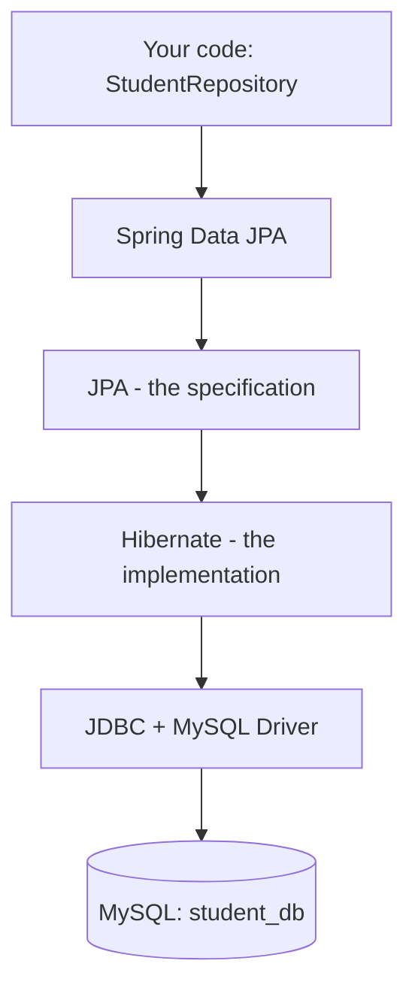
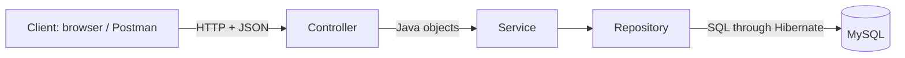

# Spring Boot Step by Step: From Hello World to a Student REST API with MySQL

A hands-on tutorial for Bachelor students. You start with a one-line "Hello World" web application and finish with a complete CRUD REST API that stores student records in a MySQL database using Spring Data JPA and Hibernate.

Every step has three parts: the **concept** (why), an **example** (what it looks like), and the **code** (how), with comments.

| | |
|---|---|
| **IDE** | IntelliJ IDEA |
| **Language / build tool** | Java 17 or newer, Maven |
| **Framework** | Spring Boot 3.x or 4.x |
| **Database** | MySQL 8.x |
| **Database name** | `student_db` |
| **Table** | `students (id, name, cgpa)` |

## Table of Contents

- [Step 0: Prerequisites](#step-0-prerequisites)
- [Step 1: What is Spring Boot?](#step-1-what-is-spring-boot)
- [Step 2: Create the Hello World project](#step-2-create-the-hello-world-project)
- [Step 3: Annotations, Beans and Dependency Injection](#step-3-annotations-beans-and-dependency-injection)
- [Step 4: REST API basics with an in-memory list](#step-4-rest-api-basics-with-an-in-memory-list)
- [Step 5: Prepare the MySQL database](#step-5-prepare-the-mysql-database)
- [Step 6: Connect Spring Boot to MySQL](#step-6-connect-spring-boot-to-mysql)
- [Step 7: JPA and Hibernate, and the Student entity](#step-7-jpa-and-hibernate-and-the-student-entity)
- [Step 8: The Repository layer](#step-8-the-repository-layer)
- [Step 9: The Service layer](#step-9-the-service-layer)
- [Step 10: The REST Controller (full CRUD)](#step-10-the-rest-controller-full-crud)
- [Step 11: Test the API](#step-11-test-the-api)
- [Step 12: Custom queries](#step-12-custom-queries)
- [Step 13: Validation and error handling](#step-13-validation-and-error-handling)
- [Annotation cheat sheet](#annotation-cheat-sheet)
- [Common errors and fixes](#common-errors-and-fixes)
- [Exercises](#exercises)

---

## Step 0: Prerequisites

Install these before the first class:

1. **JDK 17 or newer.** Check with `java -version` in a terminal.
2. **IntelliJ IDEA.** The built-in Spring Boot project wizard needs an Ultimate subscription (free for students with a university email through the JetBrains student programme). Without it, you create the project on the website [start.spring.io](https://start.spring.io) instead. Both ways are shown in Step 2.
3. **MySQL Server 8.x** and optionally **MySQL Workbench**. Remember the `root` password you choose during installation.
4. **Postman** (or any REST client) for testing the API.

> **Demo password.** This tutorial uses the MySQL user `root` with the password `demo1234`. It is a classroom placeholder. Replace it with your own MySQL password, and never commit a real password to GitHub.

---

## Step 1: What is Spring Boot?

### Concept

**Spring** is a Java framework for building applications. Its core idea is that the framework creates your objects and connects them together, so you write less "plumbing" code.

Plain Spring needs a lot of configuration. **Spring Boot** sits on top of Spring and removes most of it:

| Feature | What it means for you |
|---|---|
| **Starters** | One dependency such as `spring-boot-starter-web` brings in everything needed for web development. |
| **Auto-configuration** | Spring Boot looks at your dependencies and configures them. Add the MySQL driver and it sets up a database connection for you. |
| **Embedded server** | A Tomcat web server is inside your application. You run a normal `main` method; there is nothing to install or deploy. |
| **Convention over configuration** | Sensible defaults (port 8080, JSON responses, and so on) that you change only when needed. |

### Example

A traditional Java web application needed an external Tomcat server, a `web.xml` file, and XML configuration for every component. In Spring Boot the same application is one class with a `main` method.

---

## Step 2: Create the Hello World project

### Concept

Every Spring Boot project is generated by **Spring Initializr**. It produces a ready-to-run Maven project with the dependencies you choose.

### 2.1 Generate the project

**Option A: inside IntelliJ IDEA (Ultimate)**

1. **File → New → Project**, then choose **Spring Boot** in the left list.
2. Fill in the form:

   | Field | Value |
   |---|---|
   | Name | `student-app` |
   | Language | Java |
   | Type | Maven |
   | Group | `com.example` |
   | Artifact | `student-app` |
   | Package name | `com.example.studentapp` |
   | JDK / Java | 17 (or newer) |
   | Packaging | Jar |

3. Click **Next**, tick the dependency **Web → Spring Web**, then click **Create**.

**Option B: start.spring.io (works with any edition)**

1. Open [start.spring.io](https://start.spring.io) in a browser.
2. Enter the same values as the table above and add the dependency **Spring Web**.
3. Click **Generate**, unzip the downloaded file.
4. In IntelliJ: **File → Open**, select the unzipped folder, and choose **Trust Project**.

Wait until IntelliJ finishes downloading the Maven dependencies (progress bar at the bottom right).

### 2.2 Understand the project structure

```
student-app
├── pom.xml                              <- Maven file: lists the dependencies
└── src
    ├── main
    │   ├── java
    │   │   └── com/example/studentapp
    │   │       └── StudentAppApplication.java   <- the main class
    │   └── resources
    │       └── application.properties   <- configuration (port, database, ...)
    └── test                             <- unit tests
```

### 2.3 The main class

Spring Initializr already wrote this class. Read it; do not change it.

```java
package com.example.studentapp;

import org.springframework.boot.SpringApplication;
import org.springframework.boot.autoconfigure.SpringBootApplication;

// @SpringBootApplication is three annotations in one:
//   @Configuration            - this class can define beans
//   @EnableAutoConfiguration  - let Spring Boot configure things automatically
//   @ComponentScan            - find our classes in this package and its sub-packages
@SpringBootApplication
public class StudentAppApplication {

    public static void main(String[] args) {
        // Starts Spring, creates all objects, and starts the embedded Tomcat server
        SpringApplication.run(StudentAppApplication.class, args);
    }
}
```

> **Important rule.** `@ComponentScan` only looks in the package of the main class and below it. Always create your classes inside `com.example.studentapp` or one of its sub-packages, otherwise Spring will not find them.

### 2.4 Write the Hello World controller

Right-click the package `com.example.studentapp` → **New → Java Class** → name it `HelloController`.

```java
package com.example.studentapp;

import org.springframework.web.bind.annotation.GetMapping;
import org.springframework.web.bind.annotation.RestController;

// @RestController tells Spring: this class handles HTTP requests,
// and whatever the methods return is sent back as the response body.
@RestController
public class HelloController {

    // @GetMapping maps an HTTP GET request for the URL /hello to this method
    @GetMapping("/hello")
    public String sayHello() {
        return "Hello World from Spring Boot!";
    }
}
```

### 2.5 Run it

1. Open `StudentAppApplication.java` and click the green ▶ arrow next to `main` (or press **Shift + F10**).
2. Wait for this line in the Run window: `Tomcat started on port 8080`.
3. Open a browser at <http://localhost:8080/hello>.

You should see:

```
Hello World from Spring Boot!
```

To stop the application, click the red ■ button.

> If port 8080 is already in use, add `server.port=8081` to `application.properties` and use that port in the URLs.

---

## Step 3: Annotations, Beans and Dependency Injection

### Concept

**Annotation.** A label starting with `@` that you put on a class, method or field. It gives Spring an instruction, such as "this class handles web requests".

**Bean.** An object that Spring creates and manages. You do not write `new` for it.

**IoC container (Inversion of Control).** The part of Spring that creates the beans and keeps them. "Inversion" means the framework controls object creation instead of your code.

**Dependency Injection (DI).** When class A needs class B, Spring hands a B object to A automatically. A does not create B.

### Example

Think of a restaurant. The waiter (controller) does not cook; the waiter needs a chef (service). The waiter does not hire the chef either: the restaurant manager (Spring) assigns one.

Without DI:

```java
public class HelloController {
    // The controller creates its own dependency. Hard to replace and hard to test.
    private GreetingService greetingService = new GreetingService();
}
```

With DI, Spring supplies the object.

### Code

Create a new class `GreetingService`:

```java
package com.example.studentapp;

import org.springframework.stereotype.Service;

// @Service marks this class as a bean that holds business logic.
// Spring creates ONE object of it at start-up and keeps it in the container.
@Service
public class GreetingService {

    public String greet(String name) {
        return "Hello, " + name + "! Welcome to Spring Boot.";
    }
}
```

Now change `HelloController` so that it uses the service:

```java
package com.example.studentapp;

import org.springframework.web.bind.annotation.GetMapping;
import org.springframework.web.bind.annotation.PathVariable;
import org.springframework.web.bind.annotation.RestController;

@RestController
public class HelloController {

    // The dependency. "final" means it is set once and never changes.
    private final GreetingService greetingService;

    // CONSTRUCTOR INJECTION:
    // Spring sees that this constructor needs a GreetingService,
    // finds the bean in its container, and passes it in.
    public HelloController(GreetingService greetingService) {
        this.greetingService = greetingService;
    }

    @GetMapping("/hello")
    public String sayHello() {
        return "Hello World from Spring Boot!";
    }

    // {name} is a variable part of the URL.
    // @PathVariable copies its value into the method parameter.
    @GetMapping("/hello/{name}")
    public String sayHelloTo(@PathVariable String name) {
        return greetingService.greet(name);
    }
}
```

Restart the application and open <http://localhost:8080/hello/Rahim>:

```
Hello, Rahim! Welcome to Spring Boot.
```

> You will also see `@Autowired` on fields in older code. It does the same job. Constructor injection is the recommended style because the dependency can be `final` and the class is easy to test.

**The stereotype annotations** all create beans; the different names document the role of the class:

| Annotation | Role |
|---|---|
| `@Component` | Any general bean |
| `@Service` | Business logic |
| `@Repository` | Database access |
| `@RestController` | Handles HTTP requests and returns data |

---

## Step 4: REST API basics with an in-memory list

Before adding a database, build a small API that keeps students in an `ArrayList`. This isolates the REST concepts.

### Concept

**API.** A way for programs to talk to each other. A mobile app, a React front end and Postman can all use the same back-end API.

**REST.** A style of API built on HTTP. Everything is a **resource** identified by a URL, and the **HTTP method** says what to do with it.

| HTTP method | CRUD operation | Example URL | Meaning |
|---|---|---|---|
| `GET` | Read | `/api/students` | Get all students |
| `GET` | Read | `/api/students/1` | Get the student with id 1 |
| `POST` | Create | `/api/students` | Add a new student |
| `PUT` | Update | `/api/students/1` | Replace student 1 |
| `DELETE` | Delete | `/api/students/1` | Remove student 1 |

**JSON.** The text format used to send data. Spring Boot converts Java objects to JSON and back automatically (using the Jackson library).

```json
{ "id": 1, "name": "Rahim Uddin", "cgpa": 3.75 }
```

**HTTP status codes.** Every response carries a number that reports the result:

| Code | Name | Used when |
|---|---|---|
| 200 | OK | The request succeeded |
| 201 | Created | A new resource was created |
| 204 | No Content | Succeeded, nothing to return (after a delete) |
| 400 | Bad Request | The client sent invalid data |
| 404 | Not Found | The resource does not exist |
| 500 | Internal Server Error | A bug or failure on the server |

### Code

Create the class `Student`. It is a plain Java class (a "POJO") for now.

```java
package com.example.studentapp;

public class Student {

    private Integer id;
    private String name;
    private Float cgpa;

    // A no-argument constructor is required so that JSON can be converted to a Student
    public Student() {
    }

    public Student(Integer id, String name, Float cgpa) {
        this.id = id;
        this.name = name;
        this.cgpa = cgpa;
    }

    // Getters and setters: Spring uses them to read and write the fields.
    // In IntelliJ: press Alt + Insert -> "Getter and Setter" to generate them.
    public Integer getId() { return id; }
    public void setId(Integer id) { this.id = id; }

    public String getName() { return name; }
    public void setName(String name) { this.name = name; }

    public Float getCgpa() { return cgpa; }
    public void setCgpa(Float cgpa) { this.cgpa = cgpa; }
}
```

Create the class `StudentController`:

```java
package com.example.studentapp;

import org.springframework.web.bind.annotation.*;

import java.util.ArrayList;
import java.util.List;

@RestController
// Every URL in this class starts with /api/students
@RequestMapping("/api/students")
public class StudentController {

    // Temporary storage in memory. The data is lost when the application stops.
    private final List<Student> students = new ArrayList<>();
    private int nextId = 1;

    // GET /api/students  -> return the whole list as a JSON array
    @GetMapping
    public List<Student> getAll() {
        return students;
    }

    // POST /api/students  -> add a new student
    // @RequestBody converts the JSON in the request body into a Student object
    @PostMapping
    public Student create(@RequestBody Student student) {
        student.setId(nextId++);   // the server chooses the id
        students.add(student);
        return student;            // sent back to the client as JSON
    }
}
```

### Try it

Restart the application. In Postman:

1. Method **POST**, URL `http://localhost:8080/api/students`.
2. **Body → raw → JSON**, enter `{ "name": "Rahim Uddin", "cgpa": 3.75 }`, then **Send**.
3. Method **GET**, same URL, **Send**. You get `[{"id":1,"name":"Rahim Uddin","cgpa":3.75}]`.

Now stop and restart the application and send the GET again. The list is empty: memory is not permanent storage. That is the reason for a database.

---

## Step 5: Prepare the MySQL database

### Concept

A **relational database** stores data in tables made of rows and columns. Data survives restarts and can be searched with **SQL**.

- **Primary key**: a column that uniquely identifies each row. It can never be `NULL`.
- **AUTO_INCREMENT**: MySQL generates the next id (1, 2, 3, ...) by itself.

### Code

Open **MySQL Workbench** (or the MySQL command line), connect as `root`, and run:

```sql
-- 1. Create the database
CREATE DATABASE student_db;

-- 2. Select it
USE student_db;

-- 3. Create the table
CREATE TABLE students (
    id   INT          NOT NULL AUTO_INCREMENT,  -- primary key, generated by MySQL
    name VARCHAR(100) NULL,                     -- text up to 100 characters, may be empty
    cgpa FLOAT        NULL,                     -- decimal number, may be empty
    PRIMARY KEY (id)
);

-- 4. Check the structure
DESCRIBE students;
```

Expected output of `DESCRIBE students;`:

| Field | Type | Null | Key | Default | Extra |
|---|---|---|---|---|---|
| id | int | NO | PRI | NULL | auto_increment |
| name | varchar(100) | YES | | NULL | |
| cgpa | float | YES | | NULL | |

Optionally insert two rows so that there is something to read later:

```sql
INSERT INTO students (name, cgpa) VALUES ('Rahim Uddin', 3.75), ('Karima Akter', 3.90);
SELECT * FROM students;
```

> **Optional: view the database inside IntelliJ (Ultimate).** Open **View → Tool Windows → Database**, click **+ → Data Source → MySQL**, enter host `localhost`, port `3306`, user `root`, password `demo1234`, database `student_db`, then **Test Connection** and **OK**.

---

## Step 6: Connect Spring Boot to MySQL

### Concept

The application needs two more libraries:

| Dependency (name in Spring Initializr) | Purpose |
|---|---|
| **Spring Data JPA** | JPA + Hibernate + Spring's repository support |
| **MySQL Driver** | The JDBC driver that lets Java talk to MySQL |

The connection details (address, user name, password) go in `application.properties`, so they are separate from the Java code.

### 6.1 Add the dependencies

Open `pom.xml` and add these inside the `<dependencies>` element. Do not write a `<version>`; Spring Boot chooses matching versions.

```xml
<!-- Spring Data JPA: brings JPA, Hibernate and repositories -->
<dependency>
    <groupId>org.springframework.boot</groupId>
    <artifactId>spring-boot-starter-data-jpa</artifactId>
</dependency>

<!-- MySQL JDBC driver: needed only when the application runs -->
<dependency>
    <groupId>com.mysql</groupId>
    <artifactId>mysql-connector-j</artifactId>
    <scope>runtime</scope>
</dependency>
```

Then click the small **Load Maven Changes** icon that appears in the editor (or press **Ctrl + Shift + O**) so that IntelliJ downloads them.

> Leave the web dependency that Spring Initializr generated as it is. Depending on your Spring Boot version it is called `spring-boot-starter-web` or `spring-boot-starter-webmvc`; both work for this tutorial.

### 6.2 Configure the connection

Open `src/main/resources/application.properties` and add:

```properties
# ---------- Database connection ----------
# jdbc:mysql://<host>:<port>/<database name>
spring.datasource.url=jdbc:mysql://localhost:3306/student_db
spring.datasource.username=root
# Demo password for class only. Use your own MySQL password here.
spring.datasource.password=demo1234

# ---------- JPA / Hibernate ----------
# What Hibernate does with the tables at start-up:
#   none        - do nothing
#   validate    - check that tables match the entity classes, change nothing
#   update      - create missing tables/columns, never delete data   (good for learning)
#   create      - drop and re-create the tables on every start       (DELETES DATA)
#   create-drop - like create, and drop the tables on shutdown       (DELETES DATA)
spring.jpa.hibernate.ddl-auto=update

# Print every SQL statement that Hibernate runs in the console
spring.jpa.show-sql=true
# Print the SQL on several lines so it is easy to read
spring.jpa.properties.hibernate.format_sql=true
```

### 6.3 Check

Run the application. If the console shows `Tomcat started on port 8080` with no red stack trace, the connection works. If it fails, see [Common errors and fixes](#common-errors-and-fixes).

---

## Step 7: JPA and Hibernate, and the Student entity

### Concept

Java works with **objects**. MySQL works with **tables**. Something must translate between the two.

**JDBC** is the low-level way: you write every SQL statement by hand and copy each column into an object yourself.

**ORM (Object-Relational Mapping)** automates this. You describe how a class maps to a table, and the ORM tool writes the SQL.

| Java | Database |
|---|---|
| Class `Student` | Table `students` |
| Object (one student) | Row |
| Field `name` | Column `name` |

**JPA (Jakarta Persistence API)** is the *specification*: a standard set of annotations and interfaces (`@Entity`, `@Id`, ...). JPA itself contains no working code.

**Hibernate** is the *implementation*: the library that reads those annotations and generates and runs the SQL.

**Spring Data JPA** is a layer on top that writes the repository code for you (Step 8).



### Example

To save a student with plain JDBC you write about ten lines: open a connection, prepare `INSERT INTO students (name, cgpa) VALUES (?, ?)`, set each parameter, execute, close everything, and handle exceptions.

With JPA and Hibernate:

```java
studentRepository.save(student);   // Hibernate generates and runs the INSERT
```

### Code

Turn the `Student` class from Step 4 into a JPA **entity** by adding annotations. Replace the file with this version:

```java
package com.example.studentapp;

import jakarta.persistence.Column;
import jakarta.persistence.Entity;
import jakarta.persistence.GeneratedValue;
import jakarta.persistence.GenerationType;
import jakarta.persistence.Id;
import jakarta.persistence.Table;

// @Entity: this class is mapped to a database table. Each object is one row.
@Entity
// @Table: the table name. Without it Hibernate would look for a table called "student".
@Table(name = "students")
public class Student {

    // @Id: this field is the primary key
    @Id
    // IDENTITY: the database generates the value using AUTO_INCREMENT
    @GeneratedValue(strategy = GenerationType.IDENTITY)
    @Column(name = "id")
    private Integer id;

    // Maps to: name VARCHAR(100) NULL
    @Column(name = "name", length = 100, nullable = true)
    private String name;

    // Maps to: cgpa FLOAT NULL
    // We use the wrapper type Float (not the primitive float),
    // because Float can hold null and the column allows NULL.
    @Column(name = "cgpa", nullable = true)
    private Float cgpa;

    // JPA REQUIRES a no-argument constructor to create objects from rows
    public Student() {
    }

    // Convenience constructor without id, because MySQL generates the id
    public Student(String name, Float cgpa) {
        this.name = name;
        this.cgpa = cgpa;
    }

    public Integer getId() { return id; }
    public void setId(Integer id) { this.id = id; }

    public String getName() { return name; }
    public void setName(String name) { this.name = name; }

    public Float getCgpa() { return cgpa; }
    public void setCgpa(Float cgpa) { this.cgpa = cgpa; }
}
```

> **Import check.** The annotations must come from `jakarta.persistence`, not `javax.persistence`. The `javax` package belongs to old Spring Boot 2 projects.

**Rules for every entity class**

1. It has `@Entity`.
2. It has exactly one primary key marked with `@Id`.
3. It has a public or protected no-argument constructor.
4. It has getters and setters for its fields.

---

## Step 8: The Repository layer

### Concept

A **repository** is the object that reads and writes entities. With Spring Data JPA you only write an **interface**. Spring generates the implementation class while the application starts.

`JpaRepository<Student, Integer>` takes two type parameters: the entity type (`Student`) and the type of its primary key (`Integer`).

### Example

By extending `JpaRepository` you receive these methods without writing any code:

| Method | SQL that Hibernate runs |
|---|---|
| `findAll()` | `SELECT * FROM students` |
| `findById(1)` | `SELECT * FROM students WHERE id = 1` |
| `save(student)` | `INSERT ...` if the id is null, otherwise `UPDATE ...` |
| `deleteById(1)` | `DELETE FROM students WHERE id = 1` |
| `existsById(1)` | Checks whether a row with id 1 exists |
| `count()` | `SELECT COUNT(*) FROM students` |

### Code

Right-click the package → **New → Java Class** → choose **Interface** → name it `StudentRepository`.

```java
package com.example.studentapp;

import org.springframework.data.jpa.repository.JpaRepository;
import org.springframework.stereotype.Repository;

// JpaRepository<Entity type, Primary key type>
// No method bodies are needed: Spring Data JPA creates the implementation at start-up.
@Repository
public interface StudentRepository extends JpaRepository<Student, Integer> {
}
```

---

## Step 9: The Service layer

### Concept

Real applications are divided into **layers**. Each layer has one job and talks only to the layer below it.



| Layer | Annotation | Responsibility |
|---|---|---|
| Controller | `@RestController` | Receive HTTP requests, return HTTP responses |
| Service | `@Service` | Business rules and decisions |
| Repository | `@Repository` | Database access |
| Entity | `@Entity` | The data itself |

### Example

"A student's CGPA must be between 0 and 4" is a business rule. It belongs in the service, not in the controller (which only deals with HTTP) and not in the repository (which only deals with the database). If you later add a second controller, the rule is still in one place.

### Code

Create the class `StudentService`:

```java
package com.example.studentapp;

import org.springframework.stereotype.Service;

import java.util.List;
import java.util.Optional;

@Service
public class StudentService {

    private final StudentRepository studentRepository;

    // Constructor injection: Spring passes in the repository bean
    public StudentService(StudentRepository studentRepository) {
        this.studentRepository = studentRepository;
    }

    // READ all
    public List<Student> getAllStudents() {
        return studentRepository.findAll();
    }

    // READ one
    // Optional<Student> is a box that either contains a Student or is empty.
    // It forces the caller to handle the "not found" case instead of getting a null.
    public Optional<Student> getStudentById(Integer id) {
        return studentRepository.findById(id);
    }

    // CREATE
    public Student createStudent(Student student) {
        student.setId(null);                    // ignore any id sent by the client; MySQL generates it
        return studentRepository.save(student); // returns the saved object including its new id
    }

    // UPDATE
    public Optional<Student> updateStudent(Integer id, Student newData) {
        // Find the existing row. If it exists, change its fields and save it.
        return studentRepository.findById(id).map(existing -> {
            existing.setName(newData.getName());
            existing.setCgpa(newData.getCgpa());
            return studentRepository.save(existing);   // id is set, so this is an UPDATE
        });
    }

    // DELETE: returns true if a student was deleted, false if the id did not exist
    public boolean deleteStudent(Integer id) {
        if (!studentRepository.existsById(id)) {
            return false;
        }
        studentRepository.deleteById(id);
        return true;
    }
}
```

---

## Step 10: The REST Controller (full CRUD)

### Concept

The controller translates between HTTP and Java:

| Annotation | Reads data from | Example |
|---|---|---|
| `@PathVariable` | A part of the URL | `/api/students/5` → `id = 5` |
| `@RequestParam` | The query string | `/api/students/search?name=ra` → `name = "ra"` |
| `@RequestBody` | The JSON body | `{ "name": "Rahim" }` → a `Student` object |

`ResponseEntity<T>` lets the method choose the **status code** as well as the body, for example 201 after creating and 404 when nothing is found.

### Code

Replace the in-memory `StudentController` from Step 4 with this version:

```java
package com.example.studentapp;

import org.springframework.http.HttpStatus;
import org.springframework.http.ResponseEntity;
import org.springframework.web.bind.annotation.*;

import java.util.List;

@RestController
@RequestMapping("/api/students")
public class StudentController {

    private final StudentService studentService;

    public StudentController(StudentService studentService) {
        this.studentService = studentService;
    }

    // ---------- READ ALL ----------
    // GET /api/students  ->  200 OK + JSON array
    @GetMapping
    public List<Student> getAll() {
        return studentService.getAllStudents();
    }

    // ---------- READ ONE ----------
    // GET /api/students/1  ->  200 OK + student, or 404 Not Found
    @GetMapping("/{id}")
    public ResponseEntity<Student> getById(@PathVariable Integer id) {
        return studentService.getStudentById(id)
                .map(student -> ResponseEntity.ok(student))        // found: 200
                .orElse(ResponseEntity.notFound().build());        // empty: 404
    }

    // ---------- CREATE ----------
    // POST /api/students  ->  201 Created + the saved student
    @PostMapping
    public ResponseEntity<Student> create(@RequestBody Student student) {
        Student saved = studentService.createStudent(student);
        return ResponseEntity.status(HttpStatus.CREATED).body(saved);
    }

    // ---------- UPDATE ----------
    // PUT /api/students/1  ->  200 OK + the updated student, or 404 Not Found
    @PutMapping("/{id}")
    public ResponseEntity<Student> update(@PathVariable Integer id,
                                          @RequestBody Student student) {
        return studentService.updateStudent(id, student)
                .map(updated -> ResponseEntity.ok(updated))
                .orElse(ResponseEntity.notFound().build());
    }

    // ---------- DELETE ----------
    // DELETE /api/students/1  ->  204 No Content, or 404 Not Found
    @DeleteMapping("/{id}")
    public ResponseEntity<Void> delete(@PathVariable Integer id) {
        if (studentService.deleteStudent(id)) {
            return ResponseEntity.noContent().build();
        }
        return ResponseEntity.notFound().build();
    }
}
```

The project now looks like this:

```
com.example.studentapp
├── StudentAppApplication.java   <- main class
├── HelloController.java         <- Step 2 and 3
├── GreetingService.java         <- Step 3
├── Student.java                 <- entity
├── StudentRepository.java       <- repository
├── StudentService.java          <- service
└── StudentController.java       <- REST controller
```

> In larger projects each layer gets its own sub-package: `controller`, `service`, `repository`, `entity`. To reorganise, right-click a class → **Refactor → Move Class**, and IntelliJ updates the imports.

---

## Step 11: Test the API

Run the application and send these requests with Postman. For POST and PUT choose **Body → raw → JSON**.

| # | Method | URL | Body | Expected result |
|---|---|---|---|---|
| 1 | POST | `http://localhost:8080/api/students` | `{ "name": "Jamal Hossain", "cgpa": 3.42 }` | `201 Created`, JSON with a generated `id` |
| 2 | GET | `http://localhost:8080/api/students` | none | `200 OK`, array of all students |
| 3 | GET | `http://localhost:8080/api/students/1` | none | `200 OK`, one student |
| 4 | PUT | `http://localhost:8080/api/students/1` | `{ "name": "Rahim Uddin", "cgpa": 3.80 }` | `200 OK`, the changed student |
| 5 | DELETE | `http://localhost:8080/api/students/1` | none | `204 No Content` |
| 6 | GET | `http://localhost:8080/api/students/999` | none | `404 Not Found` |

**Things to observe**

- After each request, look at the IntelliJ console. Because of `spring.jpa.show-sql=true` you can read the SQL that Hibernate generated, although you wrote none.
- Run `SELECT * FROM students;` in MySQL Workbench to confirm the rows really changed.
- Restart the application and send GET again. The data is still there.

**Alternative: curl** (in a Git Bash or Linux/macOS terminal)

```bash
# Create
curl -X POST http://localhost:8080/api/students \
     -H "Content-Type: application/json" \
     -d '{"name":"Jamal Hossain","cgpa":3.42}'

# Read all
curl http://localhost:8080/api/students

# Update
curl -X PUT http://localhost:8080/api/students/1 \
     -H "Content-Type: application/json" \
     -d '{"name":"Rahim Uddin","cgpa":3.80}'

# Delete
curl -X DELETE http://localhost:8080/api/students/1
```

**Alternative: IntelliJ HTTP Client (Ultimate).** Create a file `requests.http` in the project, paste the following, and click the green ▶ next to a request:

```http
### Create a student
POST http://localhost:8080/api/students
Content-Type: application/json

{ "name": "Jamal Hossain", "cgpa": 3.42 }

### Get all students
GET http://localhost:8080/api/students
```

---

## Step 12: Custom queries

### Concept

`JpaRepository` covers basic CRUD. For other searches there are two tools:

1. **Derived query methods.** You write only a method *name* that follows a pattern, and Spring Data builds the query from the name.
2. **`@Query` with JPQL.** You write the query yourself. JPQL looks like SQL but uses **class and field names** (`Student`, `cgpa`), not table and column names.

### Example

| Method name | Generated condition |
|---|---|
| `findByName(String name)` | `WHERE name = ?` |
| `findByNameContainingIgnoreCase(String part)` | `WHERE LOWER(name) LIKE LOWER('%part%')` |
| `findByCgpaGreaterThanEqual(Float min)` | `WHERE cgpa >= ?` |
| `findByCgpaBetween(Float min, Float max)` | `WHERE cgpa BETWEEN ? AND ?` |
| `findAllByOrderByCgpaDesc()` | `ORDER BY cgpa DESC` |

### Code

Add methods to `StudentRepository`:

```java
package com.example.studentapp;

import org.springframework.data.jpa.repository.JpaRepository;
import org.springframework.data.jpa.repository.Query;
import org.springframework.data.repository.query.Param;
import org.springframework.stereotype.Repository;

import java.util.List;

@Repository
public interface StudentRepository extends JpaRepository<Student, Integer> {

    // Derived query: students whose name contains the given text, ignoring upper/lower case
    List<Student> findByNameContainingIgnoreCase(String name);

    // Derived query: students with cgpa >= the given value
    List<Student> findByCgpaGreaterThanEqual(Float cgpa);

    // JPQL query written by hand.
    // "Student" is the CLASS name and "s.cgpa" is the FIELD name.
    // :minCgpa is a named parameter filled by @Param("minCgpa").
    @Query("SELECT s FROM Student s WHERE s.cgpa >= :minCgpa ORDER BY s.cgpa DESC")
    List<Student> findTopStudents(@Param("minCgpa") Float minCgpa);
}
```

Add to `StudentService`:

```java
    public List<Student> searchByName(String name) {
        return studentRepository.findByNameContainingIgnoreCase(name);
    }

    public List<Student> getTopStudents(Float minCgpa) {
        return studentRepository.findTopStudents(minCgpa);
    }
```

Add to `StudentController`:

```java
    // GET /api/students/search?name=ra
    // @RequestParam reads the value after the ? in the URL
    @GetMapping("/search")
    public List<Student> search(@RequestParam String name) {
        return studentService.searchByName(name);
    }

    // GET /api/students/top?minCgpa=3.5
    // defaultValue is used when the client does not send the parameter
    @GetMapping("/top")
    public List<Student> top(@RequestParam(defaultValue = "3.5") Float minCgpa) {
        return studentService.getTopStudents(minCgpa);
    }
```

Try <http://localhost:8080/api/students/search?name=ra> and <http://localhost:8080/api/students/top?minCgpa=3.7> in the browser.

---

## Step 13: Validation and error handling

### Concept

Never trust data from the client. At this point the API accepts a CGPA of `9.5` or an empty name.

- **Bean Validation** puts the rules on the entity fields as annotations (`@NotBlank`, `@Size`, `@DecimalMax`, ...). `@Valid` in the controller switches the check on.
- **`@RestControllerAdvice`** is one class that catches exceptions from all controllers and turns them into clean JSON error responses.

### 13.1 Add the dependency

In `pom.xml`, then reload Maven:

```xml
<!-- Bean Validation (Hibernate Validator) -->
<dependency>
    <groupId>org.springframework.boot</groupId>
    <artifactId>spring-boot-starter-validation</artifactId>
</dependency>
```

### 13.2 Add rules to the entity

In `Student.java` add the imports and put the annotations above the two fields:

```java
import jakarta.validation.constraints.DecimalMax;
import jakarta.validation.constraints.DecimalMin;
import jakarta.validation.constraints.NotBlank;
import jakarta.validation.constraints.Size;
```

```java
    @NotBlank(message = "Name is required")                       // not null, not empty, not only spaces
    @Size(max = 100, message = "Name can have at most 100 characters")
    @Column(name = "name", length = 100, nullable = true)
    private String name;

    @DecimalMin(value = "0.0", message = "CGPA cannot be below 0.0")
    @DecimalMax(value = "4.0", message = "CGPA cannot be above 4.0")
    @Column(name = "cgpa", nullable = true)
    private Float cgpa;
```

> The database column `name` still allows `NULL`. The rule is enforced by the application before the data reaches the database.

### 13.3 Switch validation on in the controller

Add `import jakarta.validation.Valid;` and put `@Valid` in front of `@RequestBody` in the `create` and `update` methods:

```java
    @PostMapping
    public ResponseEntity<Student> create(@Valid @RequestBody Student student) {
        Student saved = studentService.createStudent(student);
        return ResponseEntity.status(HttpStatus.CREATED).body(saved);
    }

    @PutMapping("/{id}")
    public ResponseEntity<Student> update(@PathVariable Integer id,
                                          @Valid @RequestBody Student student) {
        return studentService.updateStudent(id, student)
                .map(updated -> ResponseEntity.ok(updated))
                .orElse(ResponseEntity.notFound().build());
    }
```

### 13.4 Return readable error messages

Create the class `GlobalExceptionHandler`:

```java
package com.example.studentapp;

import org.springframework.http.HttpStatus;
import org.springframework.http.ResponseEntity;
import org.springframework.web.bind.MethodArgumentNotValidException;
import org.springframework.web.bind.annotation.ExceptionHandler;
import org.springframework.web.bind.annotation.RestControllerAdvice;

import java.util.HashMap;
import java.util.Map;

// @RestControllerAdvice: this class handles exceptions thrown by ANY controller
@RestControllerAdvice
public class GlobalExceptionHandler {

    // Runs when @Valid finds invalid data
    @ExceptionHandler(MethodArgumentNotValidException.class)
    public ResponseEntity<Map<String, String>> handleValidation(MethodArgumentNotValidException ex) {
        Map<String, String> errors = new HashMap<>();

        // Collect one message per invalid field: field name -> message
        ex.getBindingResult().getFieldErrors()
                .forEach(error -> errors.put(error.getField(), error.getDefaultMessage()));

        // 400 Bad Request: the client sent wrong data
        return ResponseEntity.status(HttpStatus.BAD_REQUEST).body(errors);
    }
}
```

### Try it

Send **POST** `http://localhost:8080/api/students` with the body `{ "name": "", "cgpa": 9.5 }`.

The response is `400 Bad Request`:

```json
{
  "name": "Name is required",
  "cgpa": "CGPA cannot be above 4.0"
}
```

Nothing is saved in the database.

---

## Annotation cheat sheet

| Annotation | Placed on | Meaning |
|---|---|---|
| `@SpringBootApplication` | Main class | Starting point; enables auto-configuration and component scanning |
| `@Component` | Class | A general Spring bean |
| `@Service` | Class | A bean holding business logic |
| `@Repository` | Class / interface | A bean for database access |
| `@RestController` | Class | Handles HTTP requests; return values become the response body |
| `@Autowired` | Constructor / field | Ask Spring to inject a bean (optional on a single constructor) |
| `@RequestMapping` | Class / method | Base URL for a controller |
| `@GetMapping` | Method | Handle HTTP GET (read) |
| `@PostMapping` | Method | Handle HTTP POST (create) |
| `@PutMapping` | Method | Handle HTTP PUT (update) |
| `@DeleteMapping` | Method | Handle HTTP DELETE (delete) |
| `@PathVariable` | Parameter | Value from the URL path, `/students/{id}` |
| `@RequestParam` | Parameter | Value from the query string, `?name=...` |
| `@RequestBody` | Parameter | Convert the JSON body to a Java object |
| `@Entity` | Class | The class is mapped to a table |
| `@Table` | Class | The table name |
| `@Id` | Field | The primary key |
| `@GeneratedValue` | Field | The key is generated automatically |
| `@Column` | Field | Column name, length, nullable |
| `@Query` | Repository method | A hand-written JPQL query |
| `@Valid` | Parameter | Validate the object using its constraint annotations |
| `@NotBlank`, `@Size`, `@DecimalMin`, `@DecimalMax` | Field | Validation rules |
| `@RestControllerAdvice` | Class | Global exception handling for all controllers |
| `@ExceptionHandler` | Method | Handle one type of exception |

---

## Common errors and fixes

| Message in the console | Cause | Fix |
|---|---|---|
| `Web server failed to start. Port 8080 was already in use` | Another program, or an earlier run of this application, uses the port | Stop the other run (red ■), or add `server.port=8081` to `application.properties` |
| `Access denied for user 'root'@'localhost'` | Wrong user name or password | Correct `spring.datasource.username` and `spring.datasource.password` |
| `Unknown database 'student_db'` | The database was not created | Run `CREATE DATABASE student_db;` (Step 5) |
| `Communications link failure` | MySQL Server is not running, or the port is wrong | Start the MySQL service; check the port `3306` in the URL |
| `Failed to configure a DataSource: 'url' attribute is not specified` | JPA is on the classpath but the connection properties are missing | Complete Step 6.2; check the spelling of the property names |
| `Table 'student_db.student' doesn't exist` | `@Table(name = "students")` is missing on the entity | Add it (Step 7) |
| `Cannot resolve symbol 'Entity'` or red imports | Maven dependencies were not loaded, or `javax` was used | Click **Load Maven Changes**; import from `jakarta.persistence` |
| `No default constructor for entity` | The entity has no no-argument constructor | Add `public Student() {}` |
| `404 Not Found` for every URL | The controller is outside the main class's package, or the URL is misspelled | Move the class into `com.example.studentapp`; check the mapping |
| `415 Unsupported Media Type` | The request has no JSON content type | In Postman choose **Body → raw → JSON** |
| JSON response is `{}` | The entity has no getters | Generate getters and setters (**Alt + Insert**) |

---

## Exercises

1. **Warm-up.** Add an endpoint `GET /hello/time` that returns the current date and time.
2. **Count.** Add `GET /api/students/count` that returns the number of students. Hint: `studentRepository.count()`.
3. **Range search.** Add `GET /api/students/range?min=3.0&max=3.5` using a derived query method `findByCgpaBetween`.
4. **New column.** Add a field `email` to the `Student` entity. Restart with `ddl-auto=update` and check with `DESCRIBE students;` what Hibernate did to the table.
5. **Validation.** Make `email` required and validate its format with `@Email`.
6. **Custom 404 message.** Create a `StudentNotFoundException`, throw it from the service when an id does not exist, and handle it in `GlobalExceptionHandler` so the client receives `{ "error": "Student with id 99 not found" }` and status 404.
7. **Second entity (challenge).** Create a `Department` entity and table with its own repository, service and controller, following the same four layers.
